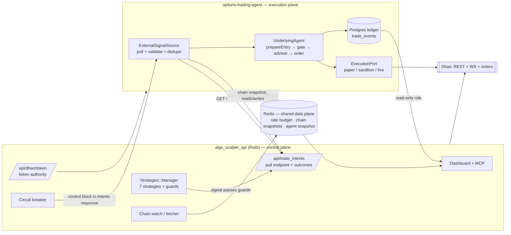

# Unified Trading Infrastructure — Plan

**Status:** draft for review · **Date:** 2026-11-18 · **Scope:** `algo_scalper_api` (Rails), `options-trading-agent` (Node/TypeScript), and `paper_exchange` (Rails, a third repo that already exists)

**Evidence tags used throughout:** **[V]** verified by reading the code or live system during this analysis · **[D]** taken from a repo's own documentation, not re-verified in code · **[?]** not verified, treat as an assumption.

> **Honest framing.** Neither system has demonstrated a net trading edge (the agent's own roadmap says so; Rails' one profitable paper day was one trade). This plan is about **safe infrastructure and a fair evaluation harness**, so that whichever signals prove out run on the safest execution layer, and so that two bots never fight over one broker account. It does not promise profitability.

---

## 1. Executive summary

**Goal:** run both applications as one system on one Dhan account, with shared infrastructure where sharing removes real conflicts or duplication, and strict separation where independence is a safety feature.

**Recommended shape**

| Plane | Owner | Responsibility |
|---|---|---|
| **Control / signal plane** | Rails | Signal generation (7 strategies, SMC, regime), entry guards that decide *whether* a signal is worth forwarding, dashboard, config UI, MCP tools, **Dhan token authority**, circuit breaker |
| **Execution plane** | Agent | The **only** process that places orders for agent-routed strategies: contract selection, sizing, pre-trade risk gate, advisor veto, broker-side bracket orders, reconciliation, fail-closed restart |
| **Shared data plane** | Redis (existing) | Token, account rate budget, **canonical option-chain snapshots**, agent state snapshot / heartbeat |
| **Ledger** | Agent Postgres | System of record for agent trades; read by Rails through a read-only role |

**Core decisions (each detailed in §12):**

1. **Rails forwards a *signal*, not an order.** The agent keeps every execution decision (strike, size, stop, target). This avoids two systems disagreeing about risk. **[V]** the agent's entry pipeline already starts from a small `Signal` type and an operator test signal already enters through it.
2. **The agent pulls; Rails never pushes.** The agent has **no inbound server** today **[V]**; keeping it outbound-only avoids a new attack surface on a system that moves real money, and "Rails is down" naturally means "no new entries".
3. **One trading authority per mode and account.** Anything routed to the agent is executed *only* by the agent. Rails stops placing orders for those strategies.
4. **Safety layers stay independent.** Do **not** share live tick feeds or the pre-trade gate. Share *data* (a canonical chain snapshot), not decisions.
5. **Promotion to live stays a human decision** (ADR-001 of the agent: "a research result must never reach a live order without a human decision").

**Effort (rough, one engineer with AI assistance; assumptions in §13):** Phase 1–2 (foundation + visibility) ≈ 2–3 weeks; Phase 3–4 (paper intake + governance) ≈ 3–4 weeks; Phase 5 (sandbox/live promotion) is gated by evidence, not by time.

**Immediate prerequisites already done:** token authority and shared chain rate gate (agent PR #14, merged) **[V]**; Ruby 4.0.9 + security gems; design-pattern cleanup (#326, merged) **[V]**.

---

## 2. Current state

### 2.1 `algo_scalper_api` (Rails 8.1, Ruby 4.0.9)

| Aspect | State |
|---|---|
| Processes **[V]** | `web` (puma :3011), `trading` daemon (services in threads), `jobs` (Solid Queue), `dashboard` (SolidJS/Vite), `mcp` (ActionMCP) — started by `Procfile.dev` with `until …; do` restart loops |
| Stores **[V]** | PostgreSQL (app data, Solid Queue, ~40 tables incl. `strategy_signals`, `position_trackers`, `candles` (≈163k rows), `instruments` (≈329k), ledger tables, paper wallet/orders/positions) · Redis (tick cache, PnL cache, rate limits, Rails.cache in dev, ActionCable) |
| Dhan touchpoints **[V]** | Token via TOTP, owner of the shared token (`GET /api/dhan/token`) · market-feed WS + order-update WS · REST (chain, quotes, data) behind `Dhan::SharedRateLimit` (Redis) · instrument master import · `Live::WsConnectionBudget` (cap 5 concurrent WS) |
| Signals **[V]** | `Strategies::Manager` runs ~7 plugin strategies per 1m candle; ~40-guard `EntryGuardPipeline`; chain analyzer + qualification; `Capital::Allocator` sizing |
| Execution **[V]** | `Orders::GatewayPaper` (default) / `GatewayLive`; client-side exits (15 rule engines, `UnifiedExitChecker`) in the daemon |
| UI/ops **[V]** | Dashboard (30 views: positions, signals, strategies, ledger, replay, backtester…), 18 read-only MCP tools, Telegram notifier, circuit breaker API |
| Known weaknesses **[V]** | Exits depend on the daemon staying healthy (a WS-reconnect leak and a CPU stall were found and fixed on 2026-11-17); no broker-side stops on entries |

### 2.2 `options-trading-agent` (Node 22, TypeScript, DhanHQ SDK 2.0.1)

| Aspect | State |
|---|---|
| Process **[V]** | One process (`src/index.tsx`, Ink cockpit); started by `scripts/session.sh` in tmux; **no inbound server** (searched `src`) |
| Stores **[V]** | PostgreSQL (`leases`, `runs`, `trade_events` (jsonb ledger + `v_closed_trades` view), `paper_wallets/orders/positions/…`) · Redis (rate gate, contract cache; "not a trading authority") · JSONL journal per IST day |
| Dhan touchpoints **[V]** | Token via PIN+TOTP **or** (now) token authority · market feed WS (+ order-update WS in live) · REST chain behind a 3 s account gate · scrip master (fail-closed exact lookup) |
| Signals **[V]** | 5 families (ORB, SuperTrend flip, EMA cross, momentum break, trend continuation); LLM advisor is **veto-only** |
| Execution **[V]** | Per-underlying FSM (one transition table), mandatory stop+target, `UNCONFIRMED` outcomes never replayed, fail-closed restart, one trading lease per `mode:clientId`, live ceilings fixed in code (2 % per trade, 6 % per day) |
| Research **[D]** | Time Machine replay, hash-chained experiment ledger, pre-registration and "spent holdout" rules |
| Known weaknesses **[D]** | "No strategy has yet shown a net edge" (its own roadmap); not run during recent sessions; cron start unreliable under WSL |

### 2.3 `paper_exchange` (third repo, `~/projects/apps/paper_exchange`)

A Rails 8 API exchange simulator (orders, positions, accounts, leases) designed "for AlgoScalperAPI" **[D]**. The agent can already target it (`PAPER_BACKEND=exchange`) **[V]**; Rails does **not** use it **[V]**. Its own `PRODUCTION_READINESS.md` states the test suite **was not executed** because no Ruby runtime was available to that reviewer **[V]** — so its maturity is unproven. It is **not** a Phase 1–4 dependency (see §6, S9).

### 2.4 Facts about the shared account

- One Dhan client id is used by both **[V]**. Any second login invalidates the first token (DH-906) **[V]**.
- Option-chain REST: ~1 call / 3 s / **account** across all processes **[V]** (both repos encode this).
- Dhan WebSocket connection limits per account: **[?]** Rails assumes 5; confirm against Dhan docs before relying on it.
- Both repos currently run **separate Postgres databases and separate paper venues**, so paper results are not directly comparable **[V]**.

---

## 3. Overlap and conflict matrix

`Share` = one implementation both use · `Bridge` = each keeps its own, with a defined handoff · `Separate` = deliberately independent.

| # | Concern | Rails | Agent | Conflict today | Decision |
|---|---|---|---|---|---|
| 1 | Dhan access token | TOTP, owner | PIN+TOTP *or* authority (merged) | DH-906 if both log in | **Share** (authority, done) |
| 2 | REST rate limits | `SharedRateLimit` (Redis Lua) | `ReservationRateGate` (same Lua) | Only chain gate shared | **Share** — extend to data/quote APIs |
| 3 | Option chain data | fetches, normalises, caches in `Rails.cache` (2 min) | fetches via its own gate, normalises | Duplicate calls spend the shared budget | **Share a canonical snapshot** (S3) |
| 4 | Live market ticks | WS → `TickCache` | WS → bar builder | Two feeds, one WS budget | **Separate** feeds (independent staleness safety); **Share** the connection budget |
| 5 | Order-update WS | `OrderUpdateHub` | live-mode only | Possible double subscribe in live | **Bridge**: only the executing system subscribes |
| 6 | Instrument master | Postgres, 209k rows daily | scrip master in memory, fail-closed | Possible divergence | **Bridge**: daily consistency check, not shared storage |
| 7 | Candles / history | `candles` table (1m index) | Time Machine datasets | Two history stores | **Bridge** (export tool, Phase 6) |
| 8 | Paper venue | own wallet/orders tables | own wallet or `paper_exchange` | Results not comparable | **Separate** now; evaluate unification later |
| 9 | Order placement | Gateway Paper/Live | `ExecutionPort` (paper/sandbox/live) | Two systems could trade the same account | **One authority** — agent for agent-routed strategies |
| 10 | Risk limits | per-index loss %, global 4 %, circuit breaker | 2 %/trade, 6 %/day fixed ceilings, kill switch | Two uncoordinated caps | **Hierarchy** (S8) |
| 11 | Position state | `position_trackers` | FSM + ledger | Two truths for one position | Agent is truth for its trades; Rails mirrors read-only |
| 12 | Exits | client-side rules | broker brackets + client trailing | Conflicting exits if both manage a position | Agent owns exits for agent-routed trades |
| 13 | Signals | 7 strategies + guards | 5 families | Different inputs | **Bridge** (intent contract, S6) |
| 14 | LLM / Ollama | `LLMSettings`, 15-min agent cycles | advisor in the entry path | One local model, contention | **Share config**, **schedule** to avoid starving the advisor (S10) |
| 15 | Alerts | Telegram notifier | webhook / Telegram | Two channels, no source tag | **Share** channel with source tags (S11) |
| 16 | Dashboard | SolidJS, 30 views | Ink terminal cockpit | Two UIs | **Bridge**: read-only agent view in dashboard (S12); cockpit keeps operator actions |
| 17 | Config | `algo.yml` (732 lines) + DB overrides | `.env` + `config.paper.yml` | Shared values drift | **Share** a small env file for common values (S13) |
| 18 | Secrets | `.env` | `.env` | Copying secrets by hand | One shared env file, never duplicated (S13) |
| 19 | Process supervision | Procfile loops | tmux + cron (unreliable on WSL) | Agent often not running | **Share** one supervisor (S14) |
| 20 | Logs / journal | log files, DB | JSONL + `trade_events` | No cross-system correlation | **Share** correlation id convention (S15) |
| 21 | CI | Rails CI (rubocop, brakeman, rspec, docker) | Node CI with PG+Redis | No cross-repo contract checks | Contract tests (S16) |
| 22 | Backtest / research | backtesters, replay | Time Machine, ledger | Different methodologies | **Bridge**: shadow-compare as the common yardstick |

---

## 4. Design principles

1. **One trading authority per account and mode.** Never two writers to the same broker account.
2. **Failure means no new entries, never a guess.** Every cross-system failure resolves to "do nothing" for entries; protection of open positions is unaffected.
3. **Independent safety layers.** The agent's gate and the Rails circuit breaker are each sufficient alone; neither depends on the other being up.
4. **Share data, not decisions.** A canonical, fixture-tested data snapshot is safe to share; verdicts and gate decisions are not.
5. **One source of truth per datum**, with a named owner. Everyone else reads.
6. **Additive rollout.** Every phase is behind a flag, defaults off, and can be rolled back without data loss.
7. **Human promotion to live**, with the agent's rollout policy (ADR-011 style) and its `LIVE_TRADING_ACK`.
8. **Contracts are versioned and tested on both sides.** No cross-language imports.
9. **Observable by default.** A correlation id follows a signal from Rails to the broker and back.

---

## 5. Target architecture



**Signal-to-fill flow (one trade)**

1. A Rails strategy emits a signal (`strategy_signals` row) and the cheap checks pass (auto-entry enabled, confidence, circuit breaker clear).
2. The Rails forwarder writes a **trade intent** (§7.1) instead of building an order. **[?]** the exact seam is `Strategies::Manager#attempt_entry` (read on 2026-11-17, not re-read in this analysis).
3. The agent polls `GET /api/trade_intents`, validates schema, expiry and `intent_id`, and feeds an internal `Signal` into `processSignal` **[V]** with `strategy = rails:<strategy-slug>`.
4. The agent's existing pipeline runs unchanged: contract selection, sizing from its own stop, pre-trade gate, advisor veto, durable intent, order **[V]**.
5. The agent posts an **outcome** back (`accepted` / `dropped` + reason / `expired`) with its `correlation_id`, so Rails can show *why* a signal did or did not trade.
6. Fills, exits and P&L land in the agent ledger; Rails reads them read-only for the dashboard and reports.

---

## 6. Shared and bridged components (detail)

Each entry: **Purpose · Owner · Mechanism · Failure behaviour · Work · Tests · Size · Risk.** Sizes: S ≈ 1–2 days, M ≈ 3–5, L ≈ 6–10 (rough).

### S1 — Token authority (done) + hardening
- **State [V]:** agent reads the token from `GET /api/dhan/token`; refetches every 30 s and 5 min before expiry; a 401 forces a real fetch; never logs in. Rails renews 30 min before expiry and force-refreshes on auth errors (`BUFFER_MINUTES = 30`).
- **Hardening to add:** (a) a `/api/health` field with token age and last rotation; (b) agent journals every token rotation it observes; (c) alert if the agent holds a token older than expiry; (d) a CI contract test that `access_token`, `expires_at`, `client_id` stay in the response.
- **Failure:** owner down → held token works until expiry; startup waits 10 min then exits (never self-login). Size S.

### S2 — Account-wide REST rate budget
- **State [V]:** key `dhan:rate_limit:option_chain` is written by Rails and by the agent with byte-identical Lua; verified alternating with exact 3.000 s spacing. `data_api` and `quote_api` keys exist on the Rails side only.
- **Work:** register the same keys in the agent for charts/funds/quote calls; document the key registry (Appendix D); add a cross-repo contract test that runs both implementations against one Redis. Size S–M.
- **Risk:** both sides must agree on units (seconds, gap). Mitigated by the contract test.

### S3 — Shared canonical option-chain snapshots
- **Why:** chain calls are the scarcest shared resource (1 per 3 s per account). Today both systems spend it independently.
- **Finding [V]:** neither side holds a raw Dhan response. The agent calls `client.optionChain.fetchNormalized` and builds `ChainStrike` objects (`src/dhan/marketData.ts`); Rails runs `normalize_option_chain_response` and `filter_option_chain_data` before caching (`app/models/instrument.rb`). Rails also serves a cached chain for up to `option_chain_cache_duration_minutes` (default 2 min), far looser than an entry gate should accept.
- **Mechanism:** a **canonical normalized schema** `chain-snapshot/1` (per strike: CE/PE ltp, bid, ask, oi, volume, iv, greeks; plus `underlying_sid`, `expiry`, `spot`, `fetched_at_ms`, `source`) stored at `dhan:chain:{underlying_sid}:{expiry}`. Whoever fetches (under the rate budget) writes it; each side keeps its own normaliser and **both are validated against the same fixtures** (taken from a real Dhan response) in CI. **Each reader applies its own freshness limit** against `fetched_at_ms` (Rails keeps its 2-minute tolerance; the agent keeps its gate rule).
- **Why not raw bodies:** it would need both SDKs to expose the unparsed response **[?]**; a canonical schema with fixture tests is verifiable today.
- **Agent seam [V]:** the `MarketData` port (`optionChain(spot, expiry)` in `src/runtime/ports.ts`); a `SharedChainMarketData` decorator reads Redis first, falls back to REST. The agent's freshness rule is unchanged: age of the snapshot at the moment the risk gate runs; missing data counts as stale.
- **Rails seam [V]:** `Instrument#fetch_option_chain` (lock + last-good + backoff) gains a JSON mirror write.
- **Failure:** Redis down → each side fetches itself as today. Size M. **Risk:** two normalisers (Ruby, TypeScript) drifting from each other or from Dhan's response; mitigated by shared fixtures from a real response and a CI check on both sides.

### S4 — Instrument master
- **Decision:** **do not share storage.** The agent requires exact, fail-closed symbol lookup; coupling it to Rails' import adds a failure path to a safety rule.
- **Work:** a daily **consistency check** comparing option-contract security ids for the agent's underlyings between both sources; alert on mismatch. Rails' boot-time staleness import (added 2026-11-17) stays. Size S.

### S5 — WebSocket connection budget
- **State:** Rails caps at 5 in-process **[V]**; the agent opens a market feed and optionally an order-update socket (`connectOrderUpdates`, `src/dhan/feed.ts`) **[V]**. Budgets are per process, so the sum is unmanaged.
- **Work:** confirm Dhan's real limits **[?]**; move the budget to Redis (lease-based slots with TTL) used by both. Rule: only the **executing** system subscribes to order updates. Size M.

### S6 — Signal intake (Rails → agent) — see §7
The centrepiece. Size L (agent: M, Rails: M).

### S7 — Ledger read-back (agent → Rails)
- **Mechanism:** a Postgres role `rails_ro` with `SELECT` on `v_closed_trades` and `trade_events` only; Rails adds a read-only abstract model on a second database connection.
- **Used by:** dashboard, `shadow:compare`, performance reports (a per-source breakdown).
- **Risk:** schema coupling; mitigated by reading a **view** the agent owns and versioning it (`v_closed_trades_v1`). Size M.

### S8 — Risk governance hierarchy
Strongest authority first:

1. **Broker kill switch** (agent can engage it once flat; Dhan refuses it while positions are open) **[D]**.
2. **Agent day book** — fixed live ceilings 2 %/trade, 6 %/day **[V]**; breach blocks entries then flattens.
3. **Rails circuit breaker** — when tripped, the intents response carries `control.circuit_breaker.tripped = true`; the agent drops new intents with `CIRCUIT_BREAKER`. It does **not** touch open positions (the agent protects those).
4. **Rails per-index and global limits** — these apply to Rails' own book; for agent-routed trades the agent's gate is authoritative.

- **Capital:** a single configured split (e.g. `AGENT_CAPITAL_SHARE`) so the two books cannot over-commit the account. **[?]** the account's real margin model needs confirming. Size M (mostly configuration and drills).

### S9 — Paper venue unification (deferred)
- **Not before Phase 6.** `paper_exchange` has no executed test suite on record and Rails does not use it. Prerequisite: run its suite green, then trial the agent against it, then decide whether Rails' `GatewayPaper` should follow. Until then keep both paper venues and compare via shadow-compare.

### S10 — LLM / Ollama
- **Conflict:** one local Ollama serves Rails agents (every 15 min, now market-hours only) and the agent's entry advisor, which **fails closed (SKIP) on a slow answer** **[D]**.
- **Work:** shared `OLLAMA_HOST` and per-role model names (one config source); schedule Rails' heavy AI jobs away from entry windows or give the advisor a separate model/endpoint; measure advisor latency percentiles. Size S–M.

### S11 — Alerts
- One Telegram chat; every message prefixed `[rails]` / `[agent]`; severity levels; a **dead-man alert** when the agent snapshot (S15) is older than its TTL during market hours. Size S.

### S12 — Dashboard
- New read-only pages fed by S7 and the agent snapshot (S15): agent positions, today's trades, day book, kill-switch state, intent outcomes ("why didn't this signal trade?"). Operator *actions* stay in the agent cockpit initially. Size M.

### S13 — Configuration and secrets
- A single shared env file (e.g. `~/.config/trading/shared.env`) for common values: `DHAN_CLIENT_ID`, `REDIS_URL`, `OLLAMA_*`, `TELEGRAM_*`, `API_OPERATOR_TOKEN` (agent's `DHAN_TOKEN_AUTHORITY_KEY` points to it). Both apps load it; secrets are never copied between `.env` files by hand.
- A startup check in each app that prints which shared values it sees (names only). Size S.

### S14 — Process supervision and lifecycle
- **Problem [V]:** the agent's cron start fired on only some weekdays (WSL not always up) and is currently disabled; Rails restarts are manual.
- **Work:** one supervisor definition for the whole stack (extend the Procfile or use systemd user units) with a market-hours schedule, ordered start (Postgres+Redis → Rails web/token authority → daemon/jobs → agent), health gates, and restart loops that distinguish crash from graceful stop (a lesson from 2026-11-17: a clean exit ends an `until` loop). Size M.

### S15 — Observability and correlation
- **Agent snapshot:** the agent writes its read-only cockpit view (`Orchestrator.snapshot`) to `trading:agent:snapshot` in Redis every ~2 s with a 10 s TTL (version, mode, per-underlying FSM state, open positions, day P&L, kill-switch states, feed age). It is display-only and doubles as a heartbeat.
- **Correlation id:** `intent_id` is carried in the agent's `entry_submitted` event and every Rails outcome record, so one id traces signal → order → fill → exit.
- A single `/api/health/system` aggregates Rails, daemon, jobs, agent heartbeat, Redis, Postgres. Size M.

### S16 — Contracts and cross-repo CI
- **Ownership:** the Rails repo holds `contracts/` (JSON Schemas + example fixtures); the agent vendors a copy and a CI job fails if it drifts from `main`'s copy. Each side runs **both** sides' fixtures in its own CI.
- Covers: `trade-intent/1`, `intent-outcome/1`, `agent-snapshot/1`, token response, chain snapshot envelope, Redis key registry. Size M.

### S17 — Research and backtest bridge
- `shadow:compare` is the first common yardstick (already built). Extend to per-source, per-strategy reports (matched trades, slippage versus signal price, exit quality).
- Later: export Rails `candles` (1m index candles since 2025-07) to the agent's Time Machine dataset format so one hypothesis can be replayed on both engines. Size L, Phase 6.

---

## 7. Contracts (v1 drafts)

### 7.1 Trade intent (Rails → agent)

`GET /api/trade_intents?after=<cursor>&mode=paper` (operator token). Returns intents oldest-first plus a control block.

```json
{
  "schema": "trade-intent/1",
  "intent_id": "8f6c1a52-…",            // uuid, idempotency key
  "issued_at": "2026-11-18T09:31:02.114+05:30",
  "expires_at": "2026-11-18T09:31:22.114+05:30",   // default TTL 20 s; the agent drops late intents
  "mode": "paper",                        // paper | sandbox | live — live requires explicit promotion
  "underlying": "NIFTY",
  "direction": "BULLISH",                 // BULLISH → long CE, BEARISH → long PE (buy-to-open only)
  "source": { "system": "algo_scalper_api", "strategy": "supertrend-adx", "strategy_version": 3, "signal_id": 79162 },
  "confidence": 0.7,
  "reasons": ["supertrend_bullish_adx_confirmed"],
  "spot_hint": 25453.35
}
```

Deliberately **absent**: strike, quantity, stop, target, order type. The agent decides all of them (ADR-004 stays intact: it always derives a mandatory stop and target).

**Control block** in the same response: `{ "circuit_breaker": { "tripped": false }, "intake_enabled": true, "server_time": "…" }`. The agent stops accepting when `tripped` or `intake_enabled` is false, or when `server_time` skews more than a configured limit from its own clock.

### 7.2 Outcome (agent → Rails)

`POST /api/trade_intents/:intent_id/outcome`

```json
{ "schema": "intent-outcome/1", "intent_id": "8f6c1a52-…", "outcome": "dropped",
  "code": "RISK_BUDGET_TOO_SMALL", "detail": "one lot risks 3120 against a budget of 2400",
  "correlation_id": "E-20261118-0931-0007", "decided_at": "…" }
```
`outcome` ∈ `accepted | dropped | expired | duplicate`. `code` reuses the agent's existing drop codes (`ENTRY_BLOCKED`, `STALE_AT_SUBMIT`, `NO_EXPIRY`, …) plus `CIRCUIT_BREAKER`, `INTENT_EXPIRED`, `SCHEMA_INVALID`.

### 7.3 Semantics

| Rule | Behaviour |
|---|---|
| Idempotency | A repeated `intent_id` is acknowledged as `duplicate` and never re-processed (agent persists seen ids durably for the trading day) |
| Ordering | Oldest first; one intent per (underlying, direction) can be active — the agent's per-direction slot must be `IDLE`, otherwise `dropped: SLOT_BUSY` |
| Expiry | Checked on receipt **and** again at submit (the agent already re-checks staleness at submit **[V]**) |
| Own vs Rails signals | First wins; the loser is dropped with a reason. Rails-sourced trades carry `strategy = rails:<slug>` so reports separate them |
| Rails down | Poll fails → no intents → no new entries; open positions unaffected (brackets + agent exits) |
| Agent down | Intents expire unconsumed; Rails sees no outcomes and raises the dead-man alert |
| Kill switch | Agent's operator block / day-book breach / broker kill switch override any intent |

### 7.4 Agent snapshot (agent → Redis → Rails)
`trading:agent:snapshot` (JSON, TTL 10 s): `schema`, `version`, `mode`, `run_id`, `updated_at`, `feed_age_ms`, `kill_switch`, `day_pnl`, `underlyings[]` (state, open position summary). Display-only; no trading decision reads it.

---

## 8. Roadmap with gates

Every phase: behind flags (default off), has an exit gate with measurable criteria, and a rollback.

### Phase 0 — Baseline and decisions (this week)
**Tasks:** review this plan; decide §12; make the agent runnable beside Rails in paper (docker compose Postgres+Redis, switch its `.env` to authority mode, `npm run smoke:live`, supervised start — *not* the old cron); run `shadow:compare` for several sessions.
**Gate:** ≥ 5 sessions with the agent running in paper and **zero** token invalidations; shadow-compare produces matched/unmatched reports.
**Rollback:** stop the agent; nothing else changed.

### Phase 1 — Shared foundation (≈ 8–12 days)
S2 (all rate keys), S3 (chain snapshots), S5 (WS budget), S13 (shared env), S14 (supervision), S11 (alerts), S15 (snapshot + health), S16 (contract tests), S1 hardening.
**Gate:** 5 consecutive sessions with: no DH-906; no Dhan 429 on chain; chain calls reduced vs baseline (measure Dhan chain calls per hour before/after); WS count within budget; heartbeat alert fires in a deliberate stop drill.
**Rollback:** each item has its own flag; Redis-down fallback is the pre-existing behaviour.

### Phase 2 — Visibility (≈ 5–8 days)
S7 (read-only ledger access), S12 (dashboard pages), per-source reporting (S17 part 1).
**Gate:** dashboard agent-trade totals equal the agent's own `journal:summary` to the rupee on 3 separate days.
**Rollback:** remove the dashboard route; DB role is read-only so no data risk.

### Phase 3 — Paper signal intake (≈ 10–15 days)
ADR in the agent (amends ADR-001: intake is a runtime-plane component); `ExternalSignalSource` + journal events; Rails endpoint + flag-gated forwarder; outcome reporting; contract tests (S16).
**Gate (paper only):** N ≥ 10 sessions; **zero** duplicate entries; expired intents are dropped; Rails-down and agent-down drills behave as §7.3; every intent has exactly one outcome; fake-broker tests cover duplicate, expiry, malformed, slot-busy, clock skew.
**Rollback:** flip `intake_enabled` false; agent reverts to its own signals.

### Phase 4 — Governance and drills (≈ 5–8 days)
S8 (hierarchy, capital split), unified kill-switch runbook, drills: (a) kill switch with an open paper position, (b) Rails down mid-session, (c) Redis down, (d) agent restart with an open position (its fail-closed restart must refuse and alert), (e) token rotated mid-session, (f) intent in flight when the circuit breaker trips.
**Gate:** all drills pass and are written into the runbook.

### Phase 5 — Sandbox, then live promotion (gated by evidence, not by calendar)
Sandbox venue first (agent's `sandbox` mode). Live only when **all** hold: a pre-registered hypothesis per source strategy shows positive net expectancy on paper at the agent's cost model (it uses 1 % half-spread and 2× stop-slippage tests); human sign-off; start with one underlying, minimum lots, agent ceilings unchanged; `LIVE_TRADING_ACK` set deliberately.
**Rollback:** `intake_enabled` false; engage broker kill switch once flat.

### Phase 6 — Consolidation (optional, ≈ 3–5 weeks)
Stop Rails' own order placement for agent-routed strategies; retire the duplicated exit machinery *for those strategies only*; evaluate `paper_exchange` as a single paper venue (after its suite runs green); shared datasets for research (S17 part 2); operator actions from the dashboard through a signed command channel (new ADR).

---

## 9. Integrated failure-mode matrix

| Failure | Detected by | Response | Owner |
|---|---|---|---|
| Rails down | intent poll fails; `/api/dhan/token` unreachable | No new entries. Held token works until expiry; agent keeps protecting open positions. Dead-man alert | agent |
| Agent down | missing/old `trading:agent:snapshot` | Intents expire; open broker brackets still protect live positions; alert | Rails |
| Redis down | client errors | Rate gate and chain share fall back to local behaviour (existing); snapshot stops → alert; intents (HTTP) unaffected | both |
| Agent Postgres down | agent startup/ledger errors | Agent refuses to trade (existing fail-closed behaviour **[D]**); Rails dashboard shows stale ledger | agent |
| Token rotated mid-session | agent 401 | Forced refetch from Rails (no retry of the rejected token); trading writes that got a 401 are not resent **[V]** | agent |
| Duplicate intent | `intent_id` seen | Ack as `duplicate`, no order | agent |
| Stale intent | `expires_at` | Dropped `INTENT_EXPIRED` | agent |
| Intent in flight when breaker trips | control block on next poll + re-check at submit | Dropped `CIRCUIT_BREAKER` if not yet submitted; if submitted, the position is managed normally | agent |
| Own and Rails signal collide | slot not IDLE | First wins; loser dropped `SLOT_BUSY` | agent |
| Clock skew | `server_time` vs local | Intake paused with alert | agent |
| Both systems subscribe order updates | startup check | Only the executing system subscribes (S5 rule) | both |
| Position mismatch (broker vs ledger) | agent reconciliation **[D]** | Agent HALTs and engages the kill switch per its matrix | agent |
| Chain snapshot stale/missing | age check at gate | Agent fetches itself or drops `DATA_UNAVAILABLE` | agent |
| LLM advisor slow | advisor timeout | SKIP (fail-closed) **[D]** | agent |

---

## 10. Test strategy

1. **Unit** — each new component with the existing styles (agent: failing test first against the fake broker, `npm run check`; Rails: RSpec + rubocop + brakeman).
2. **Contract** — JSON Schema + fixtures run in both repos' CI; Redis Lua contract test against one Redis (extends the manual verification done on 2026-11-17).
3. **Characterisation before change** — as done in the 2026-11-18 refactors: pin behaviour first (the exit-priority spec is an example).
4. **Integration** — Rails + agent + Redis + Postgres in docker compose, paper mode, recorded intents replayed.
5. **Drills** — the Phase 4 list, on a schedule, logged in the runbook.
6. **Soak** — Phase gates are measured over N sessions, not single runs.

## 11. Security

- Operator key (`API_OPERATOR_TOKEN`) is the only credential crossing systems; rotate it by editing the shared env file; the agent already validates it and reports a rejected key distinctly **[V]**.
- Intents endpoint: operator tier only; bind to loopback (or a private interface); no public exposure.
- Postgres `rails_ro` role: `SELECT` on named views only.
- Optional hardening: HMAC signature on intents (shared secret) so a compromised Redis/proxy cannot inject signals. Recommended before any live promotion.
- Nothing logs tokens or keys; contract tests assert error messages never echo them **[V]** (existing behaviour in the authority provider).

---

## 12. Decisions needed from you

| # | Decision | Recommendation |
|---|---|---|
| D1 | One trading authority per mode — agent executes agent-routed strategies | **Yes** |
| D2 | Contract is a *signal*, not an order | **Yes** |
| D3 | Transport: agent pulls over HTTP (vs Redis stream, vs Rails pushes) | **Pull over HTTP** |
| D4 | Agent trades visible in Rails via read-only DB role + a Redis snapshot | **Yes** |
| D5 | Share canonical chain snapshots (yes); share live ticks (no) | **As stated** |
| D6 | Instrument master: consistency check, not shared storage | **Yes** |
| D7 | Paper venue: keep both now; revisit `paper_exchange` in Phase 6 | **Yes** |
| D8 | Risk hierarchy as §6 S8 and capital split | **Yes** |
| D9 | Contracts live in the Rails repo; agent vendors and drift-checks | **Yes** |
| D10 | One supervisor for the whole stack (Procfile extension or systemd user units) | **Systemd user units + health gates**, if WSL boot behaviour allows **[?]** |
| D11 | HMAC-signed intents | **Yes before live; optional for paper** |
| D12 | Which Rails strategies are eligible for forwarding first | **One, e.g. the best-documented (supertrend-adx), on one underlying** |

## 13. Assumptions behind the estimates

- One engineer with AI pair assistance; both repos' CI stay green at each step; the agent's `trading-change` process (failing test first) is followed for every agent change.
- Rough: S ≈ 1–2 days, M ≈ 3–5, L ≈ 6–10. Calendar time is dominated by soak requirements (gates are measured over multiple sessions), not coding.
- Dhan limits (WS count, margin behaviour) are **[?]** and may change estimates.

## 14. Explicitly not recommended

- **Merging the codebases or rewriting one in the other's language** — months of work, no safety gain.
- **Making the agent the brain** — its signals are the weaker side; its value is execution.
- **Sharing live ticks or the pre-trade gate** — would turn two independent safety layers into one failure domain.
- **Rails dictating strike, size, stop or target** — duplicates the agent's risk logic and risks two models of the same trade.
- **Early `paper_exchange` unification** — unproven suite.
- **Automatic promotion to live** — violates the agent's ADR-001 and roadmap.

## 15. Open questions / unverified items

1. Dhan per-account WebSocket and order-API limits **[?]**.
2. The exact Rails seam for the forwarder (`Strategies::Manager#attempt_entry`) — re-read before building **[?]**.
3. The agent's option-quote freshness limit at the gate (only `FEED_STALE_MS` = 5 s for spot ticks was found; read the gate's chain-age limit before choosing the snapshot TTL) **[?]**; and whether the TS SDK can expose the unparsed chain body **[?]** (the plan avoids needing it).
4. Margin and position netting when both systems have exposure on one account **[?]**.
5. `paper_exchange` test status **[?]** (its own review says not executed).
6. Execution-code details of the agent beyond the entry path (reconciliation internals) were not read in depth **[D]**.
7. WSL boot/autostart behaviour for systemd user units **[?]**.

---

## Appendix A — Evidence index

| Claim | Where |
|---|---|
| Agent entry pipeline starts from `Signal`; test signal injects the same way | `options-trading-agent/src/runtime/underlyingAgent.ts` (`triggerTestSignal`, `processSignal`, `prepareEntry`, `finishSignal`), `src/domain/types.ts` (`Signal`) |
| Agent has no inbound server | search of `src` for `createServer|listen(|express(|fastify(|WebSocketServer` returned nothing |
| Agent market-data seam | `src/runtime/ports.ts` (`optionChain`, `listExpiries`), `src/dhan/marketData.ts` |
| Agent ledger | `src/persistence/migrations.ts` (`trade_events`, `v_closed_trades`, `leases`, `runs`, `paper_*`) |
| Token authority | `src/dhan/authorityToken.ts`, `src/config.ts` (`DHAN_TOKEN_AUTHORITY_*`), merged PR #14 |
| Rails rate limit / budget | `app/services/dhan/shared_rate_limit.rb`, `app/services/live/ws_connection_budget.rb` |
| Rails token owner | `app/controllers/api/dhan_tokens_controller.rb`, `app/services/dhan/token_manager.rb` |
| Rails chain cache | `app/models/instrument.rb` (`fetch_option_chain`) |
| Rails processes | `Procfile.dev` |
| paper_exchange maturity | `~/projects/apps/paper_exchange/PRODUCTION_READINESS.md` |
| Agent invariants and failure matrix | `docs/ARCHITECTURE.md`, `docs/DECISIONS.md` (ADR-001, 004, 005, 006, 011) |

## Appendix B — Redis key registry (current and proposed)

| Key | Writer | Readers | Format | Status |
|---|---|---|---|---|
| `dhan:auth:*` | Rails | Rails | Rails-internal | exists |
| `dhan:rate_limit:{option_chain,data_api,quote_api}` | both | both | Lua slot (seconds) | chain shared; others to add |
| `dhan:chain:{sid}:{expiry}` | whoever fetches | both | JSON `chain-snapshot/1` (normalised) | proposed (S3) |
| `trading:agent:snapshot` | agent | Rails | JSON, TTL 10 s | proposed (S15) |
| `dhan-agent:{clientId}:cache:*` , `…:rl:*` | agent | agent | agent-internal | exists |

## Appendix C — Shared environment values (proposed `shared.env`)

`DHAN_CLIENT_ID`, `REDIS_URL`, `OLLAMA_HOST`, `OLLAMA_MODEL_*`, `TELEGRAM_BOT_TOKEN`, `TELEGRAM_CHAT_ID`, `API_OPERATOR_TOKEN` (agent: `DHAN_TOKEN_AUTHORITY_KEY`), `DHAN_SHARED_RATE_LIMIT_KEY=dhan:rate_limit:option_chain`, `AGENT_CAPITAL_SHARE`, `INTENT_TTL_SECONDS`.
