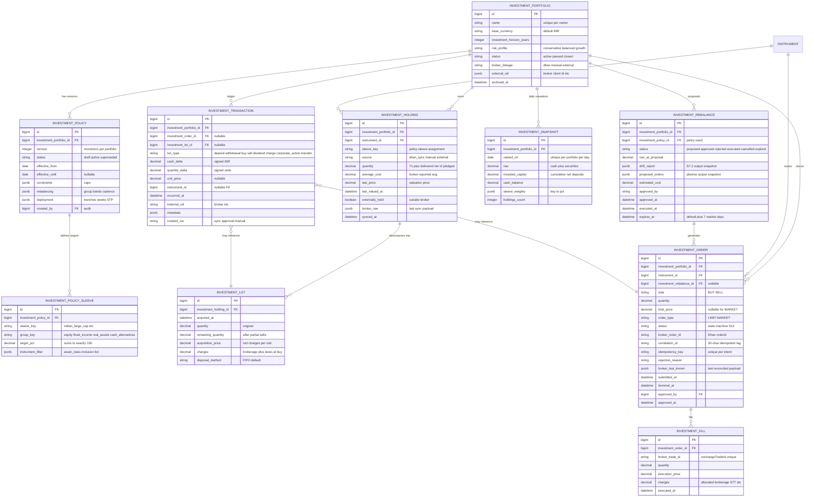
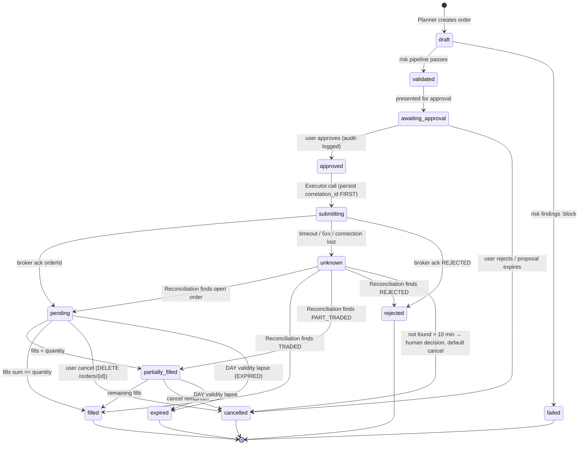
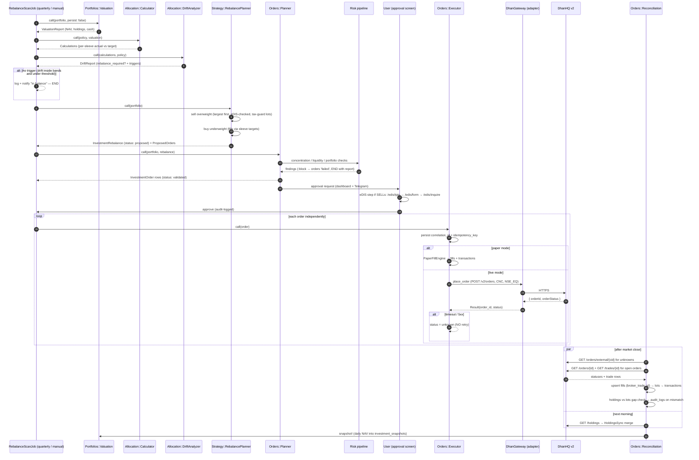

# Investing Module — Technical Design Document

| | |
|---|---|
| **Project** | AlgoScalperApi (`shubhamtaywade82/algo_scalper_api`) |
| **Document** | Technical Design Document (TDD) for the Investing domain |
| **Status** | Draft for review — v1.0 |
| **Date** | 2026-10-31 |
| **Author** | Engineering (agent-assisted) |
| **Base branch** | `develop` @ `ee55dc8f` |
| **Companion spike** | `feat/investing-portfolio-foundation` (models + allocation engine, green specs) |
| **Upstream strategy input** | *Annual Investment Strategy & Portfolio Review FY2026-27* (uploaded; identifiers and projections are illustrative placeholders — **not** execution inputs) |

---

## Table of Contents

1. [Purpose, Scope and Non-Goals](#1-purpose-scope-and-non-goals)
2. [Architecture Overview](#2-architecture-overview)
3. [Domain Model and Entity Relationships](#3-domain-model-and-entity-relationships)
4. [Database Migrations](#4-database-migrations)
5. [Configuration Schema](#5-configuration-schema)
6. [Service Contracts — `Investing::Portfolios`](#6-service-contracts--investingportfolios)
7. [Service Contracts — `Investing::Allocation`](#7-service-contracts--investingallocation)
8. [Service Contracts — `Investing::Strategy`](#8-service-contracts--investingstrategy)
9. [Service Contracts — `Investing::Risk`](#9-service-contracts--investingrisk)
10. [Service Contracts — `Investing::Orders`](#10-service-contracts--investingorders)
11. [DhanHQ v2 Adapter Specification](#11-dhanhq-v2-adapter-specification)
12. [Investment Order Lifecycle State Machine](#12-investment-order-lifecycle-state-machine)
13. [Execution Sequence — Rebalance to Reconciliation](#13-execution-sequence--rebalance-to-reconciliation)
14. [Scheduled Jobs](#14-scheduled-jobs)
15. [REST API Specification](#15-rest-api-specification)
16. [RSpec Acceptance Matrix](#16-rspec-acceptance-matrix)
17. [RSpec Skeletons](#17-rspec-skeletons)
18. [Spike Scope and Implementation Notes](#18-spike-scope-and-implementation-notes)
19. [Security, Audit and Regulatory Notes](#19-security-audit-and-regulatory-notes)
20. [Rollout Plan](#20-rollout-plan)
- [Appendix A — Verified DhanHQ v2 API Reference](#appendix-a--verified-dhanhq-v2-api-reference)
- [Appendix B — Glossary](#appendix-b--glossary)

---

## 1. Purpose, Scope and Non-Goals

### 1.1 Purpose

AlgoScalperApi is today a single-domain system: an intraday index-options scalping
engine (signal generation → entry guard → capital allocation → order execution →
trailing exits → P&L tracking). This document specifies a **second, independent
domain — Investing** — for long-term portfolio management: equity/ETF
accumulation, asset allocation, rebalancing, dividend tracking and investment
performance reporting, executed through the same broker (DhanHQ) and the same
Rails application.

The two domains share infrastructure but **never share lifecycles**:

| Dimension | Trading (existing) | Investing (new) |
|---|---|---|
| Holding period | Minutes | Years (target horizon 10y) |
| Unit of risk | Per-trade premium | Portfolio allocation weight |
| Stop mechanism | Premium stop-loss, trailing exits | Rebalancing bands, policy review |
| Loss control | Daily loss limit, session breaker | Drawdown monitoring, concentration caps |
| Exit trigger | Intraday signals, expiry | Policy drift, goal horizon |
| Order product | `NSE_FNO` / `INTRADAY` / `MARGIN` | `NSE_EQ` / `CNC` (delivery) |
| Accounting | Intraday P&L, wallet resets | Transaction ledger, tax lots, XIRR/TWR |
| Scheduling | Real-time daemon during market hours | Scheduled jobs (daily/weekly/quarterly) |

### 1.2 In scope (per phase)

See [§20 Rollout Plan](#20-rollout-plan) for phase ordering and acceptance criteria.

- Multiple investment portfolios with own policy, currency and horizon
- DhanHQ holdings synchronisation (demat equity + ETF + REIT/InvIT)
- Manual external asset and cash recording
- Versioned investment policies with allocation sleeves and constraints
- Portfolio valuation and target-vs-actual allocation analytics
- Drift analysis and rebalance *proposals* (orders are never auto-placed)
- Paper investment orders with a full lifecycle state machine
- Manual approval gate before any live order submission
- Reconciliation against Dhan order/trade/holdings data
- Performance analytics: XIRR, time-weighted return, benchmark comparison
- Risk checks: concentration, sector, liquidity, drawdown, stress scenarios

### 1.3 Non-goals (explicitly excluded)

- **No autonomous stock picking.** The system computes *deltas against a policy*,
  not investment opinions. An LLM may explain or summarise; it never computes
  balances or bypasses approval (see [§19.4](#194-llm-boundaries)).
- **No leverage, margin, or derivatives in the Investing domain.** `productType`
  is pinned to `CNC`; `MARGIN`/`MTF`/`CO`/`BO` and all `*_FNO` segments are
  rejected by the order planner.
- **No mutual fund execution.** DhanHQ v2 exposes no MF purchase/redemption/SIP
  API. Mutual funds enter as *manual external holdings* only, until a separately
  verified integration exists.
- **No automatic liquidation on intraday indicators.** Investment holdings are
  invisible to the trading engine's exit/trailing machinery.
- **No reliance on the strategy report's projections.** FY2026-27 report figures
  (prices, targets, Sharpe, volatility) are estimates and are **not** stored as
  execution inputs. Only its *policy structure* (sleeves, bands, cadence) seeds
  the default mandate template, and even that is user-editable configuration.

### 1.4 Relationship to existing code

| Existing component | Reuse decision |
|---|---|
| `Instrument` (canonical master, consolidated 2026-09) | **Reused.** Investing references `instruments` by `id`; adds classification columns (`asset_class`, `sector`, `liquidity_days_estimate`) — see [§4.1](#41-instrument-classification-migration) |
| `InstrumentsImportJob` + scrip-master sync | **Reused.** Extended to populate the new classification columns from the detailed scrip master |
| DhanHQ HTTP client / token store (`DhanAccessToken`, `app/services/dhan/`) | **Reused** via a new investing-specific adapter facade — see [§11](#11-dhanhq-v2-adapter-specification) |
| `ApplicationService` (`.call` pattern) | **Inherited** by all `Investing::*` services |
| Solid Queue + `config/recurring.yml` | **Reused** for all Investing schedules — see [§14](#14-scheduled-jobs) |
| rswag / `request` specs | **Reused** for API documentation — see [§15](#15-rest-api-specification) |
| `PositionTracker`, exit/trailing services, entry guard, capital allocator | **Not reused.** No code path from Trading touches Investing tables |
| Ledger tables (`ledger_accounts`, `ledger_postings`) | **Phase 5 option only.** Investing starts with its own `investment_transactions` ledger; mapping to the double-entry ledger is a later accounting integration decision |
| TelegramNotifier (via `ApplicationService#notify`) | **Reused** for approval requests and rebalance alerts |

---

## 2. Architecture Overview

The application becomes a unified financial platform with two independent
execution domains over shared infrastructure. The boundary is enforced in code:
separate namespaces, separate tables, separate configuration schema, separate
execution switches.

```mermaid
flowchart TB
    subgraph ALGOSCALPERAPI["AlgoScalperApi — Rails 8 API-only"]
        subgraph TRADING["Trading domain (existing, unchanged)"]
            SIG["Signal Engine<br/>(SMC + indicators)"]
            EG["Entry Guard"]
            CA["Capital Allocator"]
            OM_T["Order Manager"]
            TE["Trailing / Exit Engine"]
            PT["Position Tracker<br/>(intraday, minutes)"]
        end

        subgraph INVESTING["Investing domain (new)"]
            PM["Portfolio Manager"]
            IP["Investment Policy<br/>(versioned mandates)"]
            AE["Allocation Engine<br/>(calculator, drift)"]
            RE["Rebalancing Engine<br/>(proposal generator)"]
            IOM["Investment Order Manager<br/>(state machine + approval)"]
            HTL["Holdings & Tax Lots<br/>(years)"]
            PA["Performance Analytics<br/>(XIRR, TWR, benchmark)"]
        end

        subgraph SHARED["Shared infrastructure"]
            DHAN["DhanHQ v2 Client<br/>+ token lifecycle"]
            IM["Instrument Master<br/>(instruments table)"]
            MD["Market Data<br/>(quotes, historical)"]
            PG[("PostgreSQL")]
            RED[("Redis")]
            AUTH["Authentication<br/>(API tokens)"]
            AUD["Audit Logging<br/>(audit_logs)"]
            SQ["Solid Queue<br/>+ recurring.yml"]
        end
    end

    SIG --> EG --> CA --> OM_T --> TE --> PT
    PM --> IP --> AE --> RE --> IOM
    PM --> HTL --> PA
    IOM --> HTL

    TRADING -->|"NSE_FNO · INTRADAY/MARGIN<br/>real-time daemon"| DHAN
    INVESTING -->|"NSE_EQ · CNC only<br/>scheduled jobs"| DHAN
    TRADING --> IM
    INVESTING --> IM
    TRADING --> MD
    INVESTING --> MD
    ALGOSCALPERAPI --> PG
    ALGOSCALPERAPI --> RED
    ALGOSCALPERAPI --> AUTH
    ALGOSCALPERAPI --> AUD
    ALGOSCALPERAPI --> SQ

    DHAN -->|"HTTPS api.dhan.co/v2<br/>static IP whitelist"| BROKER["Dhan / NSE / CDSL"]
```



**Hard boundaries (enforced, not aspirational):**

1. **Namespace isolation.** All new code lives under `Investing::` (services),
   `Investing*` (models), `app/jobs/investing/`, `app/controllers/api/investments/`.
   An architecture test (see [§16, A-ARCH](#16-rspec-acceptance-matrix)) asserts
   that no `Trading`/live-trading service references any `investment_*` table or
   `Investing::` constant, and vice versa — mirroring the repo's existing
   `config/architecture_gate.yml` discipline.
2. **Execution switches are independent.** `investing.execution.mode` (paper/live)
   is a *separate* key from the trading paper/live switch; flipping one cannot
   flip the other (see [§5.2](#52-isolation-from-trading-configuration)).
3. **`Trading::PositionTracker` is not the portfolio model.** A trading position
   is a minutes-lived options contract; an investment holding is a years-lived
   demat lot cluster. Different tables, different lifecycles, no cross-writes.

---

## 3. Domain Model and Entity Relationships

### 3.1 Entity overview

| Model | Table | Responsibility | Phase |
|---|---|---|---|
| `InvestmentPortfolio` | `investment_portfolios` | Portfolio identity, owner, base currency, horizon, status | 1 |
| `InvestmentPolicy` | `investment_policies` | Versioned mandate: constraints, rebalancing bands, deployment plan | 1 |
| `InvestmentPolicySleeve` | `investment_policy_sleeves` | One allocation target row per policy version | 1 |
| `InvestmentHolding` | `investment_holdings` | Aggregated exposure per instrument per portfolio, with sleeve classification | 1 |
| `InvestmentLot` | `investment_lots` | Individual purchase lots (tax-lot accounting) | 3 |
| `InvestmentOrder` | `investment_orders` | Order intent → broker order, full lifecycle state | 3 |
| `InvestmentFill` | `investment_fills` | Executed trade records (partial fills supported) | 3 |
| `InvestmentTransaction` | `investment_transactions` | Append-only cash/asset ledger: buys, sells, dividends, deposits, withdrawals, charges | 3 |
| `InvestmentSnapshot` | `investment_snapshots` | Daily portfolio valuation point (NAV, sleeve weights) | 1 |
| `InvestmentRebalance` | `investment_rebalances` | Rebalance proposal + approval + execution linkage | 3 |
| `Instrument` (existing) | `instruments` | Canonical security master — **extended** with `asset_class`, `sector`, `liquidity_days_estimate` | 1 |

### 3.2 Entity-relationship diagram



### 3.3 Key modelling decisions

**D1 — Policies are immutable versions.** A policy row is never edited once
`active`; a change creates `version + 1` and closes the previous row with
`effective_until`. Drift analysis and rebalance proposals pin the `policy_id`
they were computed against, so historical proposals remain explainable. The
unique index `(investment_portfolio_id, version)` and a partial unique index on
`(investment_portfolio_id) WHERE status = 'active'` enforce one active mandate.

**D2 — Sleeves are normalised rows, not a JSON blob.** The user-facing YAML
(§5) compiles into `investment_policy_sleeves` rows. This makes
"sum(target_pct) = 100" a checkable constraint, lets drift SQL aggregate by
`sleeve_key`/`group_key`, and keeps policy diffs reviewable row-by-row.

**D3 — Holdings are per-instrument aggregates; lots are the accounting truth.**
`InvestmentHolding.quantity/average_cost` is the *broker-reconciled view*
(Dhan reports aggregates). `InvestmentLot` rows are our own tax-lot ledger,
created from fills. When lot-derived quantity diverges from the broker view,
`Investing::Orders::Reconciliation` flags a `reconciliation_gap` rather than
silently overwriting either side (§10.4).

**D4 — The transaction ledger is append-only and authoritative for performance.**
NAV-minus-purchases is never used as a return measure. Deposits, withdrawals,
dividends, charges, buys and sells are all `InvestmentTransaction` rows; XIRR
and TWR are computed from the ledger (§8.4). Rows are never updated or deleted;
corrections are compensating entries.

**D5 — Cash is modelled as a ledger balance, not a holding.** Cash balance =
`sum(cash_delta)` over transactions plus the broker `fundlimit` view for the
Dhan-linked portion. `Investing::Portfolios::Valuation` reconciles the two and
reports variance.

**D6 — Broker linkage is a portfolio attribute, not a global.** Multiple
portfolios may exist; at most one is `broker_linkage = 'dhan'` per Dhan client
ID (validated in `InvestmentPortfolio`). `manual`/`external` portfolios track
assets outside the broker (mutual funds, SGBs, PPF) without order execution.

**D7 — `Instrument` stays the single security master.** No parallel investment
instrument table. A lightweight migration adds `asset_class`, `sector`, and
`liquidity_days_estimate` columns used by allocation/risk (§4.1). Instrument
eligibility for CNC delivery is derived: `segment = 'NSE_EQ'` (or `BSE_EQ`),
`instrument_type` in equity/ETF series, `tradable = true`.

### 3.4 Enumerations

All enums are DB-stored as strings (house style — inspectable, no arity bugs),
defined via Rails `enum` with `_prefix`/`_suffix` where needed:

```ruby
# app/models/investment_portfolio.rb (excerpt)
enum :risk_profile, { conservative: "conservative", balanced: "balanced", growth: "growth" }, prefix: true
enum :status, { active: "active", paused: "paused", closed: "closed" }, prefix: :in
```

Sleeve keys and group keys are **open vocabularies** (not Rails enums) because
mandates evolve; the canonical FY2026-27 balanced mandate defines:

| `group_key` | `sleeve_key` | target |
|---|---|---|
| equity | `indian_large_cap` | 25% |
| equity | `indian_mid_small_cap` | 10% |
| equity | `global_equity` | 10% |
| equity | `technology_clean_energy` | 10% |
| fixed_income | `government_aaa_bonds` | 15% |
| fixed_income | `short_duration_debt` | 10% |
| real_assets | `reits_invits` | 5% |
| real_assets | `infrastructure_funds` | 7% |
| cash_alternatives | `cash_liquid_funds` | 5% |
| cash_alternatives | `gold_silver_etfs` | 3% |

These seed the `balanced_v1` mandate template (§5.3) and are editable
configuration, never hardcoded branches.

---

## 4. Database Migrations

House rules (matching existing `db/migrate` style): Rails 8 timestamps,
`decimal` for all money/percent/quantity columns (never float), reversible via
`safety_assured { ... }` where needed, no data migrations mixed into DDL.
New tables use bigint PKs. All foreign keys are explicit with `on_delete`
semantics chosen per relationship.

Migrations are listed in dependency order; phases in [§20](#20-rollout-plan)
map to them.

### 4.1 Instrument classification migration

```ruby
# db/migrate/20261031000001_add_investment_classification_to_instruments.rb
# frozen_string_literal: true

class AddInvestmentClassificationToInstruments < ActiveRecord::Migration[8.0]
  def up
    add_column :instruments, :asset_class, :string
    add_column :instruments, :sector, :string
    add_column :instruments, :liquidity_days_estimate, :integer

    add_index :instruments, :asset_class
    add_index :instruments, :sector

    # Backfill derived classification for cash-segment rows only.
    # Keep this fast and idempotent: series-based mapping, no per-row callbacks.
    reversible do |dir|
      dir.up do
        execute <<~SQL.squish
          UPDATE instruments SET asset_class = 'equity',
                 liquidity_days_estimate = 1
          WHERE segment = 'NSE_EQ'
            AND series IN ('EQ', 'BE', 'BZ')
            AND asset_class IS NULL
        SQL
        execute <<~SQL.squish
          UPDATE instruments SET asset_class = 'etf',
                 liquidity_days_estimate = 1
          WHERE segment IN ('NSE_EQ', 'BSE_EQ')
            AND series = 'ETF'
            AND asset_class IS NULL
        SQL
        execute <<~SQL.squish
          UPDATE instruments SET asset_class = 'government_bond',
                 liquidity_days_estimate = 2
          WHERE segment IN ('NSE_EQ', 'BSE_EQ')
            AND series IN ('GS', 'SG')  -- g-secs / sovereign gold bonds
            AND asset_class IS NULL
        SQL
        execute <<~SQL.squish
          UPDATE instruments SET asset_class = 'reit_invit',
                 liquidity_days_estimate = 3
          WHERE segment IN ('NSE_EQ', 'BSE_EQ')
            AND series IN ('RE', 'IV')
            AND asset_class IS NULL
        SQL
      end
    end
  end

  def down
    remove_index :instruments, :sector
    remove_index :instruments, :asset_class
    remove_column :instruments, :liquidity_days_estimate
    remove_column :instruments, :sector
    remove_column :instruments, :asset_class
  end
end
```

`sector` and finer `asset_class` splits (`corporate_bond`, `liquid_fund_etf`,
`gold_silver_etf`, `infrastructure_etf`, `global_equity_etf`) are populated by
the extended `InstrumentsImportJob` from the detailed scrip master plus a
curated symbol map (checked into `config/investing_sector_map.yml`), because
the CSV alone does not carry GICS sector or sleeve membership.

### 4.2 Portfolios and policies (Phase 1)

```ruby
# db/migrate/20261031000002_create_investment_portfolios.rb
# frozen_string_literal: true

class CreateInvestmentPortfolios < ActiveRecord::Migration[8.0]
  def change
    create_table :investment_portfolios do |t|
      t.string :name, null: false
      t.string :base_currency, null: false, default: "INR", limit: 3
      t.integer :investment_horizon_years, null: false, default: 10
      t.string :risk_profile, null: false, default: "balanced"
      t.string :status, null: false, default: "active"
      t.string :broker_linkage, null: false, default: "manual"
      t.jsonb :external_ref, null: false, default: {}
      t.datetime :archived_at
      t.timestamps
    end

    add_index :investment_portfolios, :name, unique: true
    add_index :investment_portfolios, :status
    add_index :investment_portfolios, :broker_linkage
    # One Dhan-linked portfolio per broker client id
    add_index :investment_portfolios, "((external_ref->>'dhan_client_id'))",
              name: "idx_inv_portfolios_on_dhan_client_id", unique: true,
              where: "broker_linkage = 'dhan'"
  end
end
```

```ruby
# db/migrate/20261031000003_create_investment_policies.rb
# frozen_string_literal: true

class CreateInvestmentPolicies < ActiveRecord::Migration[8.0]
  def change
    create_table :investment_policies do |t|
      t.references :investment_portfolio,
                   null: false, foreign_key: { on_delete: :cascade },
                   index: false
      t.integer :version, null: false, default: 1
      t.string :status, null: false, default: "draft"
      t.date :effective_from, null: false
      t.date :effective_until
      t.jsonb :constraints, null: false, default: {}
      t.jsonb :rebalancing, null: false, default: {}
      t.jsonb :deployment, null: false, default: {}
      t.string :mandate_key   # e.g. "balanced_v1" — provenance of the config
      t.timestamps
    end

    add_index :investment_policies,
              %i[investment_portfolio_id version], unique: true
    add_index :investment_policies, :status
    # Exactly one active policy per portfolio
    add_index :investment_policies, :investment_portfolio_id,
              unique: true, where: "status = 'active'",
              name: "idx_inv_policies_one_active_per_portfolio"
  end
end
```

```ruby
# db/migrate/20261031000004_create_investment_policy_sleeves.rb
# frozen_string_literal: true

class CreateInvestmentPolicySleeves < ActiveRecord::Migration[8.0]
  def change
    create_table :investment_policy_sleeves do |t|
      t.references :investment_policy,
                   null: false, foreign_key: { on_delete: :cascade },
                   index: false
      t.string :sleeve_key, null: false, limit: 64
      t.string :group_key, null: false, limit: 64
      t.decimal :target_pct, precision: 7, scale: 4, null: false
      t.jsonb :instrument_filter, null: false, default: {}
      t.integer :position, null: false, default: 0  # stable display order
      t.timestamps
    end

    add_index :investment_policy_sleeves,
              %i[investment_policy_id sleeve_key], unique: true
    add_index :investment_policy_sleeves, :group_key
    add_check_constraint :investment_policy_sleeves,
                         "target_pct > 0 AND target_pct <= 100",
                         name: "chk_inv_sleeve_target_pct_range"
  end
end
```

### 4.3 Holdings and snapshots (Phase 1)

```ruby
# db/migrate/20261031000005_create_investment_holdings.rb
# frozen_string_literal: true

class CreateInvestmentHoldings < ActiveRecord::Migration[8.0]
  def change
    create_table :investment_holdings do |t|
      t.references :investment_portfolio,
                   null: false, foreign_key: { on_delete: :cascade }
      t.references :instrument,
                   null: false, foreign_key: { on_delete: :restrict }
      t.string :sleeve_key, limit: 64
      t.string :source, null: false, default: "manual"
      t.decimal :quantity, precision: 20, scale: 4, null: false, default: 0
      t.decimal :average_cost, precision: 15, scale: 4
      t.decimal :last_price, precision: 15, scale: 4
      t.datetime :last_valued_at
      t.boolean :externally_held, null: false, default: false
      t.jsonb :broker_raw, null: false, default: {}
      t.datetime :synced_at
      t.timestamps
    end

    add_index :investment_holdings,
              %i[investment_portfolio_id instrument_id], unique: true
    add_index :investment_holdings, :sleeve_key
    add_index :investment_holdings, :source
    add_check_constraint :investment_holdings, "quantity >= 0",
                         name: "chk_inv_holdings_nonneg_quantity"
  end
end
```

```ruby
# db/migrate/20261031000006_create_investment_snapshots.rb
# frozen_string_literal: true

class CreateInvestmentSnapshots < ActiveRecord::Migration[8.0]
  def change
    create_table :investment_snapshots do |t|
      t.references :investment_portfolio,
                   null: false, foreign_key: { on_delete: :cascade },
                   index: false
      t.date :valued_on, null: false
      t.decimal :nav, precision: 18, scale: 4, null: false
      t.decimal :invested_capital, precision: 18, scale: 4, null: false
      t.decimal :cash_balance, precision: 18, scale: 4, null: false
      t.jsonb :sleeve_weights, null: false, default: {}
      t.integer :holdings_count, null: false, default: 0
      t.timestamps
    end

    add_index :investment_snapshots,
              %i[investment_portfolio_id valued_on], unique: true
  end
end
```

### 4.4 Rebalances, orders, fills (Phase 3)

```ruby
# db/migrate/20261031000007_create_investment_rebalances.rb
# frozen_string_literal: true

class CreateInvestmentRebalances < ActiveRecord::Migration[8.0]
  def change
    create_table :investment_rebalances do |t|
      t.references :investment_portfolio,
                   null: false, foreign_key: { on_delete: :cascade }
      t.references :investment_policy,
                   null: false, foreign_key: { on_delete: :restrict }
      t.string :status, null: false, default: "proposed"
      t.decimal :nav_at_proposal, precision: 18, scale: 4, null: false
      t.jsonb :drift_report, null: false, default: {}
      t.jsonb :proposed_orders, null: false, default: {}
      t.decimal :estimated_cost, precision: 15, scale: 4
      t.string :approved_by, limit: 100
      t.datetime :approved_at
      t.datetime :executed_at
      t.datetime :expires_at
      t.timestamps
    end

    add_index :investment_rebalances, :status
    add_index :investment_rebalances, %i[investment_portfolio_id status]
  end
end
```

```ruby
# db/migrate/20261031000008_create_investment_orders.rb
# frozen_string_literal: true

class CreateInvestmentOrders < ActiveRecord::Migration[8.0]
  def change
    create_table :investment_orders do |t|
      t.references :investment_portfolio,
                   null: false, foreign_key: { on_delete: :restrict }
      t.references :instrument,
                   null: false, foreign_key: { on_delete: :restrict }
      t.references :investment_rebalance,
                   foreign_key: { on_delete: :nullify }
      t.string :side, null: false                       # BUY / SELL
      t.decimal :quantity, precision: 20, scale: 4, null: false
      t.string :order_type, null: false, default: "LIMIT"
      t.decimal :limit_price, precision: 15, scale: 4
      t.string :status, null: false, default: "draft"
      t.string :execution_mode, null: false, default: "paper"
      t.string :broker_order_id, limit: 64
      t.string :correlation_id, limit: 30
      t.string :idempotency_key, limit: 100
      t.string :rejection_reason
      t.jsonb :broker_last_known, null: false, default: {}
      t.datetime :submitted_at
      t.datetime :terminal_at
      t.string :approved_by, limit: 100
      t.datetime :approved_at
      t.timestamps
    end

    add_index :investment_orders, :status
    add_index :investment_orders, :idempotency_key, unique: true
    add_index :investment_orders, :correlation_id, unique: true,
              where: "correlation_id IS NOT NULL"
    add_index :investment_orders, :broker_order_id, unique: true,
              where: "broker_order_id IS NOT NULL"
    add_index :investment_orders,
              %i[investment_portfolio_id created_at]
    add_check_constraint :investment_orders, "quantity > 0",
                         name: "chk_inv_orders_positive_quantity"
  end
end
```

```ruby
# db/migrate/20261031000009_create_investment_fills.rb
# frozen_string_literal: true

class CreateInvestmentFills < ActiveRecord::Migration[8.0]
  def change
    create_table :investment_fills do |t|
      t.references :investment_order,
                   null: false, foreign_key: { on_delete: :cascade },
                   index: false
      t.string :broker_trade_id, null: false, limit: 64
      t.decimal :quantity, precision: 20, scale: 4, null: false
      t.decimal :execution_price, precision: 15, scale: 4, null: false
      t.decimal :charges, precision: 15, scale: 4, null: false, default: 0
      t.datetime :executed_at, null: false
      t.timestamps
    end

    add_index :investment_fills,
              %i[investment_order_id broker_trade_id], unique: true
  end
end
```

### 4.5 Lots and the transaction ledger (Phase 3/5)

```ruby
# db/migrate/20261101000010_create_investment_lots.rb
# frozen_string_literal: true

class CreateInvestmentLots < ActiveRecord::Migration[8.0]
  def change
    create_table :investment_lots do |t|
      t.references :investment_holding,
                   null: false, foreign_key: { on_delete: :cascade },
                   index: false
      t.datetime :acquired_at, null: false
      t.decimal :quantity, precision: 20, scale: 4, null: false
      t.decimal :remaining_quantity, precision: 20, scale: 4, null: false
      t.decimal :acquisition_price, precision: 15, scale: 4, null: false
      t.decimal :charges, precision: 15, scale: 4, null: false, default: 0
      t.string :disposal_method, null: false, default: "FIFO"
      t.timestamps
    end

    add_index :investment_lots,
              %i[investment_holding_id acquired_at]
    add_check_constraint :investment_lots,
                         "remaining_quantity >= 0 AND remaining_quantity <= quantity",
                         name: "chk_inv_lots_remaining_range"
  end
end
```

```ruby
# db/migrate/20261101000011_create_investment_transactions.rb
# frozen_string_literal: true

class CreateInvestmentTransactions < ActiveRecord::Migration[8.0]
  def change
    create_table :investment_transactions do |t|
      t.references :investment_portfolio,
                   null: false, foreign_key: { on_delete: :restrict }
      t.references :investment_order, foreign_key: { on_delete: :nullify }
      t.references :investment_lot,   foreign_key: { on_delete: :nullify }
      t.references :instrument,       foreign_key: { on_delete: :nullify }
      t.string :txn_type, null: false
      t.decimal :cash_delta, precision: 18, scale: 4, null: false, default: 0
      t.decimal :quantity_delta, precision: 20, scale: 4, null: false, default: 0
      t.decimal :unit_price, precision: 15, scale: 4
      t.datetime :occurred_at, null: false
      t.string :external_ref, limit: 128
      t.string :created_via, null: false, default: "manual"
      t.jsonb :metadata, null: false, default: {}
      t.timestamps
    end

    add_index :investment_transactions,
              %i[investment_portfolio_id occurred_at]
    add_index :investment_transactions, :txn_type
    add_index :investment_transactions, :external_ref,
              unique: true, where: "external_ref IS NOT NULL"
    add_index :investment_transactions,
              %i[investment_order_id txn_type],
              where: "investment_order_id IS NOT NULL"
  end
end
```

### 4.6 Rationale for notable columns

- **`investment_orders.correlation_id` (limit 30)** — Dhan requires ≤30 chars
  from `[a-zA-Z0-9 _-]`. Generated as `INV-{order.id}-{base36 timestamp}`,
  always ≤ 30, always set *before* submission so a timeout can be resolved via
  `GET /orders/external/{correlation-id}` (§12.6).
- **`idempotency_key`** — distinct from `correlation_id`: it identifies the
  *intent* (e.g. rebalance line item) so a retried submission cannot duplicate
  the order even if the first attempt actually landed at the exchange.
- **`broker_last_known` jsonb** — the last raw broker payload seen during
  reconciliation, kept for post-mortems without re-querying.
- **`execution_mode` on orders** — frozen copy of the mode at creation; a mode
  flip mid-flight cannot retroactively make a paper order live or vice versa.
- **Partial unique index for one active policy** — DB-level enforcement of the
  "single active mandate" invariant, not just a model validation.
- **`on_delete: :restrict` for instruments** — securities referenced by
  holdings/orders can never be hard-deleted by a scrip-master cleanup; they are
  deactivated (`tradable = false`) instead.

---

## 5. Configuration Schema

### 5.1 `config/investing.yml`

A **new, separate** configuration file — deliberately not part of
`config/algo.yml` (which drives intraday trading risk) — with its own loader
(`Investing::Config`), its own schema, and its own validation. Both loaders may
share the low-level YAML reading helper, but the schemas never overlap.

```yaml
# config/investing.yml
default: &default
  enabled: false            # master switch for the whole Investing domain

  execution:
    mode: paper             # paper | live
    require_approval: true  # orders NEVER submit without explicit approval
    automatic_execution: false
    allow_margin: false     # hard-locked: CNC only
    allow_derivatives: false
    max_order_value_inr: 500000
    max_orders_per_day: 20
    price_staleness_seconds: 120   # quote age ceiling before order submission

  dhan:
    enabled: true
    product_type: CNC
    exchange_segment: NSE_EQ

  mandates:
    balanced_v1:
      description: "Balanced multi-asset mandate (FY2026-27 review template)"
      base_currency: INR
      investment_horizon_years: 10
      risk_profile: balanced
      allocation:
        indian_large_cap:        { group: equity,            target_pct: 25 }
        indian_mid_small_cap:    { group: equity,            target_pct: 10 }
        global_equity:           { group: equity,            target_pct: 10 }
        technology_clean_energy: { group: equity,            target_pct: 10 }
        government_aaa_bonds:    { group: fixed_income,      target_pct: 15 }
        short_duration_debt:     { group: fixed_income,      target_pct: 10 }
        reits_invits:            { group: real_assets,       target_pct: 5 }
        infrastructure_funds:    { group: real_assets,       target_pct: 7 }
        cash_liquid_funds:       { group: cash_alternatives, target_pct: 5 }
        gold_silver_etfs:        { group: cash_alternatives, target_pct: 3 }
      constraints:
        max_single_stock_pct: 2.5
        max_sector_pct: 12
        max_illiquid_pct: 25          # share of portfolio with liquidity_days_estimate > 7
        min_instruments: 12
      rebalancing:
        bands:                        # group-level drift bands
          equity:            { lower_pct: 50, upper_pct: 60 }
          fixed_income:      { lower_pct: 20, upper_pct: 30 }
          real_assets:       { lower_pct: 8,  upper_pct: 16 }
          cash_alternatives: { lower_pct: 3,  upper_pct: 12 }
        threshold_to_act_pct: 1.0     # per-sleeve drift below which no order is proposed
        review_frequency: quarterly
        proposal_expiry_market_days: 7
      deployment:
        equity_tranches: 3
        deployment_weeks: 12
        midcap_stp_months: 6

development:
  <<: *default
  enabled: true

test:
  <<: *default
  enabled: true

production:
  <<: *default
  enabled: false            # opt-in flip after Phase 4 review
```

### 5.2 Isolation from trading configuration

`Investing::Config` reads **only** `config/investing.yml` (with environment
layering) and exposes a frozen struct:

```ruby
# app/services/investing/config.rb (excerpt)
module Investing
  class Config
    EXECUTION_MODES = %w[paper live].freeze

    def self.execution_mode = Rails.application.config.x.investing.execution.mode
    def self.live?  = execution_mode == "live"
    def self.paper? = execution_mode == "paper"
    ...
  end
end
```

Loaded once at boot in `config/initializers/investing.rb` via
`Rails.application.config.x.investing`. **Guarantees:**

1. No key in `investing.yml` can flip `Settings.paper_trading` (trading) or
   vice versa — different files, different accessors, verified by an
   RSpec isolation test ([§16, A-CONF](#16-rspec-acceptance-matrix)).
2. `mode: live` additionally requires `ENV['INVESTING_LIVE_CONFIRMED'] == 'I Understand'`
   — a deliberate two-man-rule style guard so a YAML edit alone cannot arm
   live execution.
3. `require_approval` cannot be disabled while `mode: live` (loader hard-fails
   the boot — fail-closed, mirroring the repo's `Ai::OpenaiClient` discipline).

### 5.3 Validation rules for mandates

`Investing::Allocation::PolicyValidator` (§7.3) enforces at compile time (YAML →
policy rows) and at model save time:

| Rule | Failure mode |
|---|---|
| `allocation` weights sum to **exactly 100.0** (BigDecimal arithmetic) | `InvalidPolicy` — boot/seed error, never a silent clamp |
| Every sleeve's `group` is a known group key | `InvalidPolicy` |
| Group bands: `lower_pct < target_group_sum < upper_pct` | `InvalidPolicy` |
| `max_single_stock_pct ≤ max_sector_pct` | `InvalidPolicy` |
| All percentages in `(0, 100]`; bands in `[0, 100]` | `InvalidPolicy` |
| `threshold_to_act_pct ≥ 0.05` (avoid dust-order churn) | warning + clamp to 0.05 |
| `deployment.equity_tranches ∈ [1..12]`, `deployment_weeks ∈ [1..104]` | `InvalidPolicy` |
| At least one sleeve per group that has a band | `InvalidPolicy` |

---

## 6. Service Contracts — `Investing::Portfolios`

All services inherit `ApplicationService` and are called via `.call(...)`
(house pattern). All money math uses `BigDecimal`; all timestamps are `Time`
in app timezone (`Asia/Kolkata` market context). Result objects are POROs
(`Data`-like) — services **never** return raw hashes across boundaries, and
they never raise for domain failures; they return `Result` with `success?` /
`failure` + typed payload (matching the repo's `contracts` style under
`app/services/contracts`).

```ruby
# app/services/investing/result.rb
module Investing
  Result = Struct.new(:ok, :payload, :errors, keyword_init: true) do
    def self.success(payload) = new(ok: true, payload: payload, errors: [])
    def self.failure(errors)  = new(ok: false, payload: nil, errors: Array(errors))
    def success? = ok
  end
end
```

### 6.1 `Investing::Portfolios::Manager`

Lifecycle operations for portfolios and their policies.

```ruby
module Investing
  module Portfolios
    class Manager < ApplicationService
      # -- Portfolios ------------------------------------------------------
      # @param name [String]
      # @param opts [Hash] :base_currency("INR"), :investment_horizon_years(10),
      #   :risk_profile("balanced"), :broker_linkage("manual"), :external_ref({})
      # @return [Result] payload: { portfolio: InvestmentPortfolio }
      def create_portfolio(name, **opts)

      # @param portfolio [InvestmentPortfolio]
      # @param attrs [Hash] mutable attrs (name, horizon, risk_profile, status)
      # @return [Result] payload: { portfolio: InvestmentPortfolio }
      def update_portfolio(portfolio, **attrs)

      # Soft-close: pauses jobs, archives holdings snapshot, keeps ledger.
      # Refuses when orders are in a non-terminal state (see §12).
      # @return [Result] payload: { portfolio:, closing_snapshot: InvestmentSnapshot }
      def close_portfolio(portfolio)

      # -- Policies ---------------------------------------------------------
      # Compiles a mandate (from config/investing.yml or explicit hash) into a
      # NEW immutable policy version; supersedes the current active one in the
      # same transaction. Runs PolicyValidator first (§7.3).
      # @param portfolio [InvestmentPortfolio]
      # @param mandate [Hash] full mandate structure (see §5.3)
      # @param effective_from [Date]
      # @return [Result] payload: { policy: InvestmentPolicy (status: "active") }
      #   failure: [:policy_invalid, *errors]
      def install_policy(portfolio, mandate:, effective_from: Date.current)

      # @param portfolio [InvestmentPortfolio]
      # @return [Result] payload: { policy: InvestmentPolicy }
      #   failure: [:no_active_policy]
      def active_policy(portfolio)
    end
  end
end
```

**Invariants:** `install_policy` is transactional (old row superseded + new row
active atomically); the partial unique index is the backstop. Names are unique
case-insensitively (validation + functional index).

### 6.2 `Investing::Portfolios::Valuation`

```ruby
module Investing
  module Portfolios
    class Valuation < ApplicationService
      # Values the portfolio as of "now" (or a given timestamp).
      #
      # Price resolution order per holding:
      #   1. quoted price passed in `prices: { instrument_id => BigDecimal }`
      #      (used by tests and by the market-data batch caller)
      #   2. `instrument` market-data service LTP (cached in Redis for the
      #      caller's staleness window, default 120s)
      #   3. `holding.last_price` with `last_valued_at` staleness flag
      #
      # Cash balance = ledger sum (§3.3 D5) reconciled against Dhan fundlimit
      # when `broker_linkage == 'dhan'`; variance > 1% is reported, never auto-
      # corrected.
      #
      # @param portfolio [InvestmentPortfolio]
      # @param opts [Hash] :prices({}), :as_of(Time.now), :persist(false)
      # @return [Result] payload: ValuationReport (Data class):
      #   ValuationReport = {
      #     portfolio_id:, as_at:, nav: BigDecimal, securities_value:,
      #     cash_balance:, invested_capital:, unrealized_pnl:,
      #     holdings: [ HoldingValuation(instrument_id:, sleeve_key:, quantity:,
      #                  market_value:, cost_basis:, weight_pct:, price_used:,
      #                  price_stale: true/false) ],
      #     stale_price_count:, cash_variance_vs_broker: BigDecimal | nil
      #   }
      def call(portfolio, prices: {}, as_of: Time.current, persist: false)

      # Daily snapshot writer — idempotent per (portfolio, valued_on):
      # upserts investment_snapshots and refreshes sleeve_weights jsonb.
      # Called by PortfolioValuationJob (§14) after market close.
      # @return [Result] payload: { snapshot: InvestmentSnapshot }
      def snapshot!(portfolio, valued_on: Date.current)
    end
  end
end
```

### 6.3 `Investing::Portfolios::HoldingsSync`

```ruby
module Investing
  module Portfolios
    class HoldingsSync < ApplicationService
      # Pulls Dhan /holdings and merges into investment_holdings.
      #
      # Merge rules (broker is source of truth for quantity/average_cost):
      #   - Match on instrument (security_id within NSE_EQ/BSE_EQ; fall back
      #     to ISIN when security_id moved).
      #   - Upsert quantity = total_qty - collateral_qty (pledged units are
      #     exposure but not sellable; collateral_qty kept in broker_raw).
      #   - New broker lines → holdings with source: 'dhan_sync', sleeve_key
      #     inferred via Investing::Allocation::SleeveClassifier (§7.4).
      #   - Broker lines that vanish (fully sold outside app) → quantity 0,
      #     kept for audit, flagged in report; never deleted.
      #   - manual/external holdings are NEVER touched.
      #   - Each applied delta writes InvestmentTransaction rows
      #     (txn_type: :transfer_in with external_ref) when a holding appears.
      #
      # @return [Result] payload: {
      #   created: [InvestmentHolding], updated: [InvestmentHolding],
      #   zeroed: [InvestmentHolding], unmatched_broker_lines: [Hash],
      #   synced_at: Time }
      #   failure: [:broker_unavailable, error] (Dhan API error)
      def call
    end
  end
end
```

**Failure semantics:** broker HTTP failures abort with no partial writes (the
whole merge runs in one transaction and Dhan is called once up-front).

---

## 7. Service Contracts — `Investing::Allocation`

The deterministic core of the domain. Everything here is pure computation over
(portfolio state, policy) — no I/O except reads, no LLM, fully unit-testable.
This is the scope of the companion spike ([§18](#18-spike-scope-and-implementation-notes)).

### 7.1 `Investing::Allocation::Calculator`

```ruby
module Investing
  module Allocation
    class Calculator < ApplicationService
      # Computes actual allocation from a valuation report + policy.
      #
      # @param policy [InvestmentPolicy] (with sleeves loaded)
      # @param valuation [Investing::Portfolios::ValuationReport]
      #   Valuation may come from Valuation.call(...).payload or be built
      #   directly in tests from a { instrument_id => { sleeve_key:, value: } }
      #   hash — Calculator does not care where numbers came from.
      # @return [Calculations] (Data class):
      #   Calculations = {
      #     total_value:,                     # BigDecimal, incl. cash
      #     sleeves: [ SleeveCalc(
      #       sleeve_key:, group_key:, target_pct:, target_value:,
      #       actual_value:, actual_pct:, drift_pct:,      # actual - target (pp)
      #       drift_value:,                                  # ₹ to reach target
      #       band: { lower_pct:, upper_pct: } | nil,       # group band applied
      #       within_band?: true/false) ],
      #     groups: [ GroupCalc(group_key:, target_pct:, actual_pct:,
      #                drift_pct:, within_band?:) ],
      #     unclassified_value:,             # holdings with sleeve_key: nil
      #     unclassified_pct:
      #   }
      def call(policy:, valuation:)
    end
  end
end
```

**Arithmetic rules (test-pinned):** `drift_pct` is in percentage *points*
(`actual_pct - target_pct`), computed on `BigDecimal` with `ROUND_HALF_UP` to
4dp; `actual_pct` uses total portfolio value **including cash** as denominator;
sleeves with zero holdings report `actual_value: 0, actual_pct: 0`.

### 7.2 `Investing::Allocation::DriftAnalyzer`

```ruby
module Investing
  module Allocation
    class DriftAnalyzer < ApplicationService
      # Turns Calculations into a verdict + human-readable drift report.
      #
      # @param calculations [Calculator::Calculations]
      # @param policy [InvestmentPolicy] (for threshold + bands config)
      # @return [DriftReport] (Data class):
      #   DriftReport = {
      #     rebalance_required?: bool,      # any group outside band
      #                                    #   OR any sleeve drift >= threshold
      #     triggers: [ Trigger(kind: :group_band_breach | :sleeve_threshold,
      #                  key:, actual_pct:, target_pct:, drift_pct:,
      #                  band: | nil) ],
      #     overweights: [SleeveCalc], underweights: [SleeveCalc],
      #     max_abs_drift_pp: BigDecimal,
      #     narrative: String   # the "PORTFOLIO REBALANCE REQUIRED" block,
      #                          # plain text, deterministic template —
      #                          # e.g. "Equity: target 55.0%, actual 62.0%,
      #                          #  drift +7.0pp, band 50–60% — BREACHED"
      #   }
      def call(calculations:, policy:)
    end
  end
end
```

**Worked example (from the strategy review, test-pinned):** ₹10,00,000 NAV,
equity actual 62% vs target 55% with band 50–60% → `rebalance_required? true`,
trigger `group_band_breach(equity, drift +7.0pp)`, narrative names equity as
overweight by ₹70,000, underweight sleeves ranked by `drift_value` magnitude.

### 7.3 `Investing::Allocation::PolicyValidator`

```ruby
module Investing
  module Allocation
    class PolicyValidator < ApplicationService
      # Validates a mandate hash (config or user input) BEFORE it is compiled
      # into policy rows, and re-validates the compiled rows at save.
      #
      # @param mandate [Hash] structure of §5.1 :mandates.<key>
      # @return [Result] payload: { normalized: Hash }  # canonical BigDecimal form
      #   failure: [:weights_do_not_sum_to_100, { sum: }],
      #            [:unknown_group_key, { sleeve:, group: }],
      #            [:band_excludes_target, { group:, band:, target: }],
      #            [:invalid_pct_range, { key:, value: }],
      #            [:constraints_inconsistent, { detail: }],
      #            [:deployment_out_of_range, { key:, value: }]
      def call(mandate:)

      # Model-level: used in InvestmentPolicy before_save to assert its own
      # sleeves still satisfy every rule (defense in depth vs direct SQL).
      def validate_policy_record!(policy)
    end
  end
end
```

Weight summation uses `BigDecimal#sum` against `BigDecimal("100")` with
**exact equality** — 99.9999 is a failure, never rounded through.

### 7.4 `Investing::Allocation::SleeveClassifier`

```ruby
module Investing
  module Allocation
    class SleeveClassifier < ApplicationService
      # Maps an Instrument (or an asset_class/sector pair) to a policy sleeve.
      #
      # Resolution order:
      #   1. explicit override map in policy sleeve's instrument_filter
      #      (e.g. { symbols: ["NIFTYBEES"] })
      #   2. config/investing_sector_map.yml curated symbol → sleeve map
      #   3. asset_class → default sleeve (equity→indian_large_cap,
      #      etf→by sector of the ETF: midcap→indian_mid_small_cap,
      #      gold/silver→gold_silver_etfs, infra→infrastructure_funds,
      #      international→global_equity, reit/invit→reits_invits,
      #      government_bond→government_aaa_bonds, corporate_bond/liquid→
      #      short_duration_debt)
      #   4. nil (unclassified) — surfaces in Calculator.unclassified_value
      #      and blocks order planning for that holding until classified.
      #
      # @return [String, nil] sleeve_key
      def classify(instrument, policy:)
    end
  end
end
```

---

## 8. Service Contracts — `Investing::Strategy`

### 8.1 `Investing::Strategy::ContributionPlanner`

```ruby
module Investing
  module Strategy
    class ContributionPlanner < ApplicationService
      # Plans deployment of a NEW cash contribution into the portfolio.
      # @param portfolio [InvestmentPortfolio]
      # @param amount [BigDecimal] INR to deploy
      # @param opts [Hash] :tranches(policy.deployment.equity_tranches),
      #   :spread_weeks(policy.deployment.deployment_weeks)
      # @return [Result] payload: { plan: [Tranche(scheduled_on: Date,
      #                     amount: BigDecimal, note: String)] }
      # Tranche dates use market-calendar awareness (skip market holidays —
      # MarketHoliday model already exists in the trading domain).
      def call(portfolio, amount, **opts)
    end
  end
end
```

### 8.2 `Investing::Strategy::AccumulationPlanner`

```ruby
module Investing
  module Strategy
    class AccumulationPlanner < ApplicationService
      # Standing accumulation schedule: SIP-style recurring buys sized to keep
      # the portfolio AT target (buys only — sells come only from rebalancing).
      # Mid-cap averaging: when a sleeve is underweight and its instrument is
      # flagged for STP, splits the buy across stp_months (policy.deployment).
      # @param portfolio [InvestmentPortfolio]
      # @param opts [Hash] :as_of(Date.today)
      # @return [Result] payload: { buys: [ProposedBuy(instrument_id:,
      #                     sleeve_key:, quantity: Integer, est_price:,
      #                     est_amount:, scheduled_on:)],
      #                     unclassified_holdings: [bigint] }
      # Quantity always integral (equity lot = 1 share); rounding remainder
      # stays in cash and is reported in note.
      def call(portfolio, **opts)
    end
  end
end
```

### 8.3 `Investing::Strategy::RebalancePlanner`

```ruby
module Investing
  module Strategy
    class RebalancePlanner < ApplicationService
      # Produces a REBALANCE PROPOSAL from a DriftReport. Proposal, never
      # execution: output is a persisted InvestmentRebalance (status:
      # 'proposed') with proposed_orders JSON — no InvestmentOrder rows yet.
      #
      # Sell side: only instruments in OVERWEIGHT sleeves, largest-weight
      # first, respecting availableQty (T1+delivered-pledged) and eDIS
      # authorization availability (§11.5) — instruments lacking eDIS
      # clearance are skipped with an explicit :edis_blocked reason.
      # Buy side: underweight sleeves, filling via SleeveClassifier target
      # instruments (policy instrument_filter) or existing holdings first.
      #
      # Tax guard: lots held < 365 days are sold LAST (speculative-rate
      # avoidance is a user-config: constraints[:short_term_avoidance]).
      #
      # @param portfolio [InvestmentPortfolio]
      # @param opts [Hash] :dry_run(true) — when true nothing is persisted
      # @return [Result] payload: { rebalance: InvestmentRebalance,
      #     drift_report:, orders: [ProposedOrder(instrument_id:, side:,
      #       sleeve_key:, quantity:, est_price:, est_amount:, reason:)] }
      #   failure: [:nothing_to_do] when drift below all thresholds
      def call(portfolio, **opts)
    end
  end
end
```

---

## 9. Service Contracts — `Investing::Risk`

Risk checks are **pure validators** returning typed findings; they never mutate
portfolios. `Investing::Orders::Planner` (§10.1) runs them as a pipeline before
an order set can become `validated`.

### 9.1 `Investing::Risk::ConcentrationChecker`

```ruby
module Investing
  module Risk
    class ConcentrationChecker < ApplicationService
      # Evaluates post-trade single-stock and sector exposure.
      # @param portfolio [InvestmentPortfolio]
      # @param proposed_orders [Array<ProposedOrder>]
      # @param valuation [ValuationReport]
      # @param policy [InvestmentPolicy]
      # @return [Findings] = [ Finding(rule: :max_single_stock | :max_sector,
      #     instrument_id: | sector:, current_pct:, post_trade_pct:,
      #     limit_pct:, severity: :block | :warn) ]
      # Severity :block when the PROPOSED trade is what breaches the cap
      # (pre-existing breaches from price moves are :warn — flagged for the
      # next rebalance, not used to veto unrelated orders).
      def call(portfolio:, proposed_orders:, valuation:, policy:)
    end
  end
end
```

### 9.2 `Investing::Risk::LiquidityChecker`

```ruby
module Investing
  module Risk
    class LiquidityChecker < ApplicationService
      # Max share of portfolio in instruments with liquidity_days_estimate > 7
      # (policy constraints[:max_illiquid_pct], default 25).
      # Also flags orders whose value exceeds 5% of instrument's 20-day median
      # traded value (impact guard) — :warn severity, participation cap note.
      def call(portfolio:, proposed_orders:, valuation:, policy:)
    end
  end
end
```

### 9.3 `Investing::Risk::PortfolioRiskChecker`

```ruby
module Investing
  module Risk
    class PortfolioRiskChecker < ApplicationService
      # Portfolio-level guards for the approval screen:
      #   - drawdown vs snapshot history (warn at -15% from 365d peak,
      #     block new BUY orders at -25% unless :acknowledge_drawdown flag)
      #   - cash sufficiency for proposed buys (block)
      #   - stale prices (block when any price older than
      #     execution.price_staleness_seconds)
      #   - execution caps: max_order_value_inr, max_orders_per_day (block)
      #   - leverage/margin attempts (block — CNC-only enforcement)
      #   - stress scenarios (30% Nifty shock, +150bp rates, -5% INR):
      #     REPORTED on the approval screen as scenario table, never blocking
      def call(portfolio:, proposed_orders:, valuation:, policy:, opts: {})
    end
  end
end
```

**Stress scenarios** are deterministic coefficient tables
(`config/investing_stress_scenarios.yml`), applied to sleeve weights — the
FY2026-27 report's scenario set is the seed; coefficients are configuration,
and the report's own volatility/Sharpe estimates are explicitly **not** copied.

---

## 10. Service Contracts — `Investing::Orders`

### 10.1 `Investing::Orders::Planner`

```ruby
module Investing
  module Orders
    class Planner < ApplicationService
      # Converts an approved-or-drafted order SET (from a rebalance or an
      # accumulation plan) into validated InvestmentOrder rows (status:
      # 'validated'), after running the full risk pipeline.
      #
      # @param portfolio [InvestmentPortfolio]
      # @param proposal [InvestmentRebalance | Array<ProposedBuy>]
      # @return [Result] payload: { orders: [InvestmentOrder],
      #     findings: RiskFindings }
      #   failure: [:risk_blocked, findings:] | [:policy_inactive]
      #            | [:instrument_not_cnc_eligible, instrument_id:]
      # CNC eligibility: instruments.segment in (NSE_EQ, BSE_EQ) AND
      # tradable AND NOT derivatives flags (§3.3 D7) — enforced HERE, so the
      # executor can blindly trust it.
      def call(portfolio:, proposal:)
    end
  end
end
```

### 10.2 `Investing::Orders::Executor`

```ruby
module Investing
  module Orders
    class Executor < ApplicationService
      # Submits ONE validated+approved order to the broker (or paper engine).
      # Single-order granularity is deliberate: partial failures must not
      # roll back already-submitted siblings.
      #
      # @param order [InvestmentOrder] must be status 'approved'
      # @return [Result] payload: { order: } (status now 'submitting' →
      #     'pending'/'unknown'/'rejected' per broker ack)
      #   failure: [:not_approved] | [:mode_is_paper, order:] (paper orders
      #     "succeed" via the paper fill engine — §12.5)
      #
      # CRITICAL SEQUENCE (§12.6): correlation_id + idempotency_key are
      # persisted BEFORE the HTTP call; on timeout the order goes to
      # 'unknown' and ONLY Investing::Orders::Reconciliation may resolve it.
      def call(order)
    end
  end
end
```

### 10.3 `Investing::Orders::Gateway` (port/adapter)

```ruby
module Investing
  module Orders
    # PORT — the only surface Executor/Reconciliation are allowed to touch.
    # Production adapter wraps the existing Dhan HTTP client; specs use
    # an in-memory fake. Keep this small and boring.
    class Gateway
      Result = Struct.new(:ok, :order_id, :status, :raw, keyword_init: true)

      # @param attrs [Hash] { instrument:, side:, quantity:, order_type:,
      #   limit_price:, correlation_id: } — all Investing-side types
      # @return [Result] order_id/status from Dhan POST /orders ack
      def place_order(**attrs)

      # @return [Result] full order payload from GET /orders/{id}
      def fetch_order(broker_order_id)

      # @return [Result] full order payload from GET /orders/external/{cid}
      def fetch_order_by_correlation(correlation_id)

      # @return [Array<Hash>] trade payloads from GET /trades/{order_id}
      def fetch_trades(broker_order_id)

      # @return [Result] from DELETE /orders/{id}
      def cancel_order(broker_order_id)

      # eDIS (§11.5)
      def request_edis_form(isin:, quantity:, exchange: "NSE")
      def edis_status(isin_or_all: "ALL")
    end
  end
end
```

The adapter (§11) translates Investing-side snake_case to Dhan's camelCase
wire format, injects `dhanClientId`, pins `productType: "CNC"`,
`exchangeSegment: "NSE_EQ"`, `validity: "DAY"`, and normalizes errors.

### 10.4 `Investing::Orders::Reconciliation`

```ruby
module Investing
  module Orders
    class Reconciliation < ApplicationService
      # The authoritative truth-sync. Runs per-order and as a daily sweep.
      #
      # resolve_unknown!(order):
      #   order in 'unknown' → GET /orders/external/{correlation_id}
      #     found + terminal  → apply broker status (state machine §12)
      #     found + open      → adopt broker_order_id, keep syncing
      #     404/not-found AND order created > 10 min ago → 'cancelled'
      #       (never auto-retry placement: surface for human decision)
      #
      # sync_order!(order):
      #   GET /orders/{broker_order_id} → map orderStatus (§12.4)
      #   when TRADED/PART_TRADED → GET /trades/{id} → upsert InvestmentFill
      #     rows keyed on broker_trade_id (idempotent); fills drive lot and
      #     transaction-ledger writes (never the requested quantity)
      #
      # reconcile_holdings!:
      #   HoldingsSync output vs lot-derived positions; any gap writes an
      #   audit_logs entry (category 'investing.reconciliation_gap') and a
      #   :warn finding on the portfolio — data is NEVER auto-overwritten.
      #
      # @return [Result] payload: { resolved:, updated:, fills_created:,
      #     gaps: [Gap(portfolio_id:, instrument_id:, lot_qty:, broker_qty:)] }
      def call(scope: :daily)     # :daily | { order: order }
    end
  end
end
```

---

## 11. DhanHQ v2 Adapter Specification

One adapter, `Investing::DhanGateway < Investing::Orders::Gateway`, wraps the
repo's existing Dhan HTTP client (`app/services/dhan/`, `DhanAccessToken`
renewal) and speaks the **verified** v2 wire format. Field names below are
exact as documented at `docs.dhanhq.co` / `dhanhq.co/docs/v2` (Appendix A).

### 11.1 Wire conventions the adapter must own

| Concern | Rule |
|---|---|
| Case | Dhan uses camelCase (`transactionType`, `securityId`); Investing-side stays snake_case; the adapter is the only translation point |
| Client id | `dhanClientId` injected from the linked portfolio's `external_ref` |
| Product pinning | `productType: "CNC"`, `exchangeSegment: "NSE_EQ"` (config may add `BSE_EQ`); any attempt to pass another segment/product raises `Gateway::CncOnlyViolation` |
| `correlationId` | ≤ 30 chars, charset `[a-zA-Z0-9 _-]` — validated **before** HTTP; format `INV-{order.id}-{base36(ts)}` |
| Auth header | `access-token: <JWT>` + `client-id`; token comes from the existing `DhanAccessToken` store with its 24-hour renewal flow — the adapter never manages credentials itself |
| Static IP | Order placement/modification/cancellation requires the deployment's whitelisted static IP (Dhan v2.4 mandate). In `paper` mode the gateway is never called; in `live` mode a missing/failed IP check (`GET` preflight to a Dhan echo endpoint on first order of the day) blocks submission with `:static_ip_required` |
| Error normalization | HTTP 401/403 → `:auth_failed`; 429 → `:rate_limited` (backoff per Dhan published limits); 5xx/timeouts → `:unavailable` (→ order state `unknown`, §12.6); `omsErrorCode`/`omsErrorDescription` in payloads are copied onto `rejection_reason` verbatim |

### 11.2 Place order — `POST /v2/orders`

Request (adapter-built):

```json
{
  "dhanClientId": "1000000003",
  "correlationId": "INV-42-LZ3KQ",
  "transactionType": "BUY",
  "exchangeSegment": "NSE_EQ",
  "productType": "CNC",
  "orderType": "LIMIT",
  "validity": "DAY",
  "securityId": "11536",
  "quantity": "10",
  "disclosedQuantity": "",
  "price": "2500.00",
  "triggerPrice": "",
  "afterMarketOrder": false,
  "amoTime": "",
  "boProfitValue": "",
  "boStopLossValue": ""
}
```

Response: `{ "orderId": "112111182198", "orderStatus": "PENDING" }`.
Adapter maps ack `orderStatus` straight into the state machine (§12.4) and
persists `broker_order_id` before returning.

### 11.3 Order status & trades

| Call | Use | Fields consumed |
|---|---|---|
| `GET /v2/orders/{order-id}` | per-order sync | `orderStatus` (`TRANSIT` `PENDING` `REJECTED` `CANCELLED` `PART_TRADED` `TRADED` `EXPIRED`), `filledQty`, `remainingQuantity`, `averageTradedPrice`, `omsErrorCode`, `omsErrorDescription`, `updateTime` |
| `GET /v2/orders/external/{correlation-id}` | UNKNOWN resolution | same shape — this is why `correlation_id` is persisted pre-submit |
| `GET /v2/orders` | daily order-book sweep | `correlationId` match-back to `investment_orders` |
| `GET /v2/trades` / `GET /v2/trades/{order-id}` | fill construction | `exchangeTradeId` (fill identity), `tradedQuantity`, `tradedPrice`, `exchangeTime` |

**Fills come only from `/trades`.** `quantity`/`filledQty` on the order are
never used to mutate holdings or lots (only for cross-checks).

### 11.4 Holdings & funds

`GET /v2/holdings` (line items):

| Field | Investing use |
|---|---|
| `securityId`, `isin`, `tradingSymbol` | instrument matching (security_id primary, ISIN fallback) |
| `totalQty`, `dpQty`, `t1Qty`, `availableQty`, `collateralQty` | `quantity = totalQty - collateralQty`; `availableQty` gates SELL planning; T1/demitted split kept in `broker_raw` |
| `avgCostPrice` | `average_cost` (broker view; lots remain our own ledger) |
| `exchange` | segment resolution |

`GET /v2/fundlimit`:

| Field | Investing use |
|---|---|
| `availabelBalance` *(sic — Dhan's documented field name has this typo; adapter normalizes to `available_balance`)* | cash sufficiency check |
| `sodLimit`, `withdrawableBalance`, `utilizedAmount` | cash dashboard + variance report (§6.2) |

### 11.5 eDIS — demat sell authorization (CDSL)

Selling delivered holdings requires CDSL eDIS. The flow is **explicitly
interactive** and must gate SELL submission:

1. `GET /v2/edis/tpin` → 202; T-PIN is dispatched to the registered mobile —
   surfaced to the user as an approval-screen instruction.
2. `POST /v2/edis/form` with `{ isin:, qty:, exchange: "NSE", segment: "EQ" }`
   → returns `edisFormHtml` (escaped CDSL form). The adapter returns the HTML;
   the API layer serves it for user completion (render target: the approval
   screen / dashboard). No backend submission of credentials, ever.
3. `GET /v2/edis/inquire/{isin}` (or `ALL`) → `aprvdQty`/`totalQty`/`status`.
   `RebalancePlanner` and `Executor` treat `aprvdQty < planned sell qty` as
   `:edis_blocked` — the order stays `awaiting_approval` with the reason
   attached; it is never submitted.

### 11.6 Market data & instrument master (reuse)

- Quotes: existing market-quote/LTP services (post-batch, Redis-cached) —
  `Valuation` consumes, never calls Dhan per-holding.
- Historical: existing historical-data service for benchmark series
  (§8.4) and liquidity medians (§9.2).
- Instrument master: existing `InstrumentsImportJob` + scrip-master CSVs
  (`api-scrip-master.csv`, `api-scrip-master-detailed.csv`) extended to
  populate `asset_class`/`sector` (§4.1). Security IDs are **never hardcoded**.

### 11.7 v2.4+ auth constraints (design consequences)

| Constraint | Consequence in this design |
|---|---|
| Access tokens max 24h; API-key + secret login | Reuse `DhanAccessToken` renewal; investing jobs fail-closed (`:auth_failed`) rather than retry-storming; a 08:30 daily token-renewal job precedes all market-hours investing jobs |
| Static IP mandatory for order APIs | Deployment prerequisite for Phase 4 (§19.3); preflight check (§11.1); documented in runbook |
| (Feb 2026) access-token generation via API with TOTP | Optional future automation; explicitly out of Phase 4 scope — manual daily token step first |

---

## 12. Investment Order Lifecycle State Machine

### 12.1 States

`draft → validated → awaiting_approval → approved → submitting →
(pending | partially_filled | filled | rejected | cancelled | expired)`
plus `unknown` reachable from `submitting`, and terminal `failed` for local
validation failures that never reach the broker.

### 12.2 Diagram



### 12.3 Transition table (guards & side effects)

| From | Event | Guard | Side effects |
|---|---|---|---|
| draft | validate | risk findings without `:block` | set `status='validated'` |
| draft | fail | risk findings with `:block` | `status='failed'`, `rejection_reason`=findings |
| validated | present | `require_approval` OR always (live) | `status='awaiting_approval'`, notify via Telegram |
| awaiting_approval | approve | operator auth + policy active + prices fresh | `approved_by/at`, `status='approved'` |
| awaiting_approval | reject/expire | — | `status='cancelled'`; proposal decrement counters |
| approved | submit | mode paper→paper fill engine; live→gateway | **persist `correlation_id` + `idempotency_key`, then HTTP**; `submitted_at` |
| submitting | ack | broker `orderId` | `broker_order_id`, map ack status |
| submitting | no_ack | timeout/5xx | `status='unknown'` — no retry without reconciliation |
| pending/partially_filled | fill | trade rows via reconciliation | upsert `InvestmentFill` (by `broker_trade_id`), write lots + transactions |
| any non-terminal | cancel | broker 202 or not-found | `terminal_at` |
| pending/partially_filled | lapse | `validity DAY` ended + broker `EXPIRED` | `terminal_at`, ledger writes for fills so far |

### 12.4 Dhan status → internal status mapping

| Dhan `orderStatus` | Internal |
|---|---|
| `TRANSIT` | `submitting` |
| `PENDING` | `pending` |
| `PART_TRADED` | `partially_filled` |
| `TRADED` | `filled` |
| `REJECTED` | `rejected` (+ `omsErrorDescription` → `rejection_reason`) |
| `CANCELLED` | `cancelled` |
| `EXPIRED` | `expired` |
| (no response / 5xx / timeout) | `unknown` |

### 12.5 Paper mode

`execution.mode: paper` short-circuits the gateway: `submitting → pending`
locally, and a `PaperFillEngine` (PORO) fills orders at the planner's est.
price + deterministic slippage config, emitting **real** `InvestmentFill` +
`InvestmentTransaction` rows so downstream accounting is exercised end-to-end.
Paper and live rows are distinguishable via `execution_mode` and are **never**
mixed in the same rebalance.

### 12.6 The UNKNOWN discipline (the most important table in this document)

1. `correlation_id` and `idempotency_key` are written to the DB **before** the
   HTTP call (single transaction, same as `submitted_at`).
2. On timeout/5xx: status `unknown`. **No automatic re-submit. Ever.**
3. `Reconciliation.resolve_unknown!` queries
   `GET /orders/external/{correlation_id}`:
   - order exists → adopt `broker_order_id`, continue normal mapping;
   - confirmed absent (and > 10 min since submission) → `cancelled` with
     reason `never_reached_broker`, surfaced to the operator;
   - ambiguous → stays `unknown`, retried next sweep, alert after 3 sweeps.
4. Re-submitting a *conceptually identical* intent is only possible by
   creating a **new** order row (new idempotency key) after the old one
   reached a terminal state — the unique indexes (§4.4) make accidental
   duplicates structurally impossible.

---

## 13. Execution Sequence — Rebalance to Reconciliation



---

## 14. Scheduled Jobs

All jobs live in `app/jobs/investing/`, inherit `ApplicationJob`, run on
**Solid Queue**, and are registered in `config/recurring.yml` under a new
`investing:` prefix block. Every job fails closed (logs + Telegram alert, no
partial writes) and is idempotent — safe to re-run after a crash.

| Schedule | Job | Queue | What it does |
|---|---|---|---|
| 08:30 IST daily | `Investing::TokenRenewalReminderJob` | background | Verifies `DhanAccessToken` freshness for the linked portfolio; alerts if expiry < 2h away (Phase 4) |
| 16:15 IST daily (post-close) | `Investing::HoldingsSyncJob` | background | Dhan `/holdings` → `InvestmentHoldingsSync` merge (§6.3) |
| 16:30 IST daily | `Investing::PortfolioValuationJob` | background | `Valuation.snapshot!` for every active portfolio (§6.2) |
| 16:45 IST daily | `Investing::OrderReconciliationJob` | background | `Reconciliation.call(scope: :daily)` — unknowns, open orders, fills, holdings-vs-lots gaps (§10.4) |
| 17:00 IST daily | `Investing::AllocationDriftJob` | background | Calculator + DriftAnalyzer per portfolio; stores latest DriftReport in Redis for the dashboard; alerts only on NEW band breaches (dedup by trigger key + day) |
| Sat 09:30 weekly | `Investing::AccumulationScanJob` | background | AccumulationPlanner for portfolios with pending contributions (Phase 3+) |
| 1st of month 09:00 | `Investing::PerformanceReportJob` | background | XIRR/TWR vs benchmark; monthly report persisted (Phase 5) |
| First business day of quarter | `Investing::RebalanceScanJob` | background | Full §13 sequence up to *proposal*; approval request to user (Phase 3) |
| Jan 1 / Jul 1 | `Investing::RiskDashboardJob` | background | Concentration/liquidity/stress dashboard snapshot (Phase 5) |
| Yearly (Apr 1) | `Investing::StrategyReviewReminderJob` | background | Annual policy review nudge with current drift + performance summary |

`recurring.yml` entries (house format):

```yaml
development:
  # ...existing trading jobs...
  investing_valuation:
    class: Investing::PortfolioValuationJob
    schedule: at 4:30pm every day
    queue_name: background
    priority: 2
    description: "Post-close investment portfolio valuation snapshot"
  investing_rebalance_scan:
    class: Investing::RebalanceScanJob
    schedule: "every day at 9am in April and July"   # Solid Queue cron syntax; quarterly via job-internal guard
    queue_name: background
    priority: 1
    description: "Quarterly rebalance proposal scan (approval-gated)"
```

Market-holiday awareness reuses the existing `MarketHoliday` model: valuation
and drift jobs skip non-trading days; reconciliation still runs (broker data
settles on T+1 even when the market is closed).

---

## 15. REST API Specification

Mounted under the existing `namespace :api` → `api/investments/*`. All
endpoints require the existing operator/dashboard token auth (same tiers as
trading endpoints); responses use the repo's standard JSON envelope
(`{ data: ..., errors: [...] }`). rswag annotations document every endpoint
(`spec/swagger/`). Only the two approval endpoints mutate state dangerously —
they additionally require the operator tier and write `audit_logs` entries.

### 15.1 Endpoints

| Method | Path | Purpose | Phase |
|---|---|---|---|
| POST | `/api/investments/portfolios` | Create portfolio (+ optional initial mandate) | 1 |
| GET | `/api/investments/portfolios` | List portfolios with NAV summary | 1 |
| GET | `/api/investments/portfolios/:id` | Portfolio overview (NAV, cash, drift summary) | 1 |
| PATCH | `/api/investments/portfolios/:id` | Update mutable attrs / close | 1 |
| GET | `/api/investments/portfolios/:id/holdings` | Holdings with valuation + sleeve | 1 |
| GET | `/api/investments/portfolios/:id/allocation` | Target vs actual (Calculations) | 1 |
| GET | `/api/investments/portfolios/:id/performance` | XIRR, TWR, benchmark (Phase 5) | 5 |
| POST | `/api/investments/portfolios/:id/policies` | Install new policy version | 1 |
| GET | `/api/investments/portfolios/:id/policies` | Policy version history | 1 |
| POST | `/api/investments/portfolios/:id/rebalances` | Generate rebalance plan (dry-run by default) | 3 |
| GET | `/api/investments/rebalances/:id` | Review proposal + orders + risk findings | 3 |
| POST | `/api/investments/rebalances/:id/approve` | Approve → creates validated orders | 3 |
| POST | `/api/investments/rebalances/:id/reject` | Reject proposal | 3 |
| POST | `/api/investments/orders/:id/submit` | Submit one approved order | 3 |
| POST | `/api/investments/orders/:id/cancel` | Cancel pending order (broker + local) | 3 |
| GET | `/api/investments/orders` | Order history with filters (status/side/date) | 3 |
| GET | `/api/investments/orders/:id` | Order detail incl. fills | 3 |
| POST | `/api/investments/broker_syncs` | Trigger HoldingsSync out-of-band | 1 |

### 15.2 Representative payloads

`GET /api/investments/portfolios/1/allocation`:

```json
{
  "data": {
    "portfolio_id": 1,
    "as_of": "2026-10-31T16:30:04+05:30",
    "total_value": "1000000.00",
    "sleeves": [
      {
        "sleeve_key": "indian_large_cap",
        "group_key": "equity",
        "target_pct": "25.0",
        "actual_pct": "27.4",
        "drift_pct": "+2.4",
        "drift_value": "24000.00",
        "within_band": true
      }
    ],
    "groups": [
      {
        "group_key": "equity",
        "target_pct": "55.0",
        "actual_pct": "62.0",
        "drift_pct": "+7.0",
        "within_band": false
      }
    ],
    "unclassified_pct": "0.0",
    "rebalance_required": true
  }
}
```

`POST /api/investments/rebalances/42/approve` (success):

```json
{
  "data": {
    "rebalance_id": 42,
    "status": "approved",
    "orders": [
      { "id": 901, "side": "SELL", "quantity": 10, "status": "validated",
        "instrument": { "symbol": "HDFC", "security_id": "1330" } },
      { "id": 902, "side": "BUY", "quantity": 100, "status": "validated",
        "instrument": { "symbol": "LIQUIDBEES", "security_id": "4958" } }
    ]
  }
}
```

Error envelope (unchanged house style):

```json
{ "errors": [ { "code": "edis_blocked", "detail": "HDFC aprvdQty 0 < sell qty 10 — complete CDSL eDIS first" } ] }
```

### 15.3 Dashboard components (web)

Existing dashboard gains an "Investing" section (the SPA already has a
Portfolio view): NAV + cash cards, target-vs-actual allocation bars (with band
markers), holdings table with sleeve + P&L, rebalance queue with
approve/reject, risk findings, and performance charts from snapshot history.
No trading screen ever displays investing data or vice versa.

---

## 16. RSpec Acceptance Matrix

IDs are referenced from [§17](#17-rspec-skeletons) and the rollout plan
(§20). Every matrix row is one or more concrete `it` blocks; "skeleton" points
to the runnable skeleton in §17.

### Phase 1 — Foundation (models, sync, valuation, allocation)

| ID | Scenario | Skeleton |
|---|---|---|
| A-MDL-01 | Portfolio validates presence of name, uniqueness (case-insensitive), currency ∈ ISO list, horizon 1–50 | S1 |
| A-MDL-02 | At most one active policy per portfolio (DB partial index + model) | S1 |
| A-MDL-03 | Policy versions monotonic per portfolio; supersede closes `effective_until` atomically | S1 |
| A-POL-01 | Mandate weights summing to 99.9999 → `weights_do_not_sum_to_100` (exact BigDecimal) | S2 |
| A-POL-02 | Weights summing to exactly 100.0000 → compiles to N sleeve rows | S2 |
| A-POL-03 | Band excluding group target → `band_excludes_target` | S2 |
| A-POL-04 | `max_single_stock_pct > max_sector_pct` → `constraints_inconsistent` | S2 |
| A-ALC-01 | Actual pct per sleeve = sleeve value / total value incl. cash (BigDecimal, 4dp) | S3 |
| A-ALC-02 | Empty portfolio: all sleeves actual 0, cash 100%, no drift triggers | S3 |
| A-ALC-03 | Holdings with nil sleeve accumulate into `unclassified_value/pct` | S3 |
| A-ALC-04 | Worked example: equity 62% vs target 55%, band 50–60 → group breach flagged | S3 |
| A-ALC-05 | Drift +1.4pp with threshold 1.0 → trigger; +0.6pp → none | S3 |
| A-ALC-06 | Narrative string renders deterministic "PORTFOLIO REBALANCE REQUIRED" block with per-group lines | S3 |
| A-SYNC-01 | Broker holdings upsert: quantity = totalQty − collateralQty; average_cost from avgCostPrice | S4 |
| A-SYNC-02 | Vanished broker line → quantity 0, row kept, reported in `zeroed` | S4 |
| A-SYNC-03 | Manual/external holdings untouched by sync | S4 |
| A-SYNC-04 | Unmatched broker line (unknown security_id AND isin) → `unmatched_broker_lines`, no crash | S4 |
| A-SYNC-05 | Broker HTTP failure → `broker_unavailable`, zero writes | S4 |
| A-VAL-01 | NAV = Σ(quantity×price) + cash ledger balance | S5 |
| A-VAL-02 | Price resolution: explicit prices > market LTP > stale last_price (flagged) | S5 |
| A-VAL-03 | Snapshot! idempotent per (portfolio, day) — upsert, not duplicate | S5 |
| A-CONF-01 | `investing.yml` cannot alter `Settings.paper_trading` and vice versa | S6 |
| A-CONF-02 | `mode: live` without `INVESTING_LIVE_CONFIRMED` env → stays paper + logs warning | S6 |
| A-CONF-03 | `require_approval: false` with `mode: live` → boot fails | S6 |
| A-ARCH-01 | No file under `app/services/live|entries|auto_exp|exits` references `Investing::` or `investment_` tables; no `Investing::` service references `PositionTracker`/live-trading constants | S6 |

### Phase 3 — Orders & reconciliation

| ID | Scenario | Skeleton |
|---|---|---|
| A-ORD-01 | Planner rejects FNO/MARGIN instrument with `instrument_not_cnc_eligible` | S7 |
| A-ORD-02 | Risk `:block` finding → orders created as `failed` with reasons | S7 |
| A-ORD-03 | Executor persists correlation_id BEFORE gateway call (order-of-operations test with a recording fake) | S7 |
| A-ORD-04 | correlation_id ≤ 30 chars, charset-valid, unique | S7 |
| A-ORD-05 | Broker ack `TRADED` → `filled`, fill rows from `/trades` payloads | S7 |
| A-ORD-06 | Partial fills: two trades ≠ order quantity → `partially_filled`, both fills persisted, lots split correctly | S7 |
| A-ORD-07 | Timeout on submit → `unknown`; NO automatic re-submit; reconciliation via `/orders/external/{cid}` resolves to `filled` | S7 |
| A-ORD-08 | Reconciliation finds order absent >10min → `cancelled` + `never_reached_broker` | S7 |
| A-ORD-09 | Duplicate idempotency_key insert → DB unique violation (intent dedup) | S7 |
| A-ORD-10 | Paper mode: submit → pending → PaperFillEngine fills at est. price; transactions written | S7 |
| A-ORD-11 | eDIS: `aprvdQty` 0 < sell qty → order stays `awaiting_approval`, `edis_blocked` error surfaced | S7 |
| A-ORD-12 | SELL planning respects `availableQty` (not totalQty) | S7 |
| A-RBL-01 | Drift under all thresholds → RebalancePlanner returns `nothing_to_do` | S8 |
| A-RBL-02 | Proposal persists immutable drift snapshot + proposed orders JSON | S8 |
| A-RBL-03 | Approve → validated orders; reject → cancelled orders + freed counters | S8 |
| A-RBL-04 | Proposal expiry (7 market days) auto-cancels remaining awaiting orders | S8 |

### Phase 5 — Analytics

| ID | Scenario |
|---|---|
| A-PERF-01 | XIRR: known cash-flow vector → expected rate (±1e-6) |
| A-PERF-02 | TWR: two-period portfolio with mid-period deposit excludes deposit from return |
| A-PERF-03 | Benchmark: portfolio TWR vs NIFTY 50 TR total return over same window |
| A-PERF-04 | Dividend transaction appears in XIRR cash flows and in holdings income report |
| A-TAX-01 | FIFO lot disposal: sell 30 of (10@100 + 25@110) consumes lot1 fully + lot2 partially; realized P&L exact |
| A-TAX-02 | Charges allocated to lot acquisition_price; remaining_quantity never negative |

---

## 17. RSpec Skeletons

Runnable skeletons (condensed but syntactically valid against the spike's
real interfaces). Factories under `spec/factories/investing/`. Fake gateway
and price feeds follow the repo's existing `instance_double`/stub discipline.

### S1 — Models

```ruby
# spec/models/investment_portfolio_spec.rb
# frozen_string_literal: true

require "rails_helper"

RSpec.describe InvestmentPortfolio do
  describe "associations" do
    it { is_expected.to have_many(:policies).class_name("InvestmentPolicy") }
    it { is_expected.to have_many(:holdings).class_name("InvestmentHolding") }
    it { is_expected.to have_many(:snapshots).class_name("InvestmentSnapshot") }
  end

  describe "validations" do
    subject(:portfolio) { build(:investment_portfolio) }

    it { is_expected.to validate_presence_of(:name) }
    it { is_expected.to validate_uniqueness_of(:name).case_insensitive }
    it { is_expected.to validate_inclusion_of(:base_currency).in_array(%w[INR USD]) }
    it { is_expected.to validate_numericality_of(:investment_horizon_years)
          .is_greater_than_or_equal_to(1).is_less_than_or_equal_to(50) }
  end
end
```

```ruby
# spec/models/investment_policy_spec.rb (core invariants)
RSpec.describe InvestmentPolicy do
  it "enforces a single active policy per portfolio at the DB level" do
    portfolio = create(:investment_portfolio)
    create(:investment_policy, :active, investment_portfolio: portfolio, version: 1)

    expect {
      create(:investment_policy, :active, investment_portfolio: portfolio, version: 2)
    }.to raise_error(ActiveRecord::RecordNotUnique)
  end

  it "bumps version monotonically" do
    portfolio = create(:investment_portfolio)
    v1 = create(:investment_policy, :active, investment_portfolio: portfolio, version: 1)
    v2 = create(:investment_policy, :draft,  investment_portfolio: portfolio, version: 2)

    expect(v2.version).to eq(v1.version + 1)
  end
end
```

### S2 — Policy validation

```ruby
# spec/services/investing/allocation/policy_validator_spec.rb
RSpec.describe Investing::Allocation::PolicyValidator do
  subject(:result) { described_class.call(mandate: mandate) }

  let(:base_mandate) do
    {
      allocation: {
        indian_large_cap:     { group: :equity,            target_pct: 25 },
        indian_mid_small_cap:{ group: :equity,            target_pct: 10 },
        government_aaa_bonds:{ group: :fixed_income,      target_pct: 15 },
        cash_liquid_funds:    { group: :cash_alternatives, target_pct: 50 }
      },
      constraints: { max_single_stock_pct: 2.5, max_sector_pct: 12 },
      rebalancing: {
        bands: { equity: { lower_pct: 30, upper_pct: 40 },
                 fixed_income: { lower_pct: 10, upper_pct: 20 },
                 cash_alternatives: { lower_pct: 40, upper_pct: 60 } },
        threshold_to_act_pct: 1.0
      }
    }
  end

  context "when weights sum to exactly 100" do
    let(:mandate) { base_mandate }

    it { is_expected.to be_success }
    its("payload.dig(:normalized, :allocation, :indian_large_cap, :target_pct)")
      { is_expected.to eq(BigDecimal("25")) }
  end

  context "when weights sum to 99.9999" do
    let(:mandate) do
      base_mandate.tap { |m| m[:allocation][:cash_liquid_funds][:target_pct] = 49.9999 }
    end

    it "fails with weights_do_not_sum_to_100 and the actual sum" do
      expect(result).not_to be_success
      expect(result.errors.first).to eq(
        [:weights_do_not_sum_to_100, { sum: a_value_equivalent_to(99.9999) }]
      )
    end
  end

  context "when an equity band excludes the group target (35 vs upper 40 is fine, 45 is not)" do
    let(:mandate) do
      m = base_mandate
      m[:allocation][:indian_large_cap][:target_pct] = 40  # equity sum 50 > upper 40
      m[:allocation][:cash_liquid_funds][:target_pct] = 35
      m
    end

    it "fails with band_excludes_target" do
      expect(result.errors.map(&:first))
        .to include(:band_excludes_target)
    end
  end
end
```

### S3 — Calculator & DriftAnalyzer (the worked example, test-pinned)

```ruby
# spec/services/investing/allocation/calculator_spec.rb
RSpec.describe Investing::Allocation::Calculator do
  subject(:calculations) { described_class.call(policy: policy, valuation: valuation) }

  let(:portfolio) { create(:investment_portfolio) }
  let(:policy)    { create(:investment_policy, :active, :balanced, investment_portfolio: portfolio) }

  # 10,00,000 portfolio: equity sleeves 6,20,000; fixed income 2,00,000;
  # real assets 1,00,000; cash 80,000 — the strategy-review worked example.
  let(:valuation) do
    build(:valuation_report, :workbook_case,
          total_value: 1_000_000,
          sleeve_values: {
            indian_large_cap:     350_000,
            indian_mid_small_cap: 150_000,
            global_equity:        60_000,
            technology_clean_energy: 60_000,
            government_aaa_bonds: 200_000,
            short_duration_debt:  0,
            reits_invits:         40_000,
            infrastructure_funds: 60_000,
            cash_liquid_funds:    80_000,
            gold_silver_etfs:     0
          })
  end

  it "computes actual group percentages on BigDecimal" do
    equity = calculations.groups.find { |g| g.group_key == "equity" }
    expect(equity.actual_pct).to eq(BigDecimal("62.0"))
    expect(equity.target_pct).to eq(BigDecimal("55.0"))
    expect(equity.drift_pct).to eq(BigDecimal("7.0"))
  end

  it "flags the equity group as outside its 50–60 band" do
    equity = calculations.groups.find { |g| g.group_key == "equity" }
    expect(equity).not_to be_within_band
  end

  it "aggregates unclassified holdings separately" do
    calc = described_class.call(
      policy: policy,
      valuation: build(:valuation_report, sleeve_values: { indian_large_cap: 90 },
                                        unclassified_value: 10, total_value: 100)
    )
    expect(calc.unclassified_pct).to eq(BigDecimal("10.0"))
  end
end
```

```ruby
# spec/services/investing/allocation/drift_analyzer_spec.rb
RSpec.describe Investing::Allocation::DriftAnalyzer do
  subject(:report) { described_class.call(calculations: calculations, policy: policy) }

  let(:calculations) { Investing::Allocation::Calculator.call(policy: policy, valuation: valuation) }
  let(:policy)     { create(:investment_policy, :active, :balanced) }
  let(:valuation)  { build(:valuation_report, :workbook_case) }

  it "requires rebalance when a group breaches its band" do
    expect(report).to be_rebalance_required
    trigger = report.triggers.find { |t| t.kind == :group_band_breach }
    expect(trigger.key).to eq("equity")
    expect(trigger.drift_pct).to eq(BigDecimal("7.0"))
  end

  it "ranks over/underweights by drift_value magnitude" do
    expect(report.overweights.map(&:sleeve_key)).to eq(
      %w[indian_large_cap indian_mid_small_cap]
    )
  end

  it "renders the deterministic narrative block" do
    expect(report.narrative).to include("PORTFOLIO REBALANCE REQUIRED")
    expect(report.narrative).to include("Equity: target 55.0%, actual 62.0%")
    expect(report.narrative).to include("band 50.0–60.0% — BREACHED")
  end

  context "when all sleeves are inside bands and thresholds" do
    let(:valuation) { build(:valuation_report, :at_target) }

    it { is_expected.not_to be_rebalance_required }
  end
end
```

### S4 — HoldingsSync

```ruby
# spec/services/investing/portfolios/holdings_sync_spec.rb
RSpec.describe Investing::Portfolios::HoldingsSync do
  let(:gateway) { instance_double(Investing::Orders::Gateway) }

  before do
    allow(Investing::Orders::Gateway).to receive(:new).and_return(gateway)
    # existing instrument master rows
    create(:instrument, :nifty_etf, security_id: "1333", isin: "INE001A01036")
  end

  it "upserts quantity as totalQty minus collateralQty" do
    allow(gateway).to receive(:fetch_holdings).and_return(
      [ { "securityId" => "1333", "isin" => "INE001A01036", "tradingSymbol" => "NIFTYBEES",
          "totalQty" => 1000, "dpQty" => 900, "t1Qty" => 100, "availableQty" => 1000,
          "collateralQty" => 200, "avgCostPrice" => 265.5, "exchange" => "ALL" } ]
    )

    result = described_class.call

    holding = InvestmentHolding.sole
    expect(holding.quantity).to eq(800)          # 1000 - 200 pledged
    expect(holding.average_cost).to eq(BigDecimal("265.5"))
    expect(holding.source).to eq("dhan_sync")
  end

  it "zeroes vanished broker lines but never deletes them" do
    holding = create(:investment_holding, :dhan_sync, quantity: 100)
    allow(gateway).to receive(:fetch_holdings).and_return([])

    result = described_class.call

    expect(holding.reload.quantity).to eq(0)
    expect(result.payload[:zeroed]).to contain_exactly(holding)
    expect(InvestmentHolding.exists?(holding.id)).to be(true)
  end

  it "fails closed with zero writes when the broker errors" do
    allow(gateway).to receive(:fetch_holdings)
      .and_raise(Investing::Orders::Gateway::Unavailable)

    expect { described_class.call }
      .not_to change(InvestmentHolding, :count)
  end
end
```

### S5 — Valuation

```ruby
# spec/services/investing/portfolios/valuation_spec.rb
RSpec.describe Investing::Portfolios::Valuation do
  it "computes NAV as securities plus ledger cash" do
    portfolio = create(:investment_portfolio)
    create(:investment_holding, :with_instrument, portfolio: portfolio,
                       quantity: 10, last_price: BigDecimal("250"))
    create(:investment_transaction, :deposit, portfolio: portfolio,
                       cash_delta: 5_000, occurred_at: 2.days.ago)
    create(:investment_transaction, :withdrawal, portfolio: portfolio,
                       cash_delta:(-1_000), occurred_at: 1.day.ago)

    report = described_class.call(portfolio, prices: {}).payload

    expect(report.nav).to eq(BigDecimal("7500"))   # 2500 securities + 4000 cash
    expect(report.cash_balance).to eq(BigDecimal("4000"))
  end

  it "is idempotent per portfolio-day for snapshots" do
    portfolio = create(:investment_portfolio)
    expect {
      2.times { described_class.call(portfolio).snapshot!(portfolio) }
    }.not_to change(InvestmentSnapshot, :count)
  end
end
```

### S6 — Config & architecture isolation

```ruby
# spec/services/investing/config_spec.rb
RSpec.describe Investing::Config do
  it "cannot influence the trading paper-trading flag" do
    expect(Investing::Config).not_to respond_to(:paper_trading)
    expect(Settings).not_to respond_to(:investing)
  end

  it "refuses to arm live mode without the explicit env confirmation" do
    ClimateControl.modify INVESTING_LIVE_CONFIRMED: nil do
      expect(Investing::Config).to be_paper
    end
  end
end
```

```ruby
# spec/architecture/investing_isolation_spec.rb
RSpec.describe "Investing/Trading domain isolation" do
  TRADING_DIRS = %w[app/services/live app/services/entries app/services/auto_exp
                    app/services/exits app/services/capital].freeze

  it "trading services never reference the investing domain" do
    offenses = Dir.glob(TRADING_DIRS.flat_map { |d| Rails.root.join(d, "**", "*.rb") })
                  .select { |f| File.read(f) =~ /(Investing::|investment_) }

    expect(offenses).to be_empty
  end

  it "investing services never reference the trading position tracker" do
    offenses = Dir.glob(Rails.root.join("app/services/investing/**/*.rb").to_s)
                  .select { |f| File.read(f) =~ /(PositionTracker|Live::|EntryGuard)/ }

    expect(offenses).to be_empty
  end
end
```

### S7 — Orders & the UNKNOWN discipline

```ruby
# spec/services/investing/orders/executor_spec.rb
RSpec.describe Investing::Orders::Executor do
  let(:gateway) { instance_double(Investing::DhanGateway) }
  let(:order)   { create(:investment_order, :approved, :buy_nifty_etf) }

  before { allow(Investing::DhanGateway).to receive(:new).and_return(gateway) }

  it "persists the correlation id BEFORE calling the gateway" do
    ordering = []
    allow(order).to receive(:save!) { ordering << :save }
    allow(gateway).to receive(:place_order) { ordering << :http }

    described_class.call(order)

    expect(ordering).to eq(%i[save http])
    expect(order.correlation_id).to match(/\AINV-\d+-[A-Z0-9]+\z/)
    expect(order.correlation_id.length).to be <= 30
  end

  it "goes to unknown on timeout and never auto-resubmits" do
    allow(gateway).to receive(:place_order)
      .and_raise(Investing::Orders::Gateway::Timeout)

    described_class.call(order)

    expect(order.reload).to be_status_unknown
    expect(gateway).not_to have_received(:place_order).twice
  end
end
```

```ruby
# spec/services/investing/orders/reconciliation_spec.rb
RSpec.describe Investing::Orders::Reconciliation do
  let(:gateway) { instance_double(Investing::DhanGateway) }

  it "resolves an unknown order via correlation id and adopts its fills" do
    order = create(:investment_order, :unknown, correlation_id: "INV-77-ABC")
    allow(gateway).to receive(:fetch_order_by_correlation).with("INV-77-ABC")
      .and_return(Struct.new(:ok, :order_id, :status, :raw)
        .new(true, "112111182198", "TRADED", {}))
    allow(gateway).to receive(:fetch_trades).with("112111182198")
      .and_return([ { "exchangeTradeId" => "15112111182045", "tradedQuantity" => 40,
                      "tradedPrice" => 3345.8, "exchangeTime" => "2026-11-02 10:15:00" } ])

    described_class.call(scope: { order: order })

    expect(order.reload).to be_status_filled
    expect(order.fills.sole.broker_trade_id).to eq("15112111182045")
    expect(order.fills.sole.quantity).to eq(40)   # from trades, never requested qty
  end

  it "cancels an order the broker never received after the grace window" do
    order = create(:investment_order, :unknown, :submitted_11_minutes_ago)
    allow(gateway).to receive(:fetch_order_by_correlation)
      .and_raise(Investing::Orders::Gateway::NotFound)

    described_class.call(scope: { order: order })

    expect(order.reload).to be_status_cancelled
    expect(order.rejection_reason).to eq("never_reached_broker")
  end
end
```

### S8 — Rebalance planner

```ruby
# spec/services/investing/strategy/rebalance_planner_spec.rb
RSpec.describe Investing::Strategy::RebalancePlanner do
  it "returns nothing_to_do when drift is under every threshold" do
    portfolio = create(:investment_portfolio, :at_target)
    result = described_class.call(portfolio)

    expect(result.errors).to eq([:nothing_to_do])
  end

  it "proposes sells for overweight sleeves and buys for underweight, never mixing" do
    portfolio = create(:investment_portfolio, :equity_overweight)
    result = described_class.call(portfolio, dry_run: true)

    orders = result.payload[:orders]
    expect(orders.select { |o| o.side == "SELL" }.map(&:sleeve_key))
      .to all(eq("indian_large_cap"))
    expect(orders.select { |o| o.side == "BUY" }.map(&:sleeve_key))
      .to include("government_aaa_bonds", "cash_liquid_funds")
  end
end
```

---

## 18. Spike Scope and Implementation Notes

The companion branch `feat/investing-portfolio-foundation` delivers a **vertical
slice of Phase 1** — enough to prove the domain model, the allocation core and
the house-style integration points, with green specs:

**In the spike**

| Component | Content |
|---|---|
| Migrations | `investment_portfolios`, `investment_policies`, `investment_policy_sleeves`, `investment_holdings` (§4.2–4.3) |
| Models | The four models with associations, validations, enums, and the one-active-policy invariant |
| Services | `Investing::Result`, `Investing::Allocation::PolicyValidator`, `Investing::Allocation::Calculator`, `Investing::Allocation::DriftAnalyzer`, `Investing::Allocation::SleeveClassifier` (classification via static asset-class map only — no sector-map file yet) |
| Factories | `spec/factories/investing/portfolios.rb`, `policies.rb` (trait `:balanced` = the FY2026-27 sleeve set), `holdings.rb`, plus a `:valuation_report` PORO factory |
| Specs | S1–S3 skeletons from §17, fully fleshed out — model invariants, policy validation failures, the worked example (62% vs 55% band breach), narrative rendering, unclassified holdings |
| Config | `config/investing.yml` + `Investing::Config` + boot wiring + S6 isolation tests (A-CONF-01…03, A-ARCH-01) |

**Deliberately NOT in the spike** (design-only in this document): Dhan gateway
and holdings sync (§6.3, §11), valuation service with live prices (§6.2 — the
spike's Calculator consumes a built-by-hand `ValuationReport` PORO), rebalance
planner and the entire order lifecycle (§8.3, §10, §12), jobs, controllers and
rswag specs (§14–15). This keeps the review surface small while pinning the
most failure-prone logic — arithmetic and invariants — in tests.

**Spike acceptance criteria:** `bundle exec rspec spec/models/investment_* 
spec/services/investing` green; full existing suite unaffected; rubocop +
architecture gate clean; migration up/down reversible against the test DB.

---

## 19. Security, Audit and Regulatory Notes

### 19.1 Authentication and authorization

All endpoints ride the existing token tiers. Approval endpoints
(`rebalances/:id/approve`, `orders/:id/submit`) require the **operator** tier.
Approval is attributed (`approved_by` + `audit_logs` entry with the operator
identity, order set hash and drift snapshot hash) — an approval is
cryptographically-ish tied to what was on screen.

### 19.2 Audit trail

`audit_logs` (existing model) gains category prefixes `investing.policy.*`,
`investing.order.*`, `investing.rebalance.*`, `investing.reconciliation.*`.
Every state transition in §12.3 writes an audit entry; reconciliation gaps get
their own category. The transaction ledger is append-only at the model layer
(` InvestmentTransaction.before_update { errors.add(:base, :immutable) }`).

### 19.3 Operational prerequisites for live mode (Phase 4 gate)

- **Static egress IP** whitelisted with Dhan (v2.4 mandate) — deployment
  change, verified by the Executor preflight.
- Daily access-token renewal runbook (24h validity), alerting on expiry < 2h.
- eDIS runbook for SELL flows (T-PIN → CDSL form → `aprvdQty` verification).
- **Regulatory review before unattended live orders**: verify current Dhan,
  NSE and SEBI requirements for API-based retail algo participation. This
  design's default — human approval per order set, CNC delivery only, no
  leverage — is deliberately conservative, but the compliance check is a
  Phase 4 entry criterion, not an afterthought.

### 19.4 LLM boundaries

The existing AI services may: explain a DriftReport in the dashboard, draft
quarterly-review prose from computed numbers, summarise holdings news. They
must **never**: compute balances or quantities, choose instruments, create or
approve orders, or run during order submission. The Executor/Planner code
paths contain no LLM calls at all (enforced by A-ARCH-01-style grep test:
`app/services/investing/orders` must not reference the AI client constants).

### 19.5 Data protection

Holdings and performance are financial personal data: same at-rest posture as
the trading domain (PG), same token-gated API. `broker_raw` payloads are
trimmed to the fields in §11.4 (no free-form dumps), and the investing
endpoints are excluded from any public/unauthenticated dashboard surface.

---

## 20. Rollout Plan

| Phase | Scope | Exit criteria (measured by §16 IDs) | Risk if rushed |
|---|---|---|---|
| **1. Foundation** | Migrations (§4.1–4.3, 4.6), models, `Investing::Config`, PolicyValidator, Calculator, DriftAnalyzer, SleeveClassifier, HoldingsSync (broker read-only), Valuation + snapshots, allocation + holdings API endpoints, Investing dashboard section | A-MDL-01…03, A-POL-01…04, A-ALC-01…06, A-SYNC-01…05, A-VAL-01…03, A-CONF-01…03, A-ARCH-01 green; NAV reconciles against broker holdings within 0.5% | Contaminated trading domain; wrong allocation math propagates everywhere |
| **2. Strategy engine** | ContributionPlanner, AccumulationPlanner, risk checkers, drift job, Redis drift cache | Planner outputs reproducible from (portfolio, policy, prices) — golden-file tests; no order side effects possible yet | None serious — pure functions |
| **3. Rebalance + paper execution** | RebalancePlanner, InvestmentRebalance, order state machine, Executor in paper mode, PaperFillEngine, fills→lots→transactions, Reconciliation against a **fake** gateway | A-ORD-01…12, A-RBL-01…04, A-TAX-01…02 green; full §13 sequence in paper with zero duplicate orders across crash-recovery drills | Duplicate/lost orders — the UNKNOWN discipline must be proven in paper first |
| **4. Live execution (opt-in)** | DhanGateway adapter, static IP + token runbook, eDIS flow, approval UX hardening, `mode: live` with env confirmation | 20 supervised live CNC orders reconciled 100% against Dhan order/trade books over ≥ 2 weeks; zero unexplained state transitions | Financial loss; broker trust |
| **5. Portfolio intelligence** | Dividends, corporate actions, XIRR/TWR, benchmark comparator, stress dashboard, monthly/quarterly reports | A-PERF-01…04 green; XIRR matches an independently computed reference within 1e-6 | Misleading performance numbers |
| **6. Automation** | Recurring contributions, multi-portfolio dashboards, external MF import, AI-assisted review drafts | Policy-controlled ops with full audit trail; LLM outputs advisory-only (§19.4) | Over-trust in automation |

Each phase ships behind `investing.enabled` (default false in production) and
is independently revertible (feature off ⇒ jobs no-op, endpoints 404, tables
dormant).

---

## Appendix A — Verified DhanHQ v2 API Reference

Endpoints and field names below were verified against the live v2 documentation
(2026-10-31). The adapter implements exactly this surface.

| Capability | Method & path | Key request fields | Key response fields |
|---|---|---|---|
| Place order | `POST /v2/orders` | `dhanClientId*`, `correlationId` (≤30, `[a-zA-Z0-9 _-]`), `transactionType*` (BUY/SELL), `exchangeSegment*` (NSE_EQ), `productType*` (CNC), `orderType*` (LIMIT/MARKET/STOP_LOSS/STOP_LOSS_MARKET), `validity*` (DAY/IOC), `securityId`, `quantity*`, `price*` (LIMIT), `triggerPrice` (SL), `afterMarketOrder`, `amoTime` | `orderId`, `orderStatus` |
| Modify order | `PUT /v2/orders/{order-id}` | `dhanClientId*`, `orderId*`, `orderType*`, `quantity`, `price`, `disclosedQuantity`, `triggerPrice`, `validity*` | `orderId`, `orderStatus` |
| Cancel order | `DELETE /v2/orders/{order-id}` | — | `orderId`, `orderStatus` (202) |
| Order book | `GET /v2/orders` | — | array incl. `correlationId`, `orderStatus` (+PART_TRADED), `filledQty`, `remainingQuantity`, `averageTradedPrice`, `omsErrorCode`, `omsErrorDescription` |
| Order by id | `GET /v2/orders/{order-id}` | — | same as order-book item |
| Order by correlation id | `GET /v2/orders/external/{correlation-id}` | — | same — UNKNOWN resolution primitive |
| Trade book | `GET /v2/trades` | — | `orderId`, `exchangeTradeId`, `tradedQuantity`, `tradedPrice`, `exchangeTime` |
| Trades of order | `GET /v2/trades/{order-id}` | — | same — fill construction source |
| Holdings | `GET /v2/holdings` | — | `exchange`, `tradingSymbol`, `securityId`, `isin`, `totalQty`, `dpQty`, `t1Qty`, `availableQty`, `collateralQty`, `avgCostPrice` |
| Positions | `GET /v2/positions` | — | (not used by Investing — CNC delivery has no intraday positions) |
| Fund limit | `GET /v2/fundlimit` | — | `availabelBalance` *(sic)*, `sodLimit`, `collateralAmount`, `receiveableAmount`, `utilizedAmount`, `blockedPayoutAmount`, `withdrawableBalance` |
| Margin calculator | `POST /v2/margincalculator` | order payload | `totalMargin`, `availableBalance`, … (used only as a capital-protection cross-check) |
| eDIS T-PIN | `GET /v2/edis/tpin` | — | 202 (T-PIN dispatched to registered mobile) |
| eDIS form | `POST /v2/edis/form` | `isin`, `qty`, `exchange`, `segment`, `bulk` | `dhanClientId`, `edisFormHtml` (escaped CDSL form to render) |
| eDIS inquiry | `GET /v2/edis/inquire/{isin}` | `isin` or `ALL` | `clientId`, `isin`, `totalQty`, `aprvdQty`, `status`, `remark` |
| Market quote / LTP / OHLC | `POST /v2/marketfeed/ltp`, `/v2/marketfeed/ohlc` | `NSE_EQ` int-array of security ids | `data.{segment}.{securityId}.last_price`, `.ohlc.{open,high,low,close}` |
| Historical data | `POST /v2/charts/historical` | `securityId`, `exchangeSegment`, `instrument`, `interval`, `fromDate`, `toDate` | `open`, `high`, `low`, `close`, `volume`, `timestamp` arrays |
| Instrument master | CSV downloads | `https://images.dhan.co/api-data/api-scrip-master.csv` (compact), `…-detailed.csv` | `SEM_EXM_EXCH_ID`, `SEM_SEGMENT`, `SEM_INSTRUMENT_NAME`, `SM_SYMBOL_NAME`, `SEM_CUSTOM_SYMBOL`, `SEM_EXCH_INSTRUMENT_TYPE`, `SEM_SERIES`, `SEM_LOT_UNITS`, `SEM_TICK_SIZE`, `SM_EXPIRY_DATE`, `SEM_STRIKE_PRICE`, `SEM_OPTION_TYPE`, ISIN |

**Auth & platform constraints (v2.4, Sep 2025 + v2.5, Feb 2026):**

- API key + secret (≈1-year validity) → daily access token via credential
  verification; tokens capped at **24 hours**.
- **Static IP whitelisting is mandatory** for all order placement,
  modification and cancellation.
- v2.5 adds API-based token generation with TOTP (optional future
  automation only).
- Sources: `dhanhq.co/docs/v2` (Orders, Portfolio and Positions, EDIS, Funds &
  Margin, Releases), `docs.dhanhq.co/partners/guides/annexure`.

## Appendix B — Glossary

| Term | Meaning |
|---|---|
| Sleeve | One allocation target row (e.g. `indian_large_cap` at 25%) within a policy |
| Group | Sleeve aggregate subject to a drift band (equity 50–60%) |
| Band | Per-group `[lower, upper]` weight window that triggers rebalancing when exited |
| Drift | `actual_pct − target_pct` in percentage points; `drift_value` in ₹ |
| CNC | Cash-and-carry (delivery) product type — the only order mode in Investing |
| eDIS | CDSL electronic delivery instruction slip required to sell demat holdings |
| T1 | Settlement day +1 quantity (bought, not yet delivered) |
| XIRR | Extended internal rate of return over irregular cash flows |
| TWR | Time-weighted return — removes contribution/withdrawal timing effects |
| Tax lot | A single purchase parcel tracked for cost basis and holding period |
| UNKNOWN | Order state after an ambiguous submission; resolved only via reconciliation |
| Idempotency key | Stable identity of an order *intent* preventing accidental duplicates |
