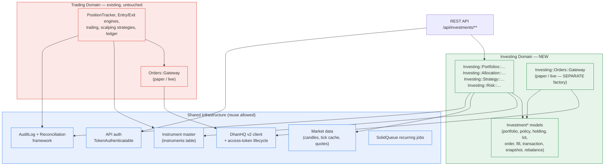
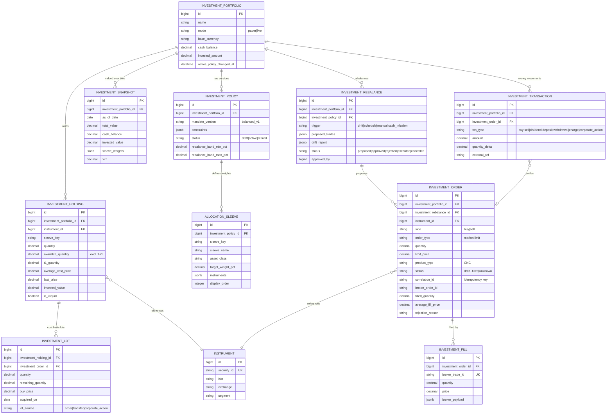
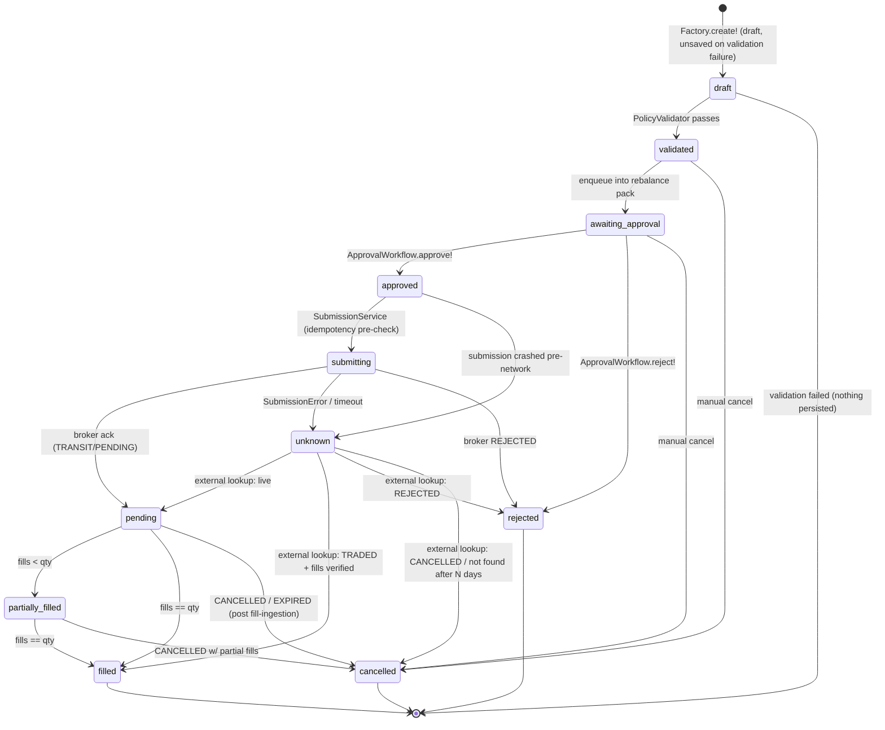

# Investment Management & Portfolio Module — Technical Design Document

| | |
|---|---|
| **Document** | `docs/investing/TECHNICAL_DESIGN.md` |
| **Status** | Draft for review |
| **Applies to** | `shubhamtaywade82/algo_scalper_api` (`develop`) |
| **Author** | Engineering (generated with Z.ai agent) |
| **Related** | FY2026-27 Investment Strategy Report (product input), PR #296 audit remediation, `docs/investing/SPIKE_NOTES.md` (companion) |
| **Last updated** | 2026-10-31 |

---

## Table of Contents

1. [Purpose, Scope and Non-Goals](#1-purpose-scope-and-non-goals)
2. [Architecture Overview](#2-architecture-overview)
3. [Domain Model and Entity Relationships](#3-domain-model-and-entity-relationships)
4. [Database Migrations (Full DDL)](#4-database-migrations-full-ddl)
5. [Configuration Schema — `config/investing.yml`](#5-configuration-schema--configinvestingyml)
6. [Service Contracts — Portfolios](#6-service-contracts--portfolios)
7. [Service Contracts — Allocation](#7-service-contracts--allocation)
8. [Service Contracts — Strategy (Selection)](#8-service-contracts--strategy-selection)
9. [Service Contracts — Risk (Policy Engine)](#9-service-contracts--risk-policy-engine)
10. [Service Contracts — Orders (incl. Gateway port/adapter)](#10-service-contracts--orders-incl-gateway-portadapter)
11. [DhanHQ v2 Adapter Specification](#11-dhanhq-v2-adapter-specification)
12. [Order State Machine](#12-order-state-machine)
13. [Execution Sequence — Rebalance → Approve → Execute](#13-execution-sequence--rebalance--approve--execute)
14. [Scheduled Jobs](#14-scheduled-jobs)
15. [REST API Specification](#15-rest-api-specification)
16. [RSpec Acceptance Matrix (per Phase)](#16-rspec-acceptance-matrix-per-phase)
17. [RSpec Skeletons (runnable)](#17-rspec-skeletons-runnable)
18. [Vertical Spike — Scope and Results](#18-vertical-spike--scope-and-results)
19. [Security, Audit and Regulatory Considerations](#19-security-audit-and-regulatory-considerations)
20. [Rollout Plan and Phase Gates](#20-rollout-plan-and-phase-gates)

- [Appendix A — Verified DhanHQ v2 API Reference](#appendix-a--verified-dhanhq-v2-api-reference)
- [Appendix B — Glossary](#appendix-b--glossary)

---

## 1. Purpose, Scope and Non-Goals

### 1.1 Purpose

This document specifies the **Investing domain**: a long-horizon (5–10 year) investment
management and portfolio module that lives alongside — but strictly separated from — the
existing **Trading domain** (intraday options scalping). Both domains share broker
connectivity (DhanHQ v2), the instrument master, market data, authentication and audit
infrastructure, and nothing else.

The module automates the *mechanics* of disciplined long-term investing:

- policy-driven strategic allocation across 11 sleeves,
- drift detection and rebalance **proposals** (never unilateral liquidation),
- multi-tranche deployment (3 equity tranches over 8–12 weeks, 6-month midcap STP),
- CNC delivery equity execution with manual approval gates,
- lot-level cost basis, corporate-action ingestion and dividend tracking,
- quarterly review packs and portfolio analytics (XIRR, CAGR, drawdown).

### 1.2 Scope

**In scope (MVP V1 — Phase 1–2):**

- `InvestmentPortfolio` + `InvestmentPolicy` + allocation sleeves, fully configurable.
- Allocation calculator: target vs actual weight, drift, rebalance deltas.
- Paper-order portfolio manager with manual approval workflow.
- Full REST API (12 endpoints) and dashboard components.
- Deterministic Ruby services only — every number in the system is reproducible.

**In scope (later phases, specified but gated):**

- Live CNC execution via DhanHQ v2 (gated on static-IP mandate — §11.8).
- eDIS-gated selling, holdings sync, dividend sync, quarterly review jobs.
- Risk engine stress scenarios (§9.5).

**Out of scope for this document:** mutual funds (no verified API — deferred,
§11.9), P2P lending, crypto, tax-loss harvesting automation, and any form of
autonomous stock picking (permanently out — §1.3).

### 1.3 Non-Goals (Architectural Commitments)

These are **permanently out of scope**, not merely deferred:

1. **No autonomous stock picking.** The system executes *user-approved* target
   portfolios. It may compute suggestions (candidates to reach a target weight) but
   never decides holdings unilaterally. An LLM, if used at all, is advisory only.
2. **No leverage, no derivatives, no intraday products in the Investing domain.**
   Equity delivery (CNC) plus the listed non-equity sleeves only.
3. **No auto-liquidation.** A breach of the equity band or any concentration limit
   produces a **rebalance proposal awaiting human approval** — never a market order.
   Worked example: actual equity drifts to 62% against a 50–60% band → the system
   *proposes* trimming ~2 pp into the cash/debt sleeve and awaits approval; it does
   not sell.
4. **No reuse of intraday exit machinery.** `PositionTracker`, trailing engines,
   exit enforcement, drawdown guards and every minutes-scale concern in
   `app/services/trading/*` and `app/services/orders/*` are off-limits to Investing
   code. Cross-domain reuse is limited to the shared infrastructure listed in §2.2.
5. **The LLM is never the accounting engine.** Quantities, cost basis, valuations,
   weights, drift and P&L are computed exclusively by deterministic Ruby services
   with RSpec-verified arithmetic (§16). LLM output may annotate, explain or suggest,
   and is stored as annotation — never as a source of record.

### 1.4 Success Criteria

| Criterion | Measure |
|---|---|
| Determinism | Every service is a pure function of (DB state, config, market prices); same inputs ⇒ same outputs; zero wall-clock/random dependence in calculation paths |
| Auditability | Every state change of an `InvestmentOrder` and every policy override writes an `AuditLog` row and (for live mode) a `ReconciliationRun` entry |
| Separation | Zero new references from `app/services/trading/**`, `app/models/position_tracker.rb` etc. into `Investing::*` (enforced by the architecture gate — §20.4) |
| Testability | Phase acceptance matrix (§16) fully green before each phase gate |
| Config-driven | The FY2026-27 strategic allocation ships as **config**, changeable without code changes; weights validated to sum to exactly 100 |

---

## 2. Architecture Overview

### 2.1 Two-Domain Map



**Reading the diagram.** Green is new; red is the existing options-scalping domain;
blue is shared. The only edges from green to red go through blue. There is **no direct
edge between the two domains** — an Investing service may never call
`Orders::GatewayLive`, and a Trading service may never read `investment_*` tables.

### 2.2 Explicit Shared-Surface Contract

| Shared asset | Rule for Investing |
|---|---|
| `Instrument` / `instruments` table | Read-only lookup by ISIN / security id. Investing never mutates instruments. |
| DhanHQ client config (`config/initializers/dhanhq_config.rb`) | Reused for credentials/env normalization. Investing adds its own thin adapter (§11), it does **not** reuse `Orders::GatewayLive` (whose semantics — market orders, MTF, margins — are scalping-specific). |
| Auth (`Api::TokenAuthenticatable`) | Same token tiers; new `investments:*` scope check (§19.1). |
| `AuditLog` | New `event_type` values (§19.3). |
| Reconciliation framework | New `Investing::Reconciler` following the `ReconciliationRun`/`ReconciliationDiscrepancy` conventions — separate rows, `mode: 'investing_live'`. |
| Market data (`candles`, tick caches) | Read-only price source for valuations. |
| SolidQueue | Own queue namespace `investing` (§14). |

### 2.3 Domain Boundaries in Code

```text
app/
  models/
    investment_portfolio.rb        investment_policy.rb
    investment_holding.rb          investment_lot.rb
    investment_order.rb            investment_fill.rb
    investment_transaction.rb      investment_snapshot.rb
    investment_rebalance.rb        allocation_sleeve.rb
  services/investing/
    portfolios/   # lifecycle, valuation, snapshot orchestration
    allocation/   # target vs actual, drift, rebalance deltas, tranches
    strategy/     # candidate selection to reach target weights (advisory)
    risk/         # policy validation, concentration limits, stress scenarios
    orders/       # order construction, gateway port + paper/live adapters
    analytics/    # XIRR, CAGR, drawdown, sleeve attribution
    reporting/    # quarterly review pack builder
  jobs/investing/
    holdings_sync_job.rb  portfolio_valuation_job.rb  rebalance_scan_job.rb
    dividend_sync_job.rb  quarterly_review_job.rb
  controllers/api/investments/
    portfolios_controller.rb  policies_controller.rb   holdings_controller.rb
    orders_controller.rb     rebalances_controller.rb
```

Naming rule: every Investing class lives under the `Investing::` service namespace or
the `Investment*` model prefix. All new tables start with `investment_` (plus
`allocation_sleeves`), so they are visually distinct in `schema.rb` and architectural
grepping is trivial: `rg "Investing::|Investment" app/services/trading app/models/position_tracker.rb`
must return nothing (CI-enforced, §20.4).

---

## 3. Domain Model and Entity Relationships

### 3.1 Aggregate Overview

| Aggregate root | Members | Invariants |
|---|---|---|
| `InvestmentPortfolio` | `InvestmentPolicy` (active + history), `InvestmentHolding` ×N, `InvestmentSnapshot` ×N, `InvestmentRebalance` ×N | Exactly one active policy; total value = Σ(holding qty × price) + cash; every holding belongs to exactly one sleeve |
| `InvestmentPolicy` | `AllocationSleeve` ×N | Sleeve weights sum to exactly 100; at most one policy `active` per portfolio |
| `InvestmentHolding` | `InvestmentLot` ×N | Σ lot quantities = holding quantity (T+1 aware); average cost = lot-weighted |
| `InvestmentOrder` | `InvestmentFill` ×N | Filled qty = Σ fill quantities (from broker trades, **never** from requested quantity); a sell cannot exceed available (non-T+1) quantity |
| `InvestmentRebalance` | proposed `InvestmentOrder` ×N | Orders exist only in `draft`/`awaiting_approval` while the rebalance is `proposed` |

Cash is modelled as a sleeve with weight, but its balance lives on the portfolio row
(`cash_balance`), updated only by `InvestmentTransaction` entries — the single
source of record for money movement.

### 3.2 ER Diagram



### 3.3 Key Modeling Decisions

**Why separate `InvestmentHolding` from `Instrument`.** The `instruments` table is the
*broker/exchange* view (one row per tradable contract, refreshed daily from the scrip
master). A *holding* is the *economic* view (one row per portfolio per ISIN, surviving
security-id changes, splits and symbol renames). They join on ISIN, not security id:
`InvestmentHolding → Instrument` via `instrument_id`, refreshed by
`Investing::Portfolios::InstrumentRefresher` when the scrip master changes
security ids (DhanHQ has remapped ids historically).

**Why lots.** LTCG/STCG taxation in India is lot-based (12-month holding for
preference), and "which shares am I selling" (FIFO) must be an explicit, auditable
choice. Each buy fill creates a lot; each sell consumes lots FIFO via
`Investing::Portfolios::LotReducer`.

**Why `correlation_id` is the idempotency key.** DhanHQ v2 accepts a client-generated
`correlationId` (≤ 30 chars) and exposes a lookup by it (`GET /v2/orders/external/{id}`,
Appendix A). We generate `INV-<portfolio_id>-<ulid>` per order attempt; the UNIQUE
index makes double-submission impossible even across process crashes.

**Why fills reference broker trades.** The broker's `/v2/trades` response is the only
authoritative fill record. `filled_quantity` on the order is a **derived cache**,
recomputed by reconciliation from `InvestmentFill` rows — never trusted from the
order-placement response alone (which may report `TRADED` before partial fills
arrive, or `TRANSIT` after a network timeout).

**Why cash is not a holding.** Cash cannot be lot-reduced, has no instrument, and
participates in every sleeve computation as the residual. Keeping it as a column
constrained by transactions avoids a special-case holding and keeps
`Σ(holding value) + cash = total value` a one-line invariant check.

---

## 4. Database Migrations (Full DDL)

All migrations are Rails 8.1 (`ActiveRecord::Migration[8.1]`), PostgreSQL-only, fully
reversible. Money columns follow the repo convention (`decimal(18,4)` for per-unit
prices and quantities, `decimal(18,2)` for amounts — matching `ledger_postings` at
18,2 and `charges_rupees` at 12,4). Percentages use `decimal(8,4)`.

### 4.1 Migration 1 — `create_investment_tables.rb`

```ruby
# frozen_string_literal: true

class CreateInvestmentTables < ActiveRecord::Migration[8.1]
  def change
    # ---------------------------------------------------------------- portfolios
    create_table :investment_portfolios do |t|
      t.string :name, null: false
      t.string :mode, null: false, default: 'paper'   # paper | live
      t.string :base_currency, null: false, default: 'INR'
      t.decimal :cash_balance, precision: 18, scale: 2, null: false, default: 0
      t.decimal :invested_amount, precision: 18, scale: 2, null: false, default: 0
      t.datetime :active_policy_changed_at
      t.jsonb :meta, null: false, default: {}
      t.timestamps
    end
    add_index :investment_portfolios, :mode
    add_index :investment_portfolios, :name, unique: true

    # ------------------------------------------------------------------- policy
    create_table :investment_policies do |t|
      t.references :investment_portfolio, null: false, foreign_key: true
      t.string :mandate_version, null: false                     # e.g. balanced_v1
      t.string :status, null: false, default: 'draft'            # draft|active|retired
      t.jsonb :constraints, null: false, default: {}             # §5 hard caps
      t.decimal :rebalance_band_min_pct, precision: 8, scale: 4, null: false, default: 50
      t.decimal :rebalance_band_max_pct, precision: 8, scale: 4, null: false, default: 60
      t.date :effective_from
      t.date :effective_to
      t.timestamps
    end
    add_index :investment_policies, [:investment_portfolio_id, :status]
    # exactly one active policy per portfolio (partial unique index)
    add_index :investment_policies, :investment_portfolio_id,
              unique: true,
              where: "status = 'active'",
              name: 'idx_investment_policies_one_active_per_portfolio'

    # ------------------------------------------------------------------ sleeves
    create_table :allocation_sleeves do |t|
      t.references :investment_policy, null: false, foreign_key: true
      t.string :sleeve_key, null: false        # stable slug, e.g. large_cap_core
      t.string :sleeve_name, null: false       # display, e.g. "Large-Cap Core (Nifty 100)"
      t.string :asset_class, null: false       # equity|debt|gold|cash|reit|invit|infra
      t.decimal :target_weight_pct, precision: 8, scale: 4, null: false
      t.jsonb :instruments, null: false, default: []   # ISIN allowlist (advisory)
      t.integer :display_order, null: false, default: 0
      t.timestamps
    end
    add_index :allocation_sleeves, [:investment_policy_id, :sleeve_key], unique: true

    # ----------------------------------------------------------------- holdings
    create_table :investment_holdings do |t|
      t.references :investment_portfolio, null: false, foreign_key: true
      t.references :instrument, null: false, foreign_key: true
      t.string :sleeve_key, null: false
      t.decimal :quantity, precision: 18, scale: 4, null: false, default: 0
      t.decimal :available_quantity, precision: 18, scale: 4, null: false, default: 0
      t.decimal :t1_quantity, precision: 18, scale: 4, null: false, default: 0
      t.decimal :average_cost_price, precision: 18, scale: 4, null: false, default: 0
      t.decimal :last_price, precision: 18, scale: 4, null: false, default: 0
      t.boolean :is_illiquid, null: false, default: false
      t.timestamps
    end
    add_index :investment_holdings,
              [:investment_portfolio_id, :instrument_id], unique: true
    add_index :investment_holdings, [:investment_portfolio_id, :sleeve_key]

    # ------------------------------------------- rebalances (before orders:
    # investment_orders carries an FK to it — table creation order matters)
    create_table :investment_rebalances do |t|
      t.references :investment_portfolio, null: false, foreign_key: true
      t.references :investment_policy, null: false, foreign_key: true
      t.string :trigger, null: false  # drift|schedule|manual|cash_infusion
      t.jsonb :proposed_trades, null: false, default: []
      t.jsonb :drift_report, null: false, default: {}
      t.string :status, null: false, default: 'proposed'
        # proposed|approved|rejected|executed|cancelled
      t.bigint :approved_by
      t.datetime :approved_at
      t.timestamps
    end
    add_index :investment_rebalances, [:investment_portfolio_id, :status]

    # ------------------------------------------------------------------- orders
    create_table :investment_orders do |t|
      t.references :investment_portfolio, null: false, foreign_key: true
      t.references :investment_rebalance, foreign_key: true
      t.references :instrument, null: false, foreign_key: true
      t.string :side, null: false                            # buy|sell
      t.string :order_type, null: false, default: 'market'   # market|limit
      t.decimal :quantity, precision: 18, scale: 4, null: false
      t.decimal :limit_price, precision: 18, scale: 4
      t.string :product_type, null: false, default: 'CNC'
      t.string :status, null: false, default: 'draft'        # §12 state machine
      t.string :correlation_id, null: false
      t.string :broker_order_id
      t.decimal :filled_quantity, precision: 18, scale: 4, null: false, default: 0
      t.decimal :average_fill_price, precision: 18, scale: 4, null: false, default: 0
      t.string :rejection_reason
      t.jsonb :broker_payload, null: false, default: {}
      t.timestamps
    end
    add_index :investment_orders, :correlation_id, unique: true
    add_index :investment_orders, [:investment_portfolio_id, :status]
    add_index :investment_orders, :broker_order_id
    add_index :investment_orders, :updated_at   # UNKNOWN sweeper scan window

    # --------------------------------------------------- lots (after orders:
    # FK to investment_orders)
    create_table :investment_lots do |t|
      t.references :investment_holding, null: false, foreign_key: true
      t.references :investment_order, foreign_key: true
      t.decimal :quantity, precision: 18, scale: 4, null: false
      t.decimal :remaining_quantity, precision: 18, scale: 4, null: false
      t.decimal :buy_price, precision: 18, scale: 4, null: false
      t.date :acquired_on, null: false
      t.string :lot_source, null: false, default: 'order'  # order|transfer|corporate_action
      t.timestamps
    end
    add_index :investment_lots, [:investment_holding_id, :acquired_on]  # FIFO scan

    # -------------------------------------------------------------------- fills
    create_table :investment_fills do |t|
      t.references :investment_order, null: false, foreign_key: true
      t.string :broker_trade_id, null: false
      t.decimal :quantity, precision: 18, scale: 4, null: false
      t.decimal :price, precision: 18, scale: 4, null: false
      t.jsonb :broker_payload, null: false, default: {}
      t.timestamps
    end
    add_index :investment_fills, :broker_trade_id, unique: true
    # note: no explicit add_index on investment_order_id — t.references
    # already creates index_investment_fills_on_investment_order_id

    # ------------------------------------------------------------ transactions
    create_table :investment_transactions do |t|
      t.references :investment_portfolio, null: false, foreign_key: true
      t.references :investment_order, foreign_key: true
      t.string :txn_type, null: false
        # buy|sell|dividend|deposit|withdrawal|charge|corporate_action
      t.decimal :amount, precision: 18, scale: 2, null: false
      t.decimal :quantity_delta, precision: 18, scale: 4, null: false, default: 0
      t.string :external_ref
      t.jsonb :meta, null: false, default: {}
      t.timestamps
    end
    add_index :investment_transactions, [:investment_portfolio_id, :created_at]

    # --------------------------------------------------------------- snapshots
    create_table :investment_snapshots do |t|
      t.references :investment_portfolio, null: false, foreign_key: true
      t.date :as_of_date, null: false
      t.decimal :total_value, precision: 18, scale: 2, null: false
      t.decimal :cash_balance, precision: 18, scale: 2, null: false
      t.decimal :invested_value, precision: 18, scale: 2, null: false
      t.jsonb :sleeve_weights, null: false, default: {}   # {sleeve_key => actual_pct}
      t.decimal :xirr, precision: 10, scale: 6
      t.timestamps
    end
    add_index :investment_snapshots, [:investment_portfolio_id, :as_of_date],
              unique: true
  end
end
```

> **Ordering lesson (spike-verified):** the first draft of this DDL created
> `investment_lots` before `investment_orders` and `investment_orders` before
> `investment_rebalances` — both FK targets didn't exist yet, and the migration
> failed mid-flight. The order above is dependency-correct: portfolios →
> policies → sleeves → holdings → rebalances → orders → lots → fills →
> transactions → snapshots.

### 4.2 Design Notes on the DDL

- **`investment_policies` partial unique index** enforces "one active policy" at the
  DB level, not just in service code — the same technique the repo uses for
  contract-identity uniqueness on `instruments`.
- **`allocation_sleeves.instruments` is a JSONB ISIN allowlist**, advisory to the
  selection service (§8), never a hard constraint: the user may hold any NSE-listed
  security within a sleeve; the policy caps (§9) are what's hard.
- **`investment_orders.correlation_id` UNIQUE** is the idempotency backbone (§12.5).
- **`investment_fills.broker_trade_id` UNIQUE** makes fill ingestion naturally
  idempotent (re-running the trades fetch after a crash cannot double-count).
- **No cross-domain foreign keys**: `instrument_id` is the only FK leaving the
  `investment_*` family, deliberately into shared infrastructure.
- **`updated_at` index on orders** supports the UNKNOWN-state sweeper (§12.4) that
  scans terminal-pending orders no older than the current trading day.

### 4.3 Rollback Notes

All tables are new; `down` is the implicit `drop_table` reversal. Deployment order
(migrate → deploy code) means old code never sees new tables, and new code treats
missing rows as "no portfolios yet". No data migration from `position_trackers` —
the domains are disjoint by design (§1.3.4).

---

## 5. Configuration Schema — `config/investing.yml`

A **separate file** from `config/algo.yml` (which is scalping-tuned and already 732
lines). Loaded by `config/initializers/investing_config.rb` into a frozen struct,
validated once at boot, fail-loud on malformed config (same philosophy as
`algo_config.rb`).

### 5.1 File

```yaml
---
# config/investing.yml — Investing domain configuration.
# NOTE: all percentages are numbers, not fractions (25 == 25%).
default: &default
  execution:
    mode: paper                  # paper | live  (Phase 4 flips this per-portfolio)
    require_manual_approval: true
    max_order_value_inr: 500000  # single-order hard ceiling (risk backstop)
    max_orders_per_day: 12
    market_open: "09:15"
    market_close: "15:30"
    no_trade_first_minutes: 15   # no orders in the opening auction window
    no_trade_last_minutes: 10

  mandates:
    balanced_v1:
      description: "FY2026-27 strategic allocation (illustrative default)"
      rebalance_band_pct: [50, 60]        # equity band
      sleeves:
        - key: large_cap_core
          name: "Large-Cap Core (Nifty 100)"
          asset_class: equity
          target_weight_pct: 25
        - key: mid_small_cap
          name: "Mid & Small Cap Growth"
          asset_class: equity
          target_weight_pct: 10
        - key: global_equity
          name: "Global Equity (international funds/ETFs)"
          asset_class: equity
          target_weight_pct: 10
        - key: thematic_tech_clean
          name: "Tech & Clean Energy"
          asset_class: equity
          target_weight_pct: 10
        - key: govt_aaa_bonds
          name: "Govt/AAA Bonds (G-Sec + SDL + AAA corp)"
          asset_class: debt
          target_weight_pct: 15
        - key: short_duration_debt
          name: "Short-Duration Debt / Liquid"
          asset_class: debt
          target_weight_pct: 10
        - key: reit_invit
          name: "REITs & InvITs"
          asset_class: reit
          target_weight_pct: 5
        - key: infra
          name: "Infrastructure"
          asset_class: infra
          target_weight_pct: 7
        - key: cash
          name: "Cash & Equivalents"
          asset_class: cash
          target_weight_pct: 5
        - key: gold_silver
          name: "Gold & Silver"
          asset_class: gold
          target_weight_pct: 3

      constraints:
        max_single_stock_pct: 2.5
        max_sector_pct: 12
        max_illiquid_pct: 25
        min_sleeve_holdings: 3     # a sleeve counts as "implemented" at ≥3 holdings

      rebalancing:
        review_cadence: quarterly
        drift_threshold_pct: 5     # absolute deviation triggers a proposal
        equity_band_pct: [50, 60]

      deployment:
        equity_tranches: 3
        tranche_spacing_weeks: 4   # 3 tranches over 8–12 weeks
        midcap_stp_months: 6       # mid/small-cap via 6-month STP

test:
  <<: *default

development:
  <<: *default

production:
  <<: *default
```

### 5.2 Validation Rules (boot-time, fail-loud)

The initializer (`Investing::Config.load!`) rejects the boot if any rule fails:

| Rule | Error |
|---|---|
| `sleeves` non-empty, unique `key`s, unique `display_order` | `Investing::ConfigError` |
| `Σ target_weight_pct == 100` exactly (BigDecimal comparison) | `Investing::ConfigError: sleeves must sum to exactly 100 (got 99.5)` |
| every `target_weight_pct` in `(0, 100]` | `Investing::ConfigError` |
| `rebalance_band_pct` sorted, within `[0, 100]`, band contains the sum of equity-sleeve weights | `Investing::ConfigError` |
| **Asset-class classification note**: `infra` is a real-assets class, not equity. The source report's 50–60% equity band brackets the pure-equity target of **55%** (large 25 + mid/small 10 + global 10 + thematic 10) exactly; counting infra (7%) would put the target at 62% — outside its own band. If infra should count as equity, widen the band in config — never in code. The spike's boot validator surfaces this class of inconsistency immediately. | `Investing::ConfigError` |
| `max_single_stock_pct ≤ max_sector_pct` | `Investing::ConfigError` |
| `equity_tranches ≥ 1`, `tranche_spacing_weeks ≥ 1` | `Investing::ConfigError` |
| `mode` ∈ {paper, live}; `live` refuses to boot unless `INVESTING_LIVE_CONFIRMED=yes` env is set (§19.2) | `Investing::ConfigError` |

The FY2026-27 weights above sum to exactly **100** (25+10+10+10+15+10+5+7+5+3). They
are the **illustrative default**; the strategic report is *input*, not law — changing
`config/investing.yml` and rebooting is the supported way to change strategy. Code
must never read these numbers (no `0.025` literals anywhere in `app/services/investing`).

---

## 6. Service Contracts — Portfolios

Module `Investing::Portfolios`. All services are POROs taking dependencies in the
constructor; all public methods are pure w.r.t. their arguments (DB reads allowed,
DB writes only in methods explicitly named `*!`). Errors are typed
(`Investing::ValidationError`, `Investing::TransitionError`, `Investing::InsufficientQuantity`,
`Investing::EdisGateError`), never bare `StandardError`, mirroring
`app/domain/errors.rb` conventions.

### 6.1 `Investing::Portfolios::Creator`

Creates a portfolio with its initial policy from a mandate name.

```ruby
module Investing
  module Portfolios
    class Creator
      # @param name [String]
      # @param mode [Symbol] :paper | :live  (paper only until Phase 4)
      # @param mandate [String] key into Investing::Config.mandates (e.g. "balanced_v1")
      # @param initial_cash [BigDecimal]
      # @return [InvestmentPortfolio]
      # @raise [Investing::ValidationError] on duplicate name / unknown mandate / live gate
      def call(name:, mode: :paper, mandate:, initial_cash:) end
    end
  end
end
```

Contract:

1. Runs in a transaction; creates portfolio, `InvestmentPolicy(status: 'active')`
   with sleeves materialized from config, and an opening `deposit` transaction.
2. Emits `AuditLog(event_type: 'investing_portfolio_created')`.
3. Refuses `mode: :live` unless the Phase-4 gate is open (§20).
4. `initial_cash` ≥ 0, BigDecimal-coerced; stores to paise precision.

### 6.2 `Investing::Portfolios::Valuer`

Deterministic valuation. Pure read.

```ruby
module Investing
  module Portfolios
    class Valuer
      # @param portfolio [InvestmentPortfolio]
      # @param prices [Hash{Integer=>BigDecimal}] instrument_id => price
      #        (caller-supplied so tests are hermetic; production source: §6.3)
      # @return [Investing::Portfolios::Valuation]
      def valuation(portfolio, prices: nil) end
    end
  end
end

# Returned struct (dry-struct-like immutable):
# Investing::Portfolios::Valuation
#   .total_value        BigDecimal  Σ(holding.quantity * last_price) + cash_balance
#   .cash_value         BigDecimal
#   .invested_value     BigDecimal  Σ(holding.quantity * last_price)
#   .cost_basis         BigDecimal  Σ(holding.quantity * average_cost_price)
#   .unrealized_pnl     BigDecimal  invested_value - cost_basis
#   .sleeve_weights     Hash{String=>BigDecimal} sleeve_key => actual weight pct (2dp)
#   .holding_values     Hash{Integer=>BigDecimal} holding_id => market value
```

Rules: any holding without a price uses `last_price` stored on the row (stale-tolerant
— long-horizon domain); a portfolio with zero holdings values to `cash_balance`;
weights are computed against `total_value` (not invested) so cash counts as its own
sleeve; rounding to 2dp happens only at the struct boundary, never mid-computation.

### 6.3 `Investing::Portfolios::PriceSource`

Read-only market-data facade. In production it resolves prices from the shared candle
cache/tick cache (latest daily close for equities); in tests it is stubbed. One
method: `prices_for(instrument_ids) -> Hash{Integer=>BigDecimal}`. It never raises on
missing prices — it omits the key (Valuer's stale-price rule handles it).

### 6.4 `Investing::Portfolios::Snapshotter`

Persists a daily valuation.

```ruby
module Investing
  module Portfolios
    class Snapshotter
      # @param date [Date] defaults to the caller's business date (IST)
      # @return [InvestmentSnapshot] upserted by [portfolio, as_of_date]
      def snapshot!(portfolio, date: ) end
    end
  end
end
```

Idempotent: re-running the same date overwrites the row (unique index upsert). This is
the ONLY writer of `investment_snapshots`.

### 6.5 `Investing::Portfolios::LotReducer`

FIFO lot consumption on sells / the accounting heart of cost basis.

```ruby
module Investing
  module Portfolios
    class LotReducer
      # @param holding [InvestmentHolding]
      # @param quantity [BigDecimal] quantity being sold (must be ≤ available_quantity)
      # @param trade_date [Date]
      # @return [Array<LotConsumption>] lots consumed, oldest acquired_on first,
      #        ties broken by lot id (deterministic ordering)
      # @raise [Investing::InsufficientQuantity] if quantity > available (excl. T+1)
      def consume_fifo!(holding, quantity:, trade_date:) end
    end
  end
end
```

Determinism rule: ordering is `(acquired_on, id)` ASC — never DB default order, never
random. A lot is never partially consumed twice for the same fill (consumption happens
inside the fill-ingestion transaction, §10.4).

### 6.6 `Investing::Portfolios::HoldingsImporter` (Phase 3)

Reconciles broker holdings (`GET /v2/holdings`, Appendix A) into local holdings +
lots. Creates `transfer`-source lots for pre-existing broker positions with the
broker's `avgCostPrice`. Produces a diff report (`added`, `quantity_changed`,
`price_changed`) and writes `ReconciliationRun(mode: 'investing_live')` — the broker
remains authoritative for holdings that predate the module (§1.3, protection 4).

---

## 7. Service Contracts — Allocation

Module `Investing::Allocation`. This is the mathematical core of the module and the
subject of the vertical spike (§18). Everything here is pure computation — no DB
writes, no wall clock, no network.

### 7.1 `Investing::Allocation::Calculator`

```ruby
module Investing
  module Allocation
    class Calculator
      # @param sleeves [Array<AllocationSleeve>] policy sleeves (target weights)
      # @param valuation [Investing::Portfolios::Valuation] current valuation
      # @return [Investing::Allocation::Report]
      def report(sleeves, valuation) end
    end
  end
end

# Investing::Allocation::Report (immutable)
#   .rows               Array<Row>  one per sleeve + synthetic cash row if unallocated
#   .equity_weight_pct  BigDecimal  Σ actual weights of asset_class == 'equity'
#   .within_equity_band? Boolean
#   .breached_sleeves   Array<Row>  |drift| >= drift_threshold_pct
#   .to_h               serializable hash (for InvestmentRebalance.drift_report)
#
# Row:
#   .sleeve_key, .sleeve_name, .asset_class
#   .target_value   BigDecimal  target_pct/100 * total_value
#   .actual_value   BigDecimal
#   .target_pct, .actual_pct   BigDecimal (2dp at boundary)
#   .drift_pct      BigDecimal  actual_pct - target_pct
#   .delta_value    BigDecimal  actual_value - target_value  (negative ⇒ buy)
```

Computation rules (all BigDecimal, rounding only at the struct boundary):

1. `actual_pct(sleeve) = actual_value(sleeve) / total_value * 100`, where
   `actual_value(sleeve) = Σ holding values of holdings with that sleeve_key`.
2. Cash is attributed to the `cash` sleeve **and** to the sleeves' denominators:
   uninvested money shows up as cash-sleeve overweight. There is no hidden
   normalization that forces Σ actual_pct = 100 — it follows from the definition
   (Σ holding values + cash = total value) and is asserted in specs.
3. A sleeve with no holdings has `actual_pct = 0`, `drift_pct = -target_pct`.
4. `equity_weight_pct` = total weight of sleeves with `asset_class == 'equity'`
   (computed from raw values — see rule 6).
5. `within_equity_band? = band_min ≤ equity_weight_pct ≤ band_max` (inclusive).
6. **Rounding boundary semantics** (single source of truth): every reported
   percentage — row `actual_pct`, `target_pct`, `drift_pct`,
   `equity_weight_pct` — is the exact quotient rounded **half-up to 2 dp**, and
   the band comparison uses the *rounded* `equity_weight_pct` (so what the
   dashboard shows is what the guard enforced: 60.001% reports as 60.00 and is
   *in* band; 60.005% reports as 60.01 and is *out*). `equity_weight_pct` is
   computed from raw sleeve **values** (`Σ equity sleeve values / total × 100`),
   never by re-summing rounded row percentages.

### 7.2 `Investing::Allocation::RebalancePlanner`

Turns a `Report` into a **proposal** — never executes anything.

```ruby
module Investing
  module Allocation
    class RebalancePlanner
      # @param report [Report]
      # @param portfolio [InvestmentPortfolio]
      # @param policy [InvestmentPolicy]
      # @param cash_inflows [BigDecimal] money waiting to be deployed (optional)
      # @return [Investing::Allocation::Plan]
      def plan(report, portfolio:, policy:, cash_inflows: 0) end
    end
  end
end

# Plan:
#   .trades  Array<ProposedTrade>
#     .sleeve_key, .side (:buy|:sell), .amount BigDecimal (value, not qty),
#     .rationale String (e.g. "equity 62.0% > band max 60.0%; trim 2.0pp")
#   .tranche_assignments Hash{sleeve_key => Integer}  which tranche (1..N)
#   .deployable_now BigDecimal  cash usable after reserving tranches 2..N
```

Planning rules:

- **Buys first, funded by cash + new inflows; sells only when a sleeve is over band
  AND the equity band itself is breached** (the 62% example: trim only enough to
  return *inside* the band, minus a 0.5 pp buffer, never to target — rebalancing to
  target is a quarterly-review decision, §7.3).
- **Tranche splitting**: total equity buy amount is split into
  `equity_tranches` tranches; tranche 1 is deployable now, tranches 2..N are parked
  (recorded in the plan, released by `Investing::Allocation::TrancheScheduler` when
  their week arrives — 3 tranches at 4-week spacing = 8–12 weeks of deployment).
- **Mid/small-cap STP**: `mid_small_cap` sleeve buys are *always* tranche-split
  across `midcap_stp_months` (6) monthly slices, regardless of the tranche count,
  per the mandate's STP discipline.
- **Lot-size awareness**: proposed amounts are rounded down to whole shares
  (multiples of the instrument's `lot_size`, which is 1 for NSE equities) at order
  construction time (§10.2), not in the planner — the planner stays in value space.
- A plan with `trades: []` is valid ("no action needed" is a reportable outcome).

### 7.3 `Investing::Allocation::QuarterlyReviewer` (Phase 5)

Builds the review pack: current weights vs target, realized/unrealized P&L by sleeve,
XIRR vs benchmark, drift history from snapshots, and a **recommendation** on whether
to rebalance to target (as opposed to band-trimming). Output is a JSON payload +
markdown summary for the dashboard; acting on it still requires the full
rebalance → approve flow.

---

## 8. Service Contracts — Strategy (Selection)

Module `Investing::Strategy`. **Advisory only** (§1.3.1): these services propose
*which instruments* could implement a sleeve target; the user chooses. They never
place orders and their output is stored as annotation on the rebalance proposal.

### 8.1 `Investing::Strategy::CandidateScreener`

```ruby
module Investing
  module Strategy
    class CandidateScreener
      # @param sleeve [AllocationSleeve]
      # @param instruments [Array<Instrument>] pre-filtered by caller
      #        (NSE_EQ, CNC-eligible, active)
      # @param prices [Hash{Integer=>BigDecimal}]
      # @param opts [Hash] { min_avg_daily_value_inr:, exclude: [isin] }
      # @return [Array<Candidate>]
      #   .instrument, .score (0..1), .reasons [String]
      def screen(sleeve, instruments, prices:, **opts) end
    end
  end
end
```

Screening is **rule-based and deterministic** (liquidity floor via average daily
traded value, index membership tags from the scrip master `SEM_CUSTOM_SYMBOL`
columns, sleeve-key heuristics). Scores are stable sort keys
`(score DESC, security_id ASC)` — no randomness, no wall clock, no LLM in the loop.
An optional `Investing::Strategy::LlmAnnotator` (Phase 6, behind a feature flag)
attaches natural-language rationale to candidates; its output is stored in
`InvestmentRebalance.drift_report["llm_annotations"]` and is **never** an input to
any calculator, planner or order.

### 8.2 `Investing::Strategy::PortfolioCompleter` (Phase 6)

Given a rebalance plan and current holdings, proposes the minimal set of new holdings
to reach sleeve `min_sleeve_holdings` (diversification floor). Same advisory rules.

---

## 9. Service Contracts — Risk (Policy Engine)

Module `Investing::Risk`.

### 9.1 `Investing::Risk::PolicyValidator`

Pre-trade gate. Runs inside the order-construction transaction (§10.2).

```ruby
module Investing
  module Risk
    class PolicyValidator
      # @param portfolio [InvestmentPortfolio]
      # @param order [InvestmentOrder] unsaved draft
      # @return [Investing::Risk::CheckResult]
      #   .ok? Boolean
      #   .violations Array<Violation>
      #     .rule (:max_single_stock|:max_sector|:max_illiquid|:equity_band|
      #            :max_order_value|:max_orders_per_day|:sleeve_unknown|
      #            :insufficient_available_qty)
      #     .message, .actual, .limit
      def check(portfolio:, order:) end
    end
  end
end
```

Hard constraints (from policy `constraints` + `execution` config):

| Rule | Check |
|---|---|
| `max_single_stock_pct` | projected post-trade weight of that ISIN ≤ 2.5% |
| `max_sector_pct` | projected sleeve+sector bucket weight ≤ 12% |
| `max_illiquid_pct` | Σ projected weights of `is_illiquid` holdings ≤ 25% |
| `equity_band_pct` | projected total equity weight ∈ [50, 60] *when buying equity*; sells that would push equity **below** band are also blocked (symmetric guard) |
| `max_order_value_inr` | order value ≤ 500,000 (config backstop) |
| `max_orders_per_day` | count of today's non-cancelled orders < 12 |
| `insufficient_available_qty` | sells ≤ `available_quantity` (T+1 excluded) |

Every violation is also written to `AuditLog(event_type: 'investing_policy_violation',
payload: violations)` — even when the caller is the paper gateway.

### 9.2 `Investing::Risk::EdisGate` (Phase 4)

Blocking pre-condition for every SELL in live mode:

```ruby
module Investing
  module Risk
    class EdisGate
      # @param order [InvestmentOrder] side == 'sell'
      # @param adapter [Investing::Orders::DhanHQ::Adapter] (test double in specs)
      # @return [Investing::Risk::EdisPermit] .granted?, .aprvd_qty, :status
      # @raise [Investing::EdisGateError] on broker transport failure (fail-closed)
      def authorize!(order, adapter:) end
    end
  end
end
```

Flow: generate TPIN session (`GET /edis/tpin`) → submit eDIS form for
`(isin, qty, exchange: NSE, segment: EQUITY)` (`POST /edis/form`) → poll
`GET /edis/inquire/{isin}` until `aprvd_qty ≥ qty` or timeout (market-hours only).
Fail-closed: any transport error, or `aprvd_qty < qty` at timeout ⇒ the sell order
stays in `awaiting_approval` with `rejection_reason: 'edis_not_approved'`. The
paper adapter stubs `granted? = true`.

### 9.3 `Investing::Risk::DriftMonitor`

Daily job helper (§14): runs the calculator, compares against `drift_threshold_pct`,
and opens an `InvestmentRebalance(trigger: 'drift')` when any sleeve breaches or the
equity band is exited. One open drift rebalance per portfolio at a time
(enforced in service, checked by spec).

### 9.4 `Investing::Risk::StressTester` (Phase 5)

Deterministic scenario engine over the current valuation:

| Scenario | Shock |
|---|---|
| `nifty_drawdown_30` | equity sleeves −30%, REITs/InvITs −25%, debt +2% (flight to safety), gold +5% |
| `rate_shock_150bp` | long bonds −8%, short debt −1.5%, equity −10% |
| `inr_depreciation_5` | global-equity sleeve +5% (INR terms), import-heavy infra −3%, rest flat |

Output: per-sleeve and total post-shock values, max drawdown vs cost basis, and a
cash-call number (negative cash path). Pure function of (valuation, scenario table);
scenario parameters live in config (§5 extension point), not code.

### 9.5 `Investing::Risk::KillSwitch`

Manual-only (dashboard button) → halts new order submission for the portfolio
(`execution.paused = true` in `meta`), leaves existing orders to settle, writes
`AuditLog(event_type: 'investing_kill_switch_trip')`. Distinct from the Trading
domain's kill switch — no shared state.

---

## 10. Service Contracts — Orders (incl. Gateway port/adapter)

Module `Investing::Orders`. Mirrors the Trading domain's `Orders::Gateway` port
pattern (`app/services/orders/gateway.rb` + `gateway_factory.rb`) but with an
**independent hierarchy** — the interfaces differ because the semantics differ
(CNC delivery, T+1 availability, eDIS gating, approval workflow, no exit-engine
concept).

### 10.1 `Investing::Orders::Gateway` (the port)

```ruby
module Investing
  module Orders
    class Gateway
      # Submit a validated, approved order to the broker (or paper simulator).
      # @param order [InvestmentOrder] status must be 'approved'
      # @return [Hash] { broker_order_id: String, broker_status: String,
      #                  raw: Hash }  raw is the untouched broker JSON
      # @raise [Investing::SubmissionError] transport-level failure — order stays
      #        in 'submitting'/'unknown', never silently rolled back (§12.5)
      def submit(order) = raise NotImplementedError

      # Authoritative status by correlation id (UNKNOWN resolution path).
      # @return [Hash] { broker_status:, filled_quantity:, raw: } or {} if not found
      def order_by_correlation(correlation_id) = raise NotImplementedError

      # Authoritative fills by broker order id.
      # @return [Array<Hash>] [{broker_trade_id:, quantity:, price:, raw:}]
      def trades_for(broker_order_id) = raise NotImplementedError

      # Funds available for CNC buys.
      # @return [Hash] { available: BigDecimal, withdrawable: BigDecimal, raw: Hash }
      def funds = raise NotImplementedError

      # eDIS surface (Phase 4; paper adapter returns granted permits).
      def edis = raise NotImplementedError
    end
  end
end
```

### 10.2 `Investing::Orders::Factory` (order construction + validation)

```ruby
module Investing
  module Orders
    class Factory
      # @param portfolio [InvestmentPortfolio]
      # @param instrument [Instrument] must be NSE_EQ / CNC-eligible / tradable
      # @param side [Symbol] :buy | :sell
      # @param amount [BigDecimal] value to trade (buy) — OR —
      # @param quantity [BigDecimal] shares (sell)
      # @param price [BigDecimal, nil] nil ⇒ market order
      # @param rebalance [InvestmentRebalance, nil]
      # @return [InvestmentOrder] persisted with status 'validated'
      # @raise [Investing::ValidationError] (no order persisted)
      def create!(portfolio:, instrument:, side:, amount: nil, quantity: nil,
                  price: nil, rebalance: nil) end
    end
  end
end
```

Steps, in one transaction: resolve instrument eligibility → compute quantity
(amount ÷ price, floored to whole `lot_size` for NSE equities; `amount:` and
`quantity:` are mutually exclusive) → generate `correlation_id` → build draft →
run `Investing::Risk::PolicyValidator` → on success transition
`draft → validated` and persist → on failure raise with violations attached (order
**not** persisted; violations only in the exception + audit log). Limit orders
require `price`; market orders ignore it.

### 10.3 `Investing::Orders::ApprovalWorkflow`

```ruby
module Investing
  module Orders
    class ApprovalWorkflow
      # @param orders [Array<InvestmentOrder>] each in 'awaiting_approval'
      # @param approver [String] identity for the audit trail
      # @return [Array<InvestmentOrder>] now 'approved'
      # @raise [Investing::TransitionError] if any order is not awaiting_approval
      def approve!(orders, approver:) end

      def reject!(orders, approver:, reason:) end   # → 'rejected'
    end
  end
end
```

Bulk approve is a single transaction (all-or-nothing) — the reviewer sees one
rebalance pack, not twelve independent confirmations. `approver` is recorded on the
rebalance (`approved_by/at`) and in the audit log.

### 10.4 `Investing::Orders::SubmissionService`

Owns the `approved → submitting → (terminal | unknown)` arc (§12):

1. Idempotency pre-check: any existing order with this `correlation_id` already in
   `submitting/pending/partially_filled/filled` ⇒ return that order, no resubmit.
2. Transition to `submitting`, then `gateway.submit(order)`.
3. On response: map `broker_status` through the table in §12.3; persist
   `broker_order_id` and `broker_payload`.
4. On `Investing::SubmissionError`: transition to `unknown` (never back to
   `approved` — the order may or may not exist at the broker; resolution is the
   sweeper's job, §12.4).
5. Fill ingestion (separate transaction per order): `gateway.trades_for` → upsert
   `InvestmentFill` by `broker_trade_id` → recompute `filled_quantity`/
   `average_fill_price` from fills → apply holding/lot/cash mutations via
   `Investing::Portfolios::LotReducer` and write the `buy`/`sell`
   `InvestmentTransaction`. **Fills drive state; the order-placement response
   never marks anything `filled` on its own.**

### 10.5 `Investing::Orders::PaperGateway` (the paper adapter)

Simulates a cooperative broker deterministically:

- `submit` returns `broker_order_id: "PAPER-<correlation_id>"`,
  `broker_status: 'PENDING'` (paper fills happen at valuation time — see below).
- Fill generation happens in `Investing::Orders::PaperFillSimulator`: on the next
  `PortfolioValuationJob` run (or immediately when `execution.paper_instant_fill:
  true` in tests), one fill is created at the PriceSource price. No randomness, no
  slippage model in V1 (a configurable flat bps slippage is a documented extension).
- `funds` reads the portfolio's `cash_balance` through the same struct the live
  adapter returns, so downstream code cannot tell which mode it is in.
- `edis` always grants.

### 10.6 `Investing::Orders::DhanHQ::Gateway` (the live adapter, Phase 4)

Thin: parameter normalization (§11), error mapping, zero business logic. All
business rules live behind the port so the adapter stays swappable/testable.

### 10.7 `Investing::Orders::GatewayFactory`

```ruby
module Investing
  module Orders
    class GatewayFactory
      # @param mode [Symbol, nil] nil ⇒ Investing::Config.execution.mode
      # @return [Investing::Orders::Gateway]
      def self.build(mode: nil) end
    end
  end
end
```

Deliberately **does not** read `AlgoConfig.paper_trading.enabled` — the Trading
domain's paper flag must never affect Investing and vice versa (§1.3.4,
protection 1).

---

## 11. DhanHQ v2 Adapter Specification

All endpoint facts below were **verified against the live DhanHQ v2 REST
documentation** (sources in Appendix A) during the design of this document. The
adapter (`Investing::Orders::DhanHQ::Adapter`) wraps the existing `DhanHQ` gem's
HTTP plumbing where possible but **owns** normalization, because the gem's
higher-level order helpers carry intraday semantics we do not want.

### 11.1 Transport & Auth

| Aspect | Contract |
|---|---|
| Base URL | `https://api.dhan.co` (config: `DHAN_BASE_URL`, sandbox via `DHANHQ_SANDBOX`) |
| Auth header | `access-token: <token>` + `client-id: <dhan_client_id>` (normalized by `dhanhq_config.rb`) |
| Token lifecycle | v2.4 (Sep 2025): API key + secret (1-year) exchanged for a daily **access token (24 h max validity)**. Token bootstrap/refresh already handled by the existing `DhanAccessToken` model + `dhan_token_bootstrap.rb` initializer — reused as-is. |
| Content type | `application/json`, camelCase body keys |
| Idempotency | client-generated `correlationId` (≤ 30 chars, `[a-zA-Z0-9 _-]`); every place/m_modify also returns it; lookup by it via `/v2/orders/external/{correlation-id}` |
| Rate limits | Dhan-side throttling is mapped to `Investing::SubmissionError` with `retryable: true`; the service retries at most once, then parks the order in `unknown` |

### 11.2 Order Placement — `POST /v2/orders`

Request (adapter-normalized field names → broker names):

| Our field | Broker field | Investing value |
|---|---|---|
| `order.correlation_id` | `correlationId` | `INV-<portfolio>-<ulid>` |
| — | `dhanClientId` | from token bootstrap |
| `order.side` | `transactionType` | `BUY` / `SELL` |
| — | `exchangeSegment` | `NSE_EQ` (equities only in V1) |
| — | `productType` | **`CNC`** (delivery) — never `MARGIN`/`MTF`/`BO`/`CO` |
| `order.order_type` | `orderType` | `MARKET` / `LIMIT` |
| `order.limit_price` | `price` | required iff LIMIT |
| — | `validity` | `DAY` (`IOC` allowed for LIMIT only, config-gated off in V1) |
| `instrument.security_id` | `securityId` | from `instruments` master |
| computed qty | `quantity` | whole shares (floored at Factory) |
| — | `afterMarketOrder` | `false` always |

Response: `{ orderId, orderStatus, correlationId? }` — persisted verbatim into
`broker_payload`.

### 11.3 Status Vocabulary & Mapping

Broker states: `TRANSIT`, `PENDING`, `REJECTED`, `CANCELLED`, `PART_TRADED`,
`TRADED`, `EXPIRED`.

| Broker | Our `InvestmentOrder.status` | Notes |
|---|---|---|
| `TRANSIT` | `pending` | keep polling |
| `PENDING` | `pending` | resting at exchange |
| `PART_TRADED` | `partially_filled` | fills must exist before this is trusted |
| `TRADED` | `filled` **only after** `Σ fills == quantity` | see §10.4.5 |
| `REJECTED` | `rejected` | capture `rejection_reason` from `remarks`/payload |
| `CANCELLED` | `cancelled` | partial fills may still exist — ingest first, then transition |
| `EXPIRED` | `cancelled` | day-order expiry; same partial-fill caveat |
| (timeout / network error / unknown string) | `unknown` | §12.4 resolution |

### 11.4 Fills & Trades — `GET /v2/trades/{order-id}`

Returns per-trade `{ tradeId, exchangeTradeId, tradedQuantity, tradedPrice,
transactionTime, … }`. Adapter maps `exchangeTradeId → broker_trade_id` (unique in
`investment_fills`), `tradedQuantity → quantity`, `tradedPrice → price`.
Trade-level charges (`brokerage`, `gst`, `stt`, …) when present are summed into the
`charge` `InvestmentTransaction` rows on ingestion day.

### 11.5 Holdings — `GET /v2/holdings` (Phase 3)

Per-security: `totalQty`, `dpQty` (demat), `t1Qty` (unsettled buys),
`availableQty` (sellable), `collateralQty`, `avgCostPrice`, `isin`, `securityId`,
`currentValue`, `investedValue`, `dayGainPnL`. Mapping:
`t1_quantity = t1Qty`, `available_quantity = availableQty`,
`quantity = totalQty`; ISIN joins to `instruments` (master refresh first when
`securityId` is unknown — Appendix A.6).

### 11.6 Funds — `GET /v2/fundlimit`

`{ availabelBalance, sodLimit, withdrawableBalance, collateralAmount, … }` — note
**`availabelBalance` is Dhan's documented misspelling**; the adapter normalizes it
to `available` in the `funds` struct and adds a regression spec pinning the
misspelling so a "fix" on either side cannot silently break parsing.

### 11.7 eDIS (CDSL) — SELL gate (Phase 4)

`GET /edis/tpin` (202 + session establishment) → `POST /edis/form` with
`{ isin, qty, exchange: 'NSE', segment: 'EQUITY', bulk: false }` → returns
`edisFormHtml` (rendered to the user for CDSL authorization) → poll
`GET /edis/inquire/{isin}` → `{ aprvdQty, status }` until `aprvdQty ≥ qty` /
timeout. Every live SELL passes `Investing::Risk::EdisGate` **before** submission
(§9.2). Paper mode stubs this.

### 11.8 Static-IP Mandate (Phase-4 hard gate)

DhanHQ v2.4 requires a **whitelisted static IP for place/modify/cancel** endpoints.
Read-only endpoints (orders/trades/holdings/funds) work without it. Consequence for
rollout: Phase 3 (sync/valuation on live data) can ship first; Phase 4 (live order
submission) ships only after the deployment's egress IP is stable and whitelisted
in the DhanHQ self-care portal. The adapter marks itself
`submission_capable: false` until `INVESTING_DHAN_STATIC_IP_READY=yes` is set —
submit attempts in that state raise `Investing::SubmissionError` without a network
call.

### 11.9 Deferred: Mutual Funds

DhanHQ's MF endpoints are not part of the verified v2 public surface; the
FY2026-27 report's MF sleeves map to ETF proxies (`gold_silver` → Gold/Silver ETFs
on NSE) for V1. MF-of-ETF substitution is recorded per-sleeve in
`AllocationSleeve.instruments` notes. Direct MF purchase/ redemption is a future
phase gated on verified API availability.

---

## 12. Order State Machine

### 12.1 Diagram



### 12.2 Transition Table (guards & side effects)

| From | Event | Guard | Side effects |
|---|---|---|---|
| draft | validate | PolicyValidator.ok? | persist, audit `investing_order_created` |
| validated | submit_for_approval | — | attach to rebalance |
| awaiting_approval | approve | approver present | `approved_by/at` on rebalance, audit `investing_order_approved` |
| awaiting_approval | reject | reason present | audit `investing_order_rejected` |
| approved → submitting | submit | no live order with this `correlation_id`; (live) eDIS granted for sells | call gateway; save `broker_order_id` |
| submitting | broker_ack | broker response present | map §11.3 |
| any non-terminal | cancel | no filled qty, or user confirms partial-cancel | broker cancel (live), audit |
| unknown | resolve | external lookup result | audit `investing_order_resolved` with evidence payload |
| pending/partially_filled | fill_ingested | recompute from fills | lots, holdings, cash, transactions |

State machine implementation: **explicit `Investing::Orders::StateMachine`** PORO
(same pattern as Trading's `Orders::Fsm`) — transitions are data (a frozen hash),
not AASM (the repo deliberately removed the AASM-based `OrderIntent` in the #296
dead-code pass; we keep that lesson: no gem dependency, fully explicit guards).

### 12.3 Invariants (spec-enforced)

1. No transition skips `awaiting_approval` when
   `execution.require_manual_approval` is true (the only bypass: approval itself).
2. `filled_quantity` changes **only** inside fill ingestion.
3. A `filled` order satisfies `Σ(fills.quantity) == quantity` exactly.
4. Terminal states (`filled`, `rejected`, `cancelled`) are immutable.
5. Every transition writes exactly one `AuditLog` row
   (`investing_order_transition`, payload: `{from, to, order_id, by}`).

### 12.4 UNKNOWN Resolution (sweeper)

`Investing::Orders::UnknownResolver` (invoked by `RebalanceScanJob` every 5 min
during market hours, §14):

1. Select orders `status: 'unknown' AND updated_at > market open today`.
2. For each: `gateway.order_by_correlation(correlation_id)` →
   `GET /v2/orders/external/{id}`.
3. Found → apply §11.3 mapping + ingest fills → terminal state; not found and
   `updated_at` older than N=3 trading days → `cancelled` with
   `rejection_reason: 'unconfirmed_at_broker'` + escalation flag in the drift
   report. **Never auto-resubmit** — resubmission is a human decision (new order,
   new correlation id, fresh approval).

### 12.5 Crash-Safety Argument

The danger window is between `transition!(submitting)` and the broker response. We
accept duplicates only via the broker's own idempotency: the same
`correlation_id` replayed to `POST /v2/orders` is rejected/returned as the existing
order by DhanHQ. Local `UNIQUE(correlation_id)` prevents two *different* orders from
ever sharing a correlation id. Combined, at-least-once submission + broker-side
idempotency + fill-level `UNIQUE(broker_trade_id)` gives effectively-once semantics
with no distributed transaction.

---

## 13. Execution Sequence — Rebalance → Approve → Execute

```mermaid
sequenceDiagram
    autonumber
    participant Job as RebalanceScanJob<br/>(or manual trigger)
    participant Calc as Investing::Allocation::Calculator
    participant Plan as Investing::Allocation::RebalancePlanner
    participant Risk as Investing::Risk::PolicyValidator
    participant DB as InvestmentRebalance /<br/>InvestmentOrder (DB)
    participant User as Approver (dashboard)
    participant Sub as Investing::Orders::SubmissionService
    participant GW as Investing::Orders::Gateway<br/>(paper | DhanHQ live)
    participant Broker as DhanHQ v2

    Job->>Calc: sleeves + today's valuation
    Calc-->>Job: Report (weights, drift, band status)
    alt equity band breached OR sleeve drift ≥ threshold
        Job->>Plan: plan(report, portfolio, policy)
        Plan-->>Job: Plan(trades, tranche assignments)
        Job->>DB: create InvestmentRebalance(status: proposed,<br/>drift_report, proposed_trades)
        Job->>DB: create InvestmentOrders(status: draft) per trade
        loop each draft order
            Job->>Risk: check(portfolio, order)
            Risk-->>Job: ok / violations
            alt ok
                Job->>DB: order → validated → awaiting_approval
            else violations
                Job->>DB: drop order + audit policy_violation
            end
        end
        Job-->>User: dashboard notification: rebalance pack ready
        User->>DB: review pack → approve (ApprovalWorkflow)
        DB-->>User: orders → approved; rebalance.approved_by/at
        loop tranche-1 orders only
            User->>Sub: submit (or auto-submitter for approved tranche)
            Sub->>Sub: idempotency pre-check (correlation_id)
            Sub->>DB: order → submitting
            Sub->>GW: submit(order)
            alt paper mode
                GW-->>Sub: PAPER ack (PENDING)
            else live mode
                GW->>Broker: POST /v2/orders (CNC, correlationId)
                Broker-->>GW: { orderId, orderStatus }
                GW-->>Sub: normalized { broker_order_id, broker_status }
            end
            Sub->>DB: map status (§11.3); save broker_payload
        end
        par fill ingestion (per order)
            Sub->>GW: trades_for(broker_order_id)
            GW->>Broker: GET /v2/trades/{order-id}
            Broker-->>GW: tradedQuantity, tradedPrice, exchangeTradeId
            Sub->>DB: upsert InvestmentFill (UNIQUE broker_trade_id)
            Sub->>DB: recompute filled_quantity/avg price from fills
            Sub->>DB: LotReducer FIFO → holdings/lots/cash/transactions
        and UNKNOWN sweeper
            Sub->>GW: order_by_correlation(id)
            GW->>Broker: GET /v2/orders/external/{correlation-id}
            Broker-->>GW: authoritative order object
            Sub->>DB: resolve unknown → terminal state + audit
        end
    else within band & no breach
        Job-->>Job: no rebalance (log-only)
    end
```

Two hard rules are visible in the flow: (a) **nothing reaches the broker without a
human approval in between** (steps "review pack → approve"), and (b) **fills and
authoritative status always come from broker reads** (trades/external lookup), never
from the submission response alone.

---

## 14. Scheduled Jobs

All jobs live in `app/jobs/investing/`, queue `investing` (new SolidQueue queue,
registered in `config/queue.yml`), scheduled in `config/recurring.yml` (IST times,
market-aware guards inside each job — jobs no-op outside market hours/days except
where noted).

| Job | Schedule (IST) | Purpose | Phase |
|---|---|---|---|
| `Investing::HoldingsSyncJob` | 08:55 daily (market days) | refresh instrument master join, pull `GET /v2/holdings` (live), diff local holdings | 3 |
| `Investing::PortfolioValuationJob` | 16:15 daily (market days) | PriceSource → Valuer → Snapshotter (all portfolios), paper fills simulation, XIRR recompute | 1–2 |
| `Investing::RebalanceScanJob` | 09:45 & 14:45 daily (market days) | DriftMonitor: calculator → planner → proposed rebalance pack; UNKNOWN sweeper pass | 1–2 |
| `Investing::DividendSyncJob` | 10:30 daily (market days) | detect corporate-action credits (live), write `dividend` transactions | 4 |
| `Investing::QuarterlyReviewJob` | first Saturday of quarter, 10:00 | build review pack (§7.3), snapshot freeze, notify | 5 |

`recurring.yml` entries follow the existing house style:

```yaml
production:
  investing_valuation:
    class: Investing::PortfolioValuationJob
    schedule: at 4:15pm every day
    queue_name: investing
    priority: 3
    description: "EOD valuation + snapshot + paper-fill simulation for all investment portfolios"
```

Jobs are idempotent and safe to re-run (upserts everywhere); each run writes a
heartbeat to `meta` for observability. In test env, jobs are tested via
`perform_enqueued_jobs` / `perform_later` matchers, never real cron.

---

## 15. REST API Specification

Namespace: `/api/investments/**` (consistent with the flat `/api` style in
`config/routes.rb`; the `investments` segment namespaces the domain). Auth via the
existing `Api::TokenAuthenticatable` concern; write endpoints require the
operator-tier token (§19.1). Errors follow the existing `Api::ErrorHandling`
envelope `{ error: { code, message, details } }`.

| # | Method & Path | Purpose | Phase | Key params / response fields |
|---|---|---|---|---|
| 1 | `GET /api/investments/portfolios` | list portfolios with current valuation | 1 | `?include=valuation` → `total_value, cash_balance, xirr, sleeve_weights` |
| 2 | `POST /api/investments/portfolios` | create portfolio + policy from mandate | 1 | `{ name, mandate, initial_cash }` → 201 + portfolio JSON |
| 3 | `GET /api/investments/portfolios/:id` | portfolio detail + drift report | 1 | includes `allocation.rows[]`, `equity_weight_pct`, `within_equity_band?` |
| 4 | `PATCH /api/investments/portfolios/:id` | update (name, pause execution) | 1 | `{ name?, execution_paused? }` |
| 5 | `GET /api/investments/portfolios/:id/holdings` | holdings with lots summary | 1 | `?group_by=sleeve` → sleeve subtotals |
| 6 | `GET /api/investments/portfolios/:id/orders` | order history + status | 2 | `?status=awaiting_approval&rebalance_id=` filter |
| 7 | `POST /api/investments/portfolios/:id/orders` | create a manual order (draft→validated) | 2 | `{ instrument_id, side, amount|quantity, order_type, limit_price? }` |
| 8 | `POST /api/investments/orders/:id/approve` | approve single order | 2 | operator token; idempotent (already-approved → 200) |
| 9 | `POST /api/investments/orders/:id/cancel` | cancel (pre-terminal) | 2 | no-op if filled |
| 10 | `GET /api/investments/portfolios/:id/rebalances` | rebalance history + packs | 2 | includes `proposed_trades`, `drift_report`, `status` |
| 11 | `POST /api/investments/portfolios/:id/rebalances/:rid/approve` | approve the whole pack | 2 | bulk atomic approve (§10.3) |
| 12 | `GET /api/investments/portfolios/:id/reviews/latest` | quarterly review pack | 5 | markdown + JSON payload |

Response envelope for orders (illustrative, #6/#7):

```json
{
  "order": {
    "id": 42,
    "instrument_id": 17,
    "isin": "INE009A01021",
    "symbol": "RELIANCE",
    "side": "buy",
    "order_type": "market",
    "quantity": 12,
    "status": "awaiting_approval",
    "correlation_id": "INV-7-01J9Z8K4M2P",
    "sleeve_key": "large_cap_core",
    "filled_quantity": "0.0",
    "rebalance_id": 9,
    "created_at": "2026-10-31T09:47:12+05:30"
  }
}
```

Dashboard components (Phase 2, `dashboard/src/views/Portfolio.jsx` already exists as
a stub): allocation donut (target vs actual per sleeve), equity-band gauge with
50–60% markers, drift table with per-sleeve buy/sell deltas, pending-approvals
queue with bulk approve, holdings table with lot drill-down, XIRR/CAGR cards fed by
snapshot history.

---

## 16. RSpec Acceptance Matrix (per Phase)

Every phase gate requires its rows green. "Matrix" specs live under
`spec/acceptance/investing/` (new dir, tagged `investing_acceptance: true` for
opt-in runs); unit specs live beside their subjects (`spec/services/investing/**`,
`spec/models/investment_*`).

### Phase 1 — Data model + allocation engine (paper, no orders)

| ID | Requirement | Spec |
|---|---|---|
| A1.1 | Migration set applies cleanly up **and** down on a fresh DB | `spec/migration/investing_schema_spec.rb` (migrate → assert tables/indexes → rollback → absent) |
| A1.2 | Sleeve weights must sum to exactly 100 (99.5 and 100.5 rejected) | `spec/services/investing/config_spec.rb` |
| A1.3 | One active policy per portfolio (DB-level, partial unique index) | `spec/models/investment_policy_spec.rb` — second `active!` raises `ActiveRecord::RecordNotUnique` |
| A1.4 | Valuer: total = Σ holdings + cash; weights sum to 100.00 ± ε | `spec/services/investing/portfolios/valuer_spec.rb` |
| A1.5 | Calculator: drift arithmetic exact for a 3-sleeve fixture with hand-computed expected values | `spec/services/investing/allocation/calculator_spec.rb` |
| A1.6 | Calculator: equity band inclusive bounds (50.00 ok, 49.99 breach; 60.00 ok, 60.01 breach) | same file |
| A1.7 | Cash-as-sleeve: uninvested money shows as `cash` overweight, not spread | same file |
| A1.8 | Snapshotter idempotent per (portfolio, date) | `spec/services/investing/portfolios/snapshotter_spec.rb` |
| A1.9 | LotReducer FIFO order deterministic `(acquired_on, id)`, partial consumption, T+1 guard | `spec/services/investing/portfolios/lot_reducer_spec.rb` |
| A1.10 | Creator refuses duplicate names, unknown mandates, live mode before Phase 4 | `spec/services/investing/portfolios/creator_spec.rb` |

### Phase 2 — Orders (paper gateway + approval workflow)

| ID | Requirement | Spec |
|---|---|---|
| A2.1 | Factory: amount→quantity flooring to whole shares; amount XOR quantity | `spec/services/investing/orders/factory_spec.rb` |
| A2.2 | Factory blocks on every PolicyValidator rule (table-driven: 8 rules × violation/ok) | same file |
| A2.3 | State machine: only legal transitions pass; illegal ones raise `Investing::TransitionError` (full adjacency matrix) | `spec/services/investing/orders/state_machine_spec.rb` |
| A2.4 | Approval: bulk atomic; wrong-state orders abort the whole batch | `spec/services/investing/orders/approval_workflow_spec.rb` |
| A2.5 | Submission idempotency: same correlation_id never submits twice | `spec/services/investing/orders/submission_service_spec.rb` |
| A2.6 | Fill ingestion: 2 partial fills → filled_quantity = Σ, avg price weighted; fills are idempotent on re-ingest | same file |
| A2.7 | Filled state requires Σ fills == quantity exactly (TRADED-without-fills stays pending) | same file |
| A2.8 | Sell reduces lots FIFO, updates holdings/cash/transactions in one transaction | `spec/services/investing/orders/fill_ingestion_spec.rb` |
| A2.9 | Paper gateway: funds struct parity with live adapter shape | `spec/services/investing/orders/paper_gateway_spec.rb` |
| A2.10 | REST #1–#11 endpoints: happy path + auth tier + error envelope (request specs) | `spec/requests/api/investments/**` |
| A2.11 | Every state transition writes exactly one AuditLog row | `spec/services/investing/orders/audit_spec.rb` |

### Phase 3 — Live read sync (no order placement)

| ID | Requirement | Spec |
|---|---|---|
| A3.1 | Holdings importer maps broker payload (incl. `t1Qty`/`availableQty` split) from recorded cassettes | `spec/services/investing/portfolios/holdings_importer_spec.rb` (webmock fixtures) |
| A3.2 | `availabelBalance` misspelling pinned: funds parser reads it and normalizes | `spec/services/investing/orders/dhanhq/adapter_spec.rb` |
| A3.3 | Security-id remap: holding survives instrument security-id change (ISIN join) | `spec/services/investing/portfolios/instrument_refresher_spec.rb` |
| A3.4 | Reconciliation run written per sync; discrepancies recorded per existing framework | `spec/services/investing/reconciler_spec.rb` |

### Phase 4 — Live execution (static IP + eDIS gated)

| ID | Requirement | Spec |
|---|---|---|
| A4.1 | Adapter request bodies byte-exact (camelCase, CNC, NSE_EQ, correlationId ≤ 30) against cassettes | `dhanhq/adapter_spec.rb` |
| A4.2 | SubmissionError → status `unknown`, never back to approved | `submission_service_spec.rb` |
| A4.3 | UnknownResolver: external lookup paths (live/REJECTED/CANCELLED/not-found-after-3-days) | `spec/services/investing/orders/unknown_resolver_spec.rb` |
| A4.4 | eDIS gate fail-closed: transport error / insufficient aprvdQty blocks sell | `spec/services/investing/risk/edis_gate_spec.rb` |
| A4.5 | Static-IP not-ready gate: submit raises without network call | `dhanhq/adapter_spec.rb` |
| A4.6 | Crash-injection: kill between submitting and ack → sweeper converges, zero duplicate fills | `submission_service_spec.rb` (fault-injection double) |

### Phase 5 — Analytics & reviews

| ID | Requirement | Spec |
|---|---|---|
| A5.1 | XIRR monotone-cashflow fixture matches hand/benchmark value to 1e-6 | `spec/services/investing/analytics/xirr_spec.rb` |
| A5.2 | Stress scenarios reproduce table in §9.4 exactly | `spec/services/investing/risk/stress_tester_spec.rb` |
| A5.3 | Quarterly pack: markdown + JSON generated from frozen fixtures (snapshot-driven) | `spec/services/investing/reporting/quarterly_reviewer_spec.rb` |

### Phase 6 — Advisory layer (optional, feature-flagged)

| ID | Requirement | Spec |
|---|---|---|
| A6.1 | CandidateScreener deterministic: same inputs → identical order (score DESC, security_id ASC) | `spec/services/investing/strategy/candidate_screener_spec.rb` |
| A6.2 | LLM annotator output never enters calculators (contract test: annotator failure leaves all numbers identical) | `spec/services/investing/strategy/llm_isolation_spec.rb` |

---

## 17. RSpec Skeletons (runnable)

These skeletons are **runnable against the spike** (§18) — file paths and class
names match what the spike implements. They live in the repo; CI runs them like any
other spec.

```ruby
# spec/services/investing/allocation/calculator_spec.rb
# frozen_string_literal: true

require "rails_helper"

RSpec.describe Investing::Allocation::Calculator do
  subject(:calculator) { described_class.new }

  # FY2026-27 illustrative default (must match config/investing.yml exactly)
  let(:sleeves) do
    [
      { sleeve_key: "large_cap_core",     asset_class: "equity", target_weight_pct: 25 },
      { sleeve_key: "mid_small_cap",      asset_class: "equity", target_weight_pct: 10 },
      { sleeve_key: "global_equity",      asset_class: "equity", target_weight_pct: 10 },
      { sleeve_key: "thematic_tech_clean",asset_class: "equity", target_weight_pct: 10 },
      { sleeve_key: "govt_aaa_bonds",     asset_class: "debt",   target_weight_pct: 15 },
      { sleeve_key: "short_duration_debt",asset_class: "debt",   target_weight_pct: 10 },
      { sleeve_key: "reit_invit",         asset_class: "reit",   target_weight_pct: 5 },
      { sleeve_key: "infra",              asset_class: "infra",  target_weight_pct: 7 },
      { sleeve_key: "cash",               asset_class: "cash",   target_weight_pct: 5 },
      { sleeve_key: "gold_silver",        asset_class: "gold",   target_weight_pct: 3 }
    ].map { |s| Struct.new(*s.keys).new(**s) } # spike: sleeve structs; Phase 1: AR rows
  end

  describe "#report" do
    it "sums actual weights to 100.00 for a fully invested portfolio" do
      valuation = valuation_with(holding_values: { "large_cap_core" => 25_000,
                                                   "mid_small_cap" => 10_000 },
                                 cash: 0)     # ... remaining sleeves at target
      report = calculator.report(sleeves, valuation)
      expect(report.rows.sum(&:actual_pct)).to eq(100.0)
    end

    it "treats uninvested cash as cash-sleeve overweight (no spreading)" do
      valuation = valuation_with(holding_values: { "large_cap_core" => 40_000 },
                                 cash: 60_000)
      report = calculator.report(sleeves, valuation)
      expect(report.rows.find { _1.sleeve_key == "cash" }.actual_pct).to eq(60.0)
    end

    it "computes hand-verified drift for the canonical fixture" do
      # fixture: total 100_000, large_cap 30_000 vs target 25_000 ⇒ +5.0pp drift
      valuation = valuation_with(holding_values: { "large_cap_core" => 30_000 },
                                 cash: 70_000)
      row = calculator.report(sleeves, valuation).rows
                        .find { _1.sleeve_key == "large_cap_core" }
      expect(row.drift_pct).to eq(5.0)
    end

    it "flags equity band breach inclusively (60.00 in, 60.01 out)" do
      valuation = valuation_with(holding_values: { "large_cap_core" => 30_000,
                                                   "mid_small_cap" => 12_000,
                                                   "global_equity" => 9_010,
                                                   "thematic_tech_clean" => 9_000 },
                                 cash: 39_990)
      report = calculator.report(sleeves, valuation)
      expect(report.equity_weight_pct).to eq(60.01)
      expect(report).not_to be_within_equity_band
    end

    it "reports a sleeve with no holdings at -target drift" do
      report = calculator.report(sleeves, empty_valuation)
      gold = report.rows.find { _1.sleeve_key == "gold_silver" }
      expect(gold.actual_pct).to eq(0)
      expect(gold.drift_pct).to eq(-3)
    end
  end
end
```

```ruby
# spec/services/investing/risk/policy_validator_spec.rb (table-driven excerpt)
RSpec.describe Investing::Risk::PolicyValidator do
  subject(:validator) { described_class.new }

  Rules = {
    max_single_stock:  { limit: 2.5,  trigger: { single_holding_value: 3_001, total: 100_000 } },
    max_sector:        { limit: 12,   trigger: { sleeve_bucket_value: 12_001, total: 100_000 } },
    max_illiquid:      { limit: 25,   trigger: { illiquid_value: 25_001, total: 100_000 } },
    max_order_value:   { limit: 500_000, trigger: { order_amount: 500_001 } }
  }.freeze

  Rules.each do |rule, spec_case|
    it "blocks when #{rule} exceeded" do
      result = validator.check(**build_case(rule, spec_case))
      expect(result).not_to be_ok
      expect(result.violations.map(&:rule)).to include(rule)
    end

    it "passes at exactly the #{rule} limit" do
      result = validator.check(**build_case(rule, spec_case, at_limit: true))
      expect(result).to be_ok
    end
  end
end
```

```ruby
# spec/services/investing/orders/state_machine_spec.rb (adjacency excerpt)
RSpec.describe Investing::Orders::StateMachine do
  ILLEGAL = [%i[draft filled], %i[validated submitting], %i[approved filled],
             %i[awaiting_approval pending], %i[filled cancelled],
             %i[rejected pending], %i[pending approved]].freeze
  LEGAL  = [%i[draft validated], %i[validated awaiting_approval],
            %i[awaiting_approval approved], %i[awaiting_approval rejected],
            %i[approved submitting], %i[submitting pending],
            %i[submitting unknown], %i[unknown pending], %i[unknown filled],
            %i[pending filled], %i[pending partially_filled],
            %i[partially_filled filled], %i[pending cancelled]].freeze

  LEGAL.each  { |from, to| it "allows #{from} → #{to}"  { expect { subject.transition!(order(from), to) }.not_to raise_error } }
  ILLEGAL.each { |from, to| it "rejects #{from} → #{to}" { expect { subject.transition!(order(from), to) }.to raise_error(Investing::TransitionError) } }
end
```

```ruby
# spec/requests/api/investments/portfolios_spec.rb (excerpt)
RSpec.describe "GET /api/investments/portfolios/:id", type: :request do
  it "includes the drift report" do
    portfolio = create(:investment_portfolio, :with_policy)
    get api_investment_portfolio_path(portfolio), headers: dashboard_headers
    expect(response).to have_http_status(:ok)
    expect(json.dig("portfolio", "allocation", "equity_weight_pct")).to be_present
  end

  it "rejects write-tier requests without operator token" do
    portfolio = create(:investment_portfolio)
    get api_investment_portfolio_path(portfolio), headers: {}
    expect(response).to have_http_status(:unauthorized)
  end
end
```

---

## 18. Vertical Spike — Scope and Results

The spike (same PR as this document) proves the two riskiest foundations before the
team commits to Phase 1: **(a)** the allocation math on real config, **(b)** the
schema/migration set.

**In the spike:**

1. `config/investing.yml` (§5.1 file, `default`+`test` sections) and
   `config/initializers/investing_config.rb` with full boot validation (§5.2).
2. Migration `db/migrate/<ts>_create_investment_tables.rb` — the complete §4.1 DDL
   (all 10 tables, all indexes).
3. `app/models/investment_portfolio.rb`, `investment_policy.rb`,
   `allocation_sleeve.rb` + associations/validations.
4. `app/services/investing/allocation/calculator.rb` — the full §7.1 contract
   against sleeve **structs or AR rows** (spike: works with plain hashes/structs so
   the math is testable before every model exists).
5. `app/services/investing/risk/policy_validator.rb` — table-driven rules (§9.1).
6. Specs: calculator (incl. hand-computed fixtures + band-boundary cases),
   policy validator (all rules × at/over limit), config loader (sum-to-100,
   malformed rejections), models (one-active-policy DB guard).

**Explicitly NOT in the spike:** orders, gateway, state machine, jobs, controllers,
dashboard. The spike ships no user-facing behavior; it ships proof.

**Acceptance for the spike itself:** `bundle exec rspec spec/services/investing
spec/models/investment_policy_spec.rb spec/lib/investing` green; migration up/down
clean on the shared CI PG.

### 18.1 Spike Results (verified 2026-10-31, this PR)

| Item | Result |
|---|---|
| Spec suite | **78 examples, 0 failures** (19 config, 19 calculator, 22 policy validator, 18 models/schema) |
| Full-suite regression | **4,645 examples, 0 failures, 14 pending** — the initializer + models break nothing |
| RuboCop | 15 files, **no offenses** |
| Migration | applies cleanly in 0.04 s; 10 tables + safety indexes verified by spec |

**Bugs the spike itself caught (and fixed) — validation of the spike approach:**

1. **Equity-band inconsistency in the source allocation**: the naive reading
   (infra counted as equity) puts the equity target at 62% — outside its own
   50–60% band. The boot validator refused to start, forcing the resolution:
   infra is a real-assets class; pure-equity target is exactly 55%, dead-center
   of the band. Documented in §5.2 and `config/investing.yml`.
2. **FK ordering**: the first DDL draft created `investment_lots` before
   `investment_orders` and `investment_orders` before `investment_rebalances` —
   both FK targets didn't exist yet; migration failed mid-flight. Table order in
   §4.1 is now dependency-correct.
3. **Duplicate index**: `t.references` auto-index collided with an explicit
   `add_index` on `investment_fills.investment_order_id` — removed.
4. **Rails inflector**: `has_many :allocation_sleeves` infers class
   `AllocationSleefe` (the *wife/wives* rule singularizes *sleeves* →
   *sleefe*); the association now pins `class_name: "AllocationSleeve"`.
5. **Frozen value objects**: memoizing `Row#actual_pct` /
   `Report#breached_sleeves` on frozen structs raises `FrozenError`; both are
   now computed eagerly in the constructor.

---

## 19. Security, Audit and Regulatory Considerations

### 19.1 API Auth & Scoping

- Read endpoints (#1, #3, #5, #6, #10, #12): dashboard-tier token (same as
  existing `/api` reads).
- Write/approve endpoints (#2, #4, #7, #8, #9, #11): operator-tier token
  (`TokenAuthenticatable` `operator?` check) — approval authority must not be
  delegatable to the read-only tier.
- All responses scoped to the authenticated principal; no cross-portfolio id
  probing (404, not 403, for foreign ids — consistent with existing handlers).

### 19.2 Live-Mode Safety Rails

- `mode: live` requires `INVESTING_LIVE_CONFIRMED=yes` at boot (§5.2) — a
  deliberate, visible ops action.
- Per-portfolio live enabling additionally requires: static-IP gate open (§11.8),
  eDIS gate exercised once in dry-run, and a signed-off `InvestmentRebalance`
  (the first live order rides inside an approved pack, never standalone).
- Kill switch per portfolio (§9.5), audited.

### 19.3 Audit Events (new `AuditLog.event_type` values)

`investing_portfolio_created`, `investing_policy_changed`,
`investing_order_created`, `investing_order_transition`,
`investing_order_approved`, `investing_order_rejected`,
`investing_policy_violation`, `investing_rebalance_proposed`,
`investing_rebalance_executed`, `investing_kill_switch_trip`,
`investing_edis_granted`, `investing_order_resolved`.

Every payload carries `{ portfolio_id, order_id?, from?, to?, by, evidence? }`;
evidence includes the broker payload hash for resolution events (§12.4).

### 19.4 Secrets & Credentials

No new credential classes: DhanHQ token lifecycle (encrypted at rest,
`active_record_encryption`) is reused verbatim. `INVESTING_*` env vars hold only
non-secret gates (`INVESTING_LIVE_CONFIRMED`, `INVESTING_DHAN_STATIC_IP_READY`).
Brakeman rules apply unchanged; the new code must not widen the existing
`brakeman.ignore` surface.

### 19.5 Regulatory Posture (India, retail self-directed)

- **The user is the investor and the approver** — the system is a personal
  decision-support tool, not an advisory service; nothing here constitutes SEBI
  RIA/RA activity because no third party is advised and no auto-execution exists
  (manual approval on every pack).
- **eDIS** is the broker's CDSL-mandated sell-authorization flow — we integrate it,
  never bypass it (§9.2, §11.7).
- **Record keeping**: fills, lots, transactions and snapshots are retained
  indefinitely (no retention job prunes `investment_*` tables — the candles
  retention pattern explicitly does not apply). LTCG/STCG reporting is a future
  analytics feature built on lots, not a tax engine.
- **STT/charges**: trade-level charges from the broker payload are recorded as
  `charge` transactions; the module does not compute its own tax figures.

---

## 20. Rollout Plan and Phase Gates

| Phase | Ships | Gate to exit phase |
|---|---|---|
| **Spike** (this PR) | TDD + config + migration + 3 models + calculator + validator + specs | CI green; reviewer sign-off on §4 DDL and §7.1 math |
| **1** (1–2 wks) | Remaining models (holding/lot/order/fill/transaction/snapshot/rebalance), Valuer, Snapshotter, LotReducer, Creator; endpoints #1–#5 | Matrix §16 Phase 1 green |
| **2** (2–3 wks) | Orders: Factory, StateMachine, ApprovalWorkflow, SubmissionService, PaperGateway; endpoints #6–#11; dashboard pack queue | Matrix §16 Phase 2 green; paper E2E demo: create → drift → propose → approve → paper fill → valuation updates |
| **3** (1–2 wks) | HoldingsSync (live reads), InstrumentRefresher, Reconciler, funds display | Matrix §16 Phase 3 green; 5 consecutive clean daily syncs on live data |
| **4** (2–3 wks) | DhanHQ live gateway, eDIS gate, UnknownResolver, static-IP whitelisting ops | Matrix §16 Phase 4 green; **static IP confirmed whitelisted**; first live pack executed with minimum size |
| **5** (2 wks) | Analytics (XIRR/CAGR/drawdown), StressTester, QuarterlyReviewer, endpoint #12 | Matrix §16 Phase 5 green |
| **6** (optional) | CandidateScreener, PortfolioCompleter, LLM annotator behind flag | Matrix §16 Phase 6 green; LLM isolation proof |

### 20.4 Architecture-Gate Enforcement

The repo's `bin/architecture_check` (pre-commit + CI) gains one rule: forbid any
reference to `Investing::` or `Investment` constants from
`app/(services|jobs|models)/trading/**`, `app/services/orders/**`,
`app/models/position_tracker.rb`, and the inverse (Investing code referencing
`Orders::Gateway`, `PositionTracker`, `AlgoConfig`). Violations fail CI before
review.

### 20.5 Rollback Strategy

Every phase is additive (new tables, new namespace, new routes). Rolling back a
phase = reverting the deploy; migrations are forward-only but non-destructive in
practice (no drops, no renames across phases). Live-mode phases (4) additionally
carry a documented manual runbook: pause portfolio → let pending orders settle →
cancel remainder via dashboard.

---

## Appendix A — Verified DhanHQ v2 API Reference

Every fact below was verified against DhanHQ's live developer documentation during
this design (checked 2026-10; re-verify before Phase 4 implementation):

| Surface | Endpoint | Verified notes | Doc source |
|---|---|---|---|
| Place order | `POST /v2/orders` | camelCase body: `dhanClientId`, `correlationId` (≤ 30 chars, charset `[a-zA-Z0-9 _-]`), `transactionType` (BUY/SELL), `exchangeSegment` (NSE_EQ), `productType` (CNC), `orderType` (MARKET/LIMIT/STOP_LOSS/STOP_LOSS_MARKET), `validity` (DAY/IOC), `securityId`, `quantity`, `price` (0 for market) → `{orderId, orderStatus}` | `developers.dhan.co/api-reference/orderapi` |
| Order list / detail | `GET /v2/orders`, `GET /v2/orders/{id}` | status vocabulary TRANSIT/PENDING/REJECTED/CANCELLED/PART_TRADED/TRADED/EXPIRED | same |
| Order by correlation | `GET /v2/orders/external/{correlation-id}` | full order object — the UNKNOWN-resolution path | same |
| Modify / cancel | `PUT /v2/orders/{id}`, `DELETE /v2/orders/{id}` | static-IP mandated | same |
| Trades | `GET /v2/trades` , `GET /v2/trades/{order-id}` | per-trade `tradedQuantity`, `tradedPrice`, `exchangeTradeId` | `developers.dhan.co/api-reference/trading-apis` (trades) |
| Holdings | `GET /v2/holdings` | `totalQty`, `dpQty`, `t1Qty`, `availableQty`, `collateralQty`, `avgCostPrice`, `isin`, `securityId`, `currentValue`, `investedValue` | same (holdings) |
| Funds | `GET /v2/fundlimit` | **`availabelBalance`** (sic — documented misspelling), `sodLimit`, `withdrawableBalance` | same (fund limit) |
| eDIS TPIN | `GET /edis/tpin` | 202 response; starts CDSL TPIN session | `developers.dhan.co/api-reference/edis` |
| eDIS form | `POST /edis/form` | body `{isin, qty, exchange, segment, bulk}` → `edisFormHtml` | same |
| eDIS inquire | `GET /edis/inquire/{isin}` | `aprvdQty`, `status` | same |
| Instrument master | `https://images.dhan.co/api-data/api-scrip-master.csv` (+ `-detailed`) | `SEM_*` columns; `SEM_EXCH_EXCHID=11` (NSE equities); detailed variant adds `SEM_ISIN` etc. | `developers.dhan.co/api-reference/instrument-files` |
| Auth (v2.4) | token exchange | API key + secret (1 yr) → daily access token, **24 h max validity**; **static IP mandatory** for place/modify/cancel | `developers.dhan.co/authentication` + v2.4 change notes (Sep 2025) |

**Normalization contract** (adapter-owned, spec-pinned — §16 A3.2/A4.1):

| Broker | Adapter |
|---|---|
| `PART_TRADED` | `partially_filled` |
| `TRADED` (status only) | **not** `filled` until fills reconcile |
| `availabelBalance` | `funds[:available]` |
| `aprvdQty` | `edis.permit.aprvd_qty` |
| `dhanClientId`, `correlationId`, `exchangeSegment`, `productType`, `securityId`, `orderId`, `orderStatus`, `tradedQuantity`, `tradedPrice`, `exchangeTradeId`, `totalQty`, `dpQty`, `t1Qty`, `availableQty`, `avgCostPrice` | snake_cased as named |

## Appendix B — Glossary

- **Sleeve** — a strategic allocation bucket (e.g. `large_cap_core`) with a target
  weight; holdings are tagged with exactly one sleeve key.
- **Band** — the allowed range for total equity weight (50–60%).
- **Drift** — `actual_pct − target_pct` per sleeve (or equity aggregate vs band).
- **Tranche** — one of N scheduled slices of a deployment (3 equity tranches, 4-week
  spacing). **STP** — systematic transfer plan (6-month monthly slices for
  mid/small-cap).
- **CNC** — Cash-and-Carry, DhanHQ's delivery product type (T+1 settlement).
- **T+1** — shares bought today are unsettled until next trading day; sellable
  quantity excludes them (`available_quantity` vs `quantity`).
- **eDIS** — electronic Delivery Instruction Slip (CDSL) authorizing a demat sell.
- **XIRR** — extended internal rate of return for dated cashflows.
- **Correlation id** — client-generated idempotency key on every broker order.
- **UNKNOWN (state)** — order whose broker outcome is unconfirmed after a
  submission fault; resolved only via `GET /v2/orders/external/{id}`.
